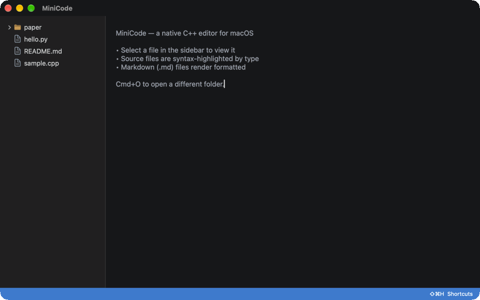
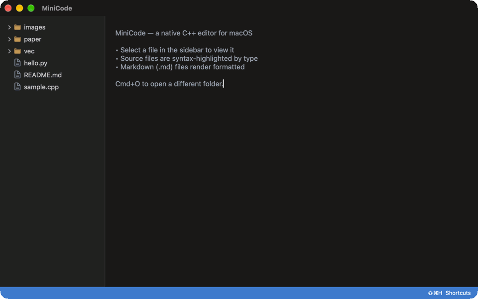
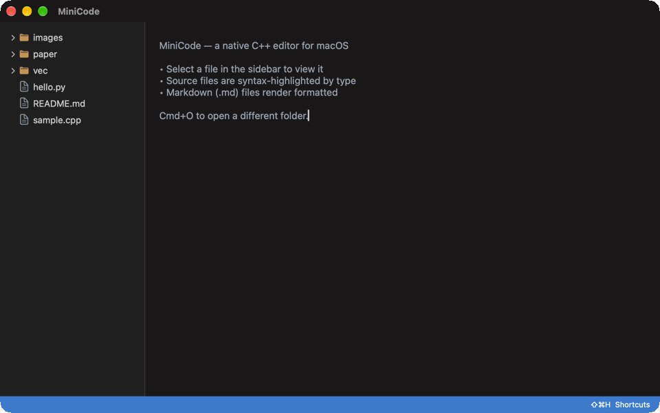
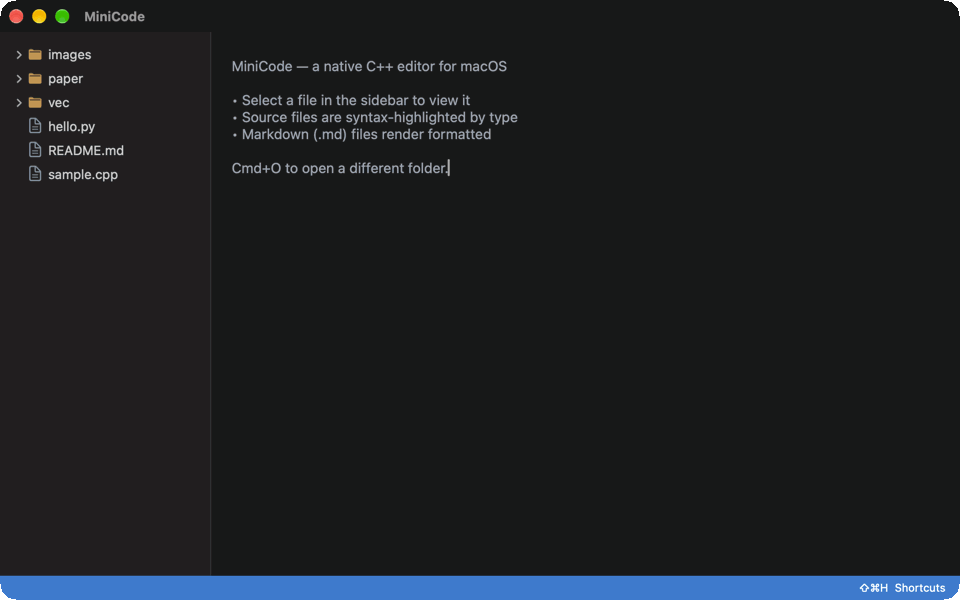
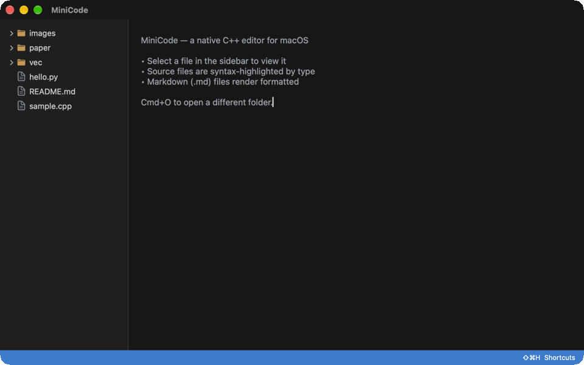
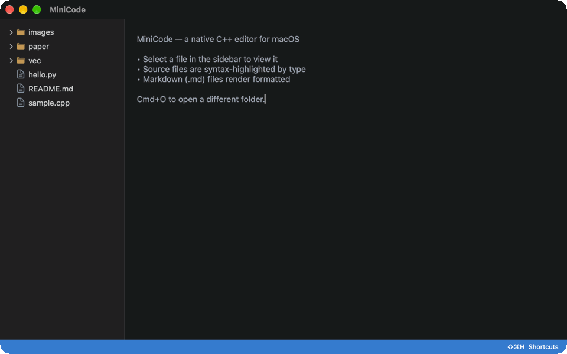
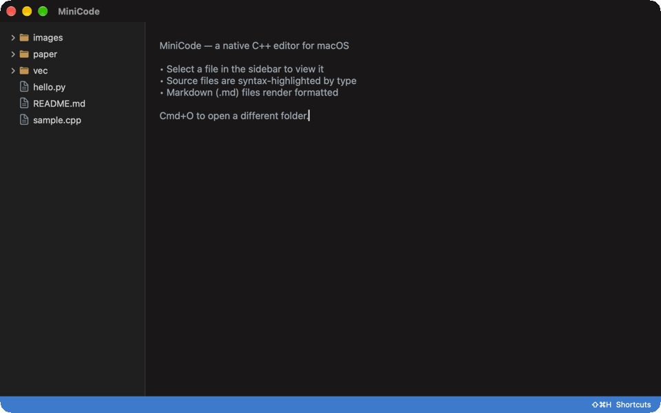
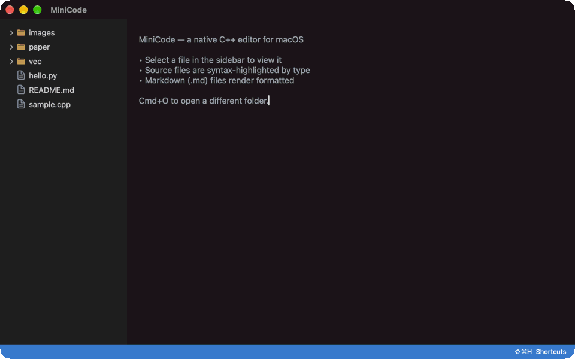

# minicode

minicode is a small editor with a terminal, a browser, a file tree, and a Markdown and LaTeX preview in one window, all driven from the keyboard. It's written from scratch in C++, with no Electron, and runs on macOS, Linux, and Android. On the Mac it is a download of under 4 MB and takes under 9 MB on disk.



```
brew install --cask e-c-hansen/tap/minicode
```

The [Linux](#linux) and [Android](#android) builds are further down.

I built it because I wanted one light place to browse a folder, edit code with a language server behind it, preview Markdown and LaTeX, and keep a terminal and a browser a keystroke away, without a few hundred megabytes of runtime underneath.

The macOS app links only against frameworks and libraries that ship with the system, zlib and SQLite among them. The Linux version is a GTK4 port that uses only what a distribution ships (GTK, VTE, WebKitGTK, and poppler), and the Android version is a Kotlin app that also uses Google's AndroidX and Material Components libraries; all three share the same C++ core. The rest of this README describes the macOS app, and the Linux and Android sections say how the others differ.

## What it does

Open a folder and you get a file tree on the left and the file you click in the main pane. Each file you open gets a tab above the editor, keeping its own unsaved changes, undo history, and place, and a dot on the tab means it has changes to save. Typing something and deleting it again leaves nothing to save. Command W closes the tab, or the terminal or browser when it has the keyboard, and Shift Command W closes the window. Command N starts a new file, Option Command N opens a new window, and Option Shift Command T reopens the tab you closed last, where it was. On the Mac and on Linux, as in VS Code, a single click on a file in the tree opens it in the preview tab, its name in italics, and the next file you click replaces it there, so looking through files does not pile up tabs. Double click the file, or Command click it, and it gets a tab of its own; editing or saving the file in the preview tab, double clicking its title, or Keep Open in its right click menu or the File menu keeps it too. A single click on a Find in Folder result and Go to Definition into another file use the preview tab the same way, and the file you started from is kept. Quick Open, Return in the tree and links open files in a tab of their own. workbench.enable-preview = off in the settings gives every file its own tab, and workbench.enable-preview-from-quick-open = on sends Quick Open to the preview tab too. The next time you open the folder, its tabs come back, the preview tab still a preview (on Linux each with its caret and scroll, kept in ~/.local/state/minicode). Unsaved changes are also copied to a backup a second after you stop typing, so if minicode crashes, is force quit, or the computer loses power, the next window on that folder brings them back as unsaved tabs, with the file on disk untouched and a note if it changed in the meantime, and minicode opens a window for each folder that has some when it starts. The backups are in ~/Library/Application Support/MiniCode/Backups on the Mac and ~/.local/share/minicode/Backups on Linux. Quitting still asks whether to save, and Don't Save throws the backups away. The tree follows changes made elsewhere, in the terminal, in git or in another program, and right clicking an item offers new file, new folder, rename, move to trash, reveal in Finder, and copy path or the path from the folder. On the Mac, right clicking a tab offers the same for its file, plus showing it in the tree and closing the tab, the others, the ones to its right, or all of them.

On the Mac the editor splits in two, as VS Code's does. Command backslash in the editor (or Split Editor in the View menu) opens the file you are in a second group on the right, with its own row of tabs, and moves the keyboard there; in the terminal Command backslash still splits the terminal. A file open in both groups is one document: what you type in one shows in the other as you type, it has one undo history, and closing it in one group asks nothing while the other still has it. Click in the other group, or press Command 1 for the left group and Command 2 for the right, and the keyboard moves there. Control Command Right and Left move the tab on show to the other group, making the right group when there is none. A file opens in the group you are in, closing a group's last tab closes the group, the bar between the groups drags to resize them, and the folder remembers the split for next time. Previews, pictures, PDFs, and the other viewers work in either group, while the group without the keyboard shows them as they were when you left it, and its text has no error underlines, folds, or inlay hints until you click into it. Command 2 used to focus the terminal; Focus Terminal is in the Navigate menu, and `cmd+2 = workbench.action.terminal.focus` in keys.conf puts it back.

On the Mac and on Linux, Shift Command P opens a command palette, as in VS Code: type a few letters of any command in the menus and press Return to run it, with the ones you ran last at the top. Command P opens the same box on the folder's files instead, matched by name with the files you opened lately first, and Control G asks for a line of the open file (42, or 42:7 for a column). Typing > at the start of the box switches to commands, and a colon to a line number. Command P and Find in Folder include dotfiles such as .github/workflows/ci.yml and .env, and leave out what the folder's .gitignore and .ignore files ignore, as VS Code does; search.use-ignore-files = false in the settings searches everything. On the Mac, Control R lists the folders you opened before, as File > Open Recent does.

On the Mac the file tree can show up to three columns at the right of each row, each switched on and off by its own key: Shift Command I for sizes, Option Shift Command I for when each file was last saved, and Control Shift Command I for when it was created. They use Finder's units ("4 KB", "2 min", "yesterday", "12 Oct"), with the exact figures in the row's tooltip, and when the row gets narrow the rightmost column goes first. A folder's size is the total of everything inside it, hidden files included, as Finder and du count it; it is added up in the background, shows "…" until it is known, and is counted again when something inside changes. A very large folder stops being counted after a couple of seconds and shows "≥" before what it reached. While the last-saved column shows, the status bar also says when the open file was last saved. Sort By in the tree's right click menu orders the tree by name, date modified, size, or date created, ascending or descending, with folders first or mixed in with the files. Dates and sizes start newest and largest first, as in Finder, and each folder remembers its own order. Shift F10 or Control Return opens the right click menu of whatever has the keyboard, at the selected row or the cursor, so all of this works without the mouse.

On the Mac, in a folder kept in git, the tree colors each name by its status, in VS Code's colors: modified, added, untracked, deleted, in conflict, and dimmed for what git ignores, such as a build folder. A folder takes the color of the strongest change inside it, so after an agent edits a dozen files you can see where without opening source control, and the row's tooltip names the status. The colors follow edits and commits within a second, and the settings file can change each of them (tree.git-modified and the rest). When something changes on disk, the tree lists again only the folders it changed in, away from the editor, so a build or an install writing inside the folder does not hold up typing.

Source files are highlighted by extension, over 200 of them, from Python, C, C++, Go, Rust, Java, Swift, JavaScript, and TypeScript to shell, YAML, SQL, Lua, and LaTeX. A few general grammars serve them all, so each gets its comments, strings, and numbers colored, while keywords are colored in Python, JavaScript, TypeScript, and the brace languages, which share C++'s list. As in VS Code's themes, a function's name takes the function color where it is called and where it is defined (def area, fn area, func area, function area), so does a Python decorator, a name after class or struct takes the type color, self, cls, this, and super have a color of their own, and an escape inside a string, such as \n or \x41, stands out from the string around it, except in raw strings, which have none; syntax.escape and syntax.self in the settings change those two. A line ends where the screen shows it ending, at a newline, a Windows carriage return and newline, or an old Mac file's lone carriage return, and a line over 20,000 characters, such as minified JavaScript, is left uncolored, as VS Code leaves it.

On the Mac and on Linux, a file over 20 MB or 300,000 lines opens in large-file mode, as in VS Code: no colors, folding, bracket boxes or language server, so a 25 MB log opens in about half a second instead of three and a half, and typing in it is as quick as anywhere. The status bar says "Large file: features off", and a click there turns them all on for that tab; editor.large-file-optimizations = off opens every file in full. Opening a file over 50 MB asks first. On Linux a file in large-file mode does not wrap either, as in VS Code; there a file over 4 MB is read without holding up the window, its tab saying "Opening…" meanwhile, files up to 256 MB open, and a line over 10,000 characters, such as minified JavaScript, is shown 10,000 characters at a time, as VS Code shows it: the part shown follows the cursor, a search or End takes you anywhere in the line, and a note after it says how much is left out.

Markdown renders as formatted text, with working links, tables and images, and Shift Command V flips to the source. On the Mac, Control Command V (VS Code's Command K V) opens the rendered page beside the source instead, with a bar between them to drag. The page follows your typing a moment after you stop, keeping its place, and even in a file of tens of thousands of lines only the part you changed is built again; the keyboard stays in the source; the same key, a drag of the bar to the right edge, or closing the tab closes it, and a file that had it open gets it back the next time the folder opens. The two scroll together, as in VS Code: scrolling the source brings the page to the same line, scrolling the page brings the source along, and a bar at the page's left marks the block the cursor is in. Double click a block on that page to edit its Markdown, as in the full preview; the change goes into the source beside it as one step for Command Z. On the Mac, both pages keep their lines to a readable length in a wide pane, centered, about as wide as GitHub shows a README; the width grows with the zoom, and markdown.max-width in the settings changes it, or turns it off with off.

Footnotes work as on GitHub: a reference shows as a raised number that jumps to its note, the notes are listed at the end of the page, each has an arrow back, and a note can hold code blocks. A task in a numbered list keeps its number before its box. On the Mac, Export as HTML in the File menu saves the file as a standalone web page beside it, unsaved changes included: headings keep GitHub's anchors, task boxes, tables, footnotes and code blocks come through, pictures and links keep their addresses, and math stays as its TeX between \( \) or \[ \] for a page that loads MathJax or KaTeX. The page loads nothing from the web itself.

Pictures with an https address, such as the badges at the top of a README, are downloaded in the background and kept in memory only; markdown.web-images = false in the settings turns that off. Math written as on GitHub, $x^2$ inline and $$ or a math code block for a display, is typeset by tectonic (the LaTeX preview's engine, below) in the background and kept in a cache, so a page opened again shows its formulas at once; markdown.math = false shows them as their TeX instead. Formulas are typeset together, so each is kept from changing the others: one that defines something globally (\gdef, \global, a counter), changes the page (\pagecolor, \special), reads a file, leaves its box, or refers to the batch's own commands is not typeset and shows its TeX with the reason as its tooltip.

On the Mac, a mermaid code block (a flowchart, a sequence diagram, any kind Mermaid draws) shows as its diagram when mermaid-cli is installed (npm install -g @mermaid-js/mermaid-cli): minicode hands each diagram to its mmdc command in the background, as it hands math to tectonic, and keeps the pictures in a cache. Without mmdc, and with markdown.mermaid = false, the block shows as its source, and a diagram mmdc cannot read shows as its source with mmdc's complaint as its tooltip.

You can also edit the rendered page: double click a paragraph, heading, list item or table cell, and a small editor opens holding its Markdown. If the file changes while that editor is open, your edit is not applied over the change; your text is put on the clipboard instead, and the status bar says so.

Images and PDFs open in the same pane, and reload when the file changes on disk. On the Mac so do video and audio files, such as mp4, mov, mp3, wav and flac, in the system's own player; nothing plays until you press Shift Command Space or the play button.



On the Mac, a file minicode has no viewer of its own for, such as a Word, Excel, PowerPoint, Pages, Numbers or Keynote document, opens in a tab as a Quick Look preview, the one Finder shows, and so does any binary file: minicode looks at the first few kilobytes, and a file with a zero byte in them is never opened as text, whatever its name says, except UTF-16 text with a byte order mark, which opens as text and is saved back in UTF-16 with its mark. Space on a file in the tree opens the Quick Look panel on it, as in Finder, and Space again or Escape closes it; while it is open, the arrow keys move it through the files.

On the Mac, CSV and TSV files open as a table, and Shift Command V flips to the text and back. Double click a cell, or press Return on a row, to edit it; the right click menu inserts and deletes rows and columns. The table edits the file's text, so it has unsaved changes, undo, backups, and auto-save like any other file, and saving writes back only what you changed: the delimiter (comma, semicolon, tab, or pipe), each field's quotes, and the line endings stay as they were, a file saved with no edits comes back byte for byte, and one changed cell changes one line. A file over 50 MB opens read-only, showing its first 100,000 rows.

A JSON file on the Mac opens as text with an outline of it at the right, its objects and arrays folded and unfolded like folders. Clicking a value, or moving to it with the arrow keys, selects its text in the editor, and moving the cursor in the text selects the value it is in. You edit in the text; the outline catches up a moment after you stop typing, and while the text is not valid JSON it keeps the last good outline and says where the error is. Shift Command V hides the outline and brings it back.

Jupyter notebooks open on the Mac rendered and read-only, the way the Markdown preview shows Markdown: the text cells as formatted text, the code cells highlighted in the notebook's language, and under each code cell what it printed, its pictures, and its errors, from the outputs saved in the file. Nothing is run, since minicode has no kernel; an HTML result, such as a pandas table, shows as its plain text. Shift Command V shows the notebook's JSON. Fenced code blocks that name their language, as in ```python, are now highlighted in every Markdown preview on the Mac.

A SQLite database (.sqlite, .db, or any file that starts with SQLite's header) opens on the Mac read-only: its tables and views down the left with the selected one's schema under them, and the first 1,000 rows of the selected one on the right. The box above the rows runs a query of your own when you press Return. minicode opens the database in SQLite's read-only mode, so nothing can change the file: a statement that would write is refused before it runs, and a query that runs longer than five seconds is stopped.

On the Mac and on Linux the editor numbers its lines down the left side, with a dot beside any line that has an error or a warning. Clicking or dragging in the numbers selects whole lines; editor.line-numbers = relative in the settings counts from the cursor's line instead, and off hides them. With the cursor beside a bracket, it and its partner are boxed, and Shift Command backslash jumps from one to the other, as in VS Code. Brackets are colored by how deeply they are nested, gold, then violet, then blue and round again in Dark+, each theme with VS Code's own colors for it, as VS Code's bracket pair colorization does; a closing bracket with nothing open before it is red, and brackets in strings and comments keep the string's or comment's color. Typing a bracket recolors the ones after it on the screen at once, and the rest as you scroll to them. editor.bracket-pair-colorization = off turns this off, and syntax.bracket-1, syntax.bracket-2, syntax.bracket-3, and syntax.bracket-unexpected change the colors; a file in large-file mode, and a line too long to color, get none. Command equals and Command minus make the text bigger and smaller, with the Markdown preview following (the terminals have a zoom of their own), Option Command 0 puts it back, and editor.font-size sets the size they start from.

Return indents the way the language expects. In Python a line ending in a colon starts an indented block, the line after return, pass, break, continue, or raise goes back a level, and a new line inside an open bracket lines up with whatever follows the bracket, or is indented one level when the bracket ends its line. The line after a call spread over several lines goes back to where the call started, not to its last argument. In C, JavaScript, Go, Rust, and the other brace languages, Return after an opening brace indents, and in YAML so does Return after a key that ends in a colon. Return between a pair of brackets, as in `foo()`, puts the closing bracket on a line of its own. Typing the colon of else, elif, except, or finally moves the line back under its if or try, and a closing brace typed on an empty line moves back under the line that opened it. How far to indent comes from the file, whether tabs or two or four spaces: Tab inserts that much, Backspace in leading spaces removes that much, and Tab and Shift Tab on a selection indent and outdent its lines.

On the Mac and on Linux, brackets and quotes close as you type them, by VS Code's rules for each language. Typing ( gives () with the cursor between, typing the ) it put there steps over it, and Backspace between the two deletes both. A bracket closes only before a space, the end of the line, or punctuation such as a comma or another closer, and not when a closer is already waiting for it. A quote closes only outside strings and comments, and not after a letter, so don't types as it is; Python's f", r", and b" close, and the third quote of """ closes the docstring. In Markdown, LaTeX, and plain text only brackets close. It works at every cursor at once, and never while an input method is composing. editor.auto-close = off in the settings turns it off; typing a bracket or quote over selected text still wraps it.

On the Mac and on Linux, code folds the way VS Code folds it. An arrow beside the line number, shown while the pointer is over the line numbers, folds or unfolds a block, and a folded line ends in a small ⋯ that unfolds it when clicked. Control Command [ folds the block the cursor is in and Control Command ] unfolds it; VS Code's Option Command [ and ] already move between minicode's terminals. Blocks come from the language server when it offers them, otherwise from brackets in C, JavaScript, Go, Rust, JSON, and the other brace languages, from indentation in Python, YAML, and the rest, from headings and fenced code in Markdown, and from sections and environments in LaTeX. Comments over several lines fold too, and so do #region and #endregion comments. The text itself never changes: copying across a fold copies what it hides, and Find, Go to Line, and go to definition open a fold when what they go to is inside it.

F9 sorts the selected lines. Lines between a `keep-sorted start` and a `keep-sorted end` comment, as used by Google's [keep-sorted](https://github.com/google/keep-sorted), are sorted the way that tool sorts them, its options included: F9 with the cursor inside such a block sorts it, Shift F9 sorts every block in the file, and editor.keep-sorted-on-save = true in the settings sorts them all whenever the file is saved. A start without an end leaves the file alone and the status bar says which line it is on.

In the settings, editor.auto-save = after-delay saves each file a second after you stop typing (editor.auto-save-delay sets how long, in milliseconds), and editor.auto-save = focus-change saves when the editor loses the keyboard, to another pane, tab, window, or app. That keeps minicode and Claude Code, or anything else editing the same files, from tripping over each other: a file with no unsaved changes follows the disk quietly, keeping your place in it, and an auto-save never writes over a file that changed on disk since minicode read it. It names the file in the status bar instead, and Command S asks whether to keep your version or reload (on Linux the tab asks when it is shown). Auto-saves don't run the formatter or sort keep-sorted blocks; Command S still does.

On the Mac and on Linux, Command F opens a find bar at the top right of the editor, laid out as VS Code's: the chevron on its left shows the replace row, and the query has its options inside it. It finds as you type, highlights every match, and says which one you are on ("3 of 17", or "No results" in red with the query outlined in red). Selected text on one line becomes the query, and with nothing selected the word at the cursor does, as in VS Code. Return and Shift Return, or Command G and Shift Command G, go to the next and previous one, and Escape closes it. The three buttons inside the query, or Option Command C, W and R, match case, match whole words only, and read the query as a regular expression in JavaScript's syntax, which VS Code uses too. A regular expression takes time in proportion to the line, whatever it holds, so a pattern such as (a+)+b, which makes most engines try every way of splitting the line, costs no more than any other; one with a backreference or a lookahead needs the slower kind of engine and is given two seconds. The button after the arrows, or Option Command L while the bar has the keyboard, finds only in the text that was selected. Option Command F, or the chevron, adds a second field for the replacement, where $1, $2 and so on stand for a regular expression's groups, and its AB button (Option Command P) keeps each match's case. Return there replaces the selected match and moves on, and Option Command Return or the button beside the field replaces them all in one undo step. On the Mac, Command E takes the selected text as the query.

Shift Command F searches the whole folder with the same three options, in a window laid out as VS Code's search view: the results are a tree of files, each with its number of matches, over the lines that hold them. It reads and matches files on every core, about as fast as ripgrep on a tree of 7,600 files, and stops at 20,000 lines, as VS Code does, saying so. Text in UTF-16 with a byte order mark is searched and replaced in its own encoding, as ripgrep reads it. Files larger than 1 MB and text files in neither UTF-8 nor such UTF-16 are left out, and a line under the results says how many, with their names in its tooltip; binary files are left out without a word. The "..." button opens files to include and files to exclude, which take globs as VS Code's do (`*.py`, `src`, `./docs`, `**/test/**`, several at once with commas).

In the folder search, Option Shift Command F, or the window's chevron, adds the replacement: each match in the results shows struck through beside what replaces it, Replace All counts the matches first and asks ("Replace 42 matches in 7 files?"), and a row's buttons or right click menu replace only that match or only that file, or dismiss it. A file open in a tab is changed there, unsaved and undoable, as rename changes it; other files are written to disk whole, so nothing is left half written; and a file whose tab has unsaved changes is left alone and named.

On the Mac and on Linux the editor has VS Code's keys for several cursors. Command D selects the word at the cursor, and each press after that adds the next place the word occurs as a whole word, going round to the top of the file at the end; with text already selected, it adds the next place that text occurs. Shift Command L selects every place at once, and Option Command Down and Up add a cursor on the line below or above. Typing, Backspace, Paste, and the arrow keys then work at every cursor, each edit one step to undo, and Escape goes back to one. Words are what VS Code's default word separators make them, in every language: punctuation such as . - $ and ( ends a word and an underscore does not, so double clicking arr in arr.size selects arr, and Option Left and Right, Option Delete, and Command D stop at the dot too (a Markdown preview keeps the system's own words, made for prose). Command L selects the cursor's line, and each press after it adds the next line; Control Shift K deletes the line, or every line a selection touches (Shift Command K stays Request a Change). With nothing selected, Command C and Command X copy or cut the whole line, and Command V puts such a line back above the cursor's line rather than in the middle of it, as VS Code does. A thin line down the editor at column 100 shows where lines get long: editor.ruler in the settings moves it, adds more (80,120), or turns it off, and editor.ruler-color sets its color.

Markdown task lists make a TODO list, written the way GitHub, Obsidian, and VS Code read them: `- [ ] buy milk` is a task still to do and `- [x] buy milk` one that is done. In the preview each task has a box you click (or tap, on Android) to tick or clear it. The file then has unsaved changes, as after any edit made in the preview, until you save it. Done tasks are greyed out and struck through (markdown.done in the settings sets their color), and the title bar says how many of the file's tasks are done. In the source, Option Command L (Ctrl Alt L on Linux) turns the line, or every selected line, into a task, ticks it if it already is one, and clears it if it was ticked. A line written as `[ ] buy milk`, without the dash, is not a task to GitHub or to minicode and shows as plain text, so select such lines and press Option Command L once: each gets its dash and keeps its box. Return at the end of a list item starts the next item, with an empty box after a task and the next number after a numbered one, and Return on an empty item ends the list. Shift Command D (Ctrl Shift D on Linux, the leader key and then W on Android) lists every TODO, FIXME, HACK, XXX, and BUG comment in the folder, along with the open tasks in its Markdown files, and opens the one you pick at its line.

Control backtick opens a terminal at the bottom. It runs one persistent zsh with your own startup files, so aliases, history and state carry over from one command to the next, and colors come through. On the Mac it is a real terminal: zsh's own line editor runs in it, so your prompt, Tab completion, Control R history search, autosuggestions, fzf's key bindings and whatever else your .zshrc sets up work as they do in Terminal.app, and vim, less, htop and ssh draw on the same screen.

Output scrolls up into 10,000 lines of scrollback (terminal.scrollback changes that), which the trackpad, the mouse wheel and Shift Page Up and Page Down page through, and Command Home and Command End jump to the top and the bottom; typing takes you back down. Command F finds text in it, scrollback included, highlighting every match, and Command K clears it. Command Up and Command Down move between the commands you ran, as in VS Code, putting each one's prompt at the top of the terminal, and with Shift they select the commands and what they printed; a command that failed has a red mark beside its prompt, and Copy Last Command Output in the Terminal menu copies what the last one printed.

Characters take the columns Unicode's data gives them, so Hebrew, Arabic and Thai text lines up, and an emoji sequence such as a family or a flag takes one wide cell, as Claude Code counts it. While zsh's line editor reads a command, from its prompt until the command runs, characters take the columns zsh itself counts instead (its own Unicode 9 table, in which a flag takes four columns and a Devanagari vowel sign such as ि none), so what you type at the prompt stays where zsh thinks it is; a program can ask for either way of counting with mode 2027. At the prompt, Command Left and Command Right go to the start and end of the line and Command Delete deletes back to its start, as in VS Code and iTerm.

When the terminal gets narrower or wider, long lines wrap again to fit, the scrollback included, and a line the terminal wrapped copies, finds and opens with Command click as one line. Drag to select, double click a word or a path, triple click a line, and Command C and Command V copy and paste.

As in VS Code, pasting several lines into a program that would run each line as it arrives (cat, an older REPL, anything that has not turned on bracketed paste) first asks whether to paste them, paste them as one line, or cancel, with the first lines shown; zsh's prompt takes pasted lines as text, so it is never asked about, and a command copied with its line break goes in without it, waiting for Return. A single line that holds a control character asks as well, since the program takes it as a key (Control O runs the line in zsh), and the question shows such characters as symbols. terminal.multiline-paste-warning = always or never changes that. Nothing in pasted text can end a bracketed paste early or send an escape sequence: an Escape character in it shows as ␛. While a program asks for a password (sudo, ssh, read -s), the terminal turns on secure keyboard entry, so other apps cannot read the keys, and shows a lock in its top right corner until the password is in or the terminal loses the keyboard.

Programs that ask for the mouse, such as vim with mouse=a, htop and less --mouse, get clicks, drags and the wheel; hold Shift to select text over them instead. Programs can set the cursor's shape, so vim's insert mode shows a bar (terminal.cursor-style = block, bar or underline sets it otherwise), draw curly, double, dotted and dashed underlines in a color of their own, overlines and hidden text, ask for the terminal's colors so they see a light theme as light, and turn on the kitty keyboard protocol's unambiguous keys, so Escape and Control and Option combinations reach them as themselves.

A program's own title, such as the file vim has open, names its terminal tab while it runs. Option works as Meta for the shell's Alt keys, and terminal.option-as-meta = false lets it type the characters your keyboard layout puts on it instead. Shift Return sends what Claude Code takes as a new line rather than Enter. terminal.font-size sets the terminal's text size, and with a terminal's keyboard Command equals, Command minus, and Option Command 0 zoom every terminal in every window, leaving the editor as it is; with the keyboard anywhere else they zoom the editor and the Markdown preview, leaving the terminals as they are. The older design, with the output as a log and an input line under it, is still there for a release with terminal.mode = line.



On the Mac you can have several terminals, each its own shell. Control Shift backtick opens another in a new tab, Command backslash splits the one you are in so two sit side by side, Split Terminal Down in the Terminal menu (or Option-clicking the ◫ button) puts a new one below it, and Option Command ] and [ move between them. The bars between split terminals drag to resize them, and so do Control Command Left, Right, Up, and Down for the terminal you are in, as in VS Code; Up and Down resize the whole panel when the terminal has none above or below it. No terminal gets narrower than 20 columns or shorter than 5 rows, and each program sees its own pane's size. Tabs you are not looking at keep running. Each tab is titled with the command running in it or the folder it is in, or with a name you give it with Rename Terminal… (in the Terminal menu or the tab's right click menu), which stays until you clear it with an empty name. Tabs drag to a new place along the strip, or move with Move Terminal Left and Right. Control Shift W, or the × on its tab, closes a terminal; closing the last one hides the panel. A terminal with something still running in it, a server, vim, or Claude Code, asks before it closes, and so do closing the window and quitting. Holding Command W down closes one thing, not everything in turn.

Shift Command Return runs the open file in the terminal. It saves the file, then types the command into the terminal on show as if you had typed it, so it stays in the shell's history and Up brings it back. A Python file runs with the python in the project's .venv, venv or env folder when there is one, and python3 otherwise; shell scripts, Go, JavaScript and Ruby have commands too, and run.<language> in the settings changes them or adds others. If that terminal is busy with something else, the file runs in a new one instead, and run.terminal = new gives every run a terminal of its own. In a Python file, Shift Return sends the selected lines, or the line the cursor is on, to a Python REPL in a terminal tab of its own, and moves on to the next line.

A new terminal starts with the folder's Python virtual environment active, as VS Code's shell startup activation does: the same interpreter Run File uses, with its bin folder first on PATH, VIRTUAL_ENV set, its name before the prompt, and deactivate to leave it. Nothing in the environment runs to do this. The folder's own .venv is activated only once you have allowed it for the language servers (the bar over a Python file asks), since programs placed in it would otherwise come first on the terminal's PATH. terminal.activate-venv = false turns it off.



Paths and URLs in the output are links. Command click src/main.cpp:42:7 from a compiler, or a file Claude Code mentions, and it opens at that line; a URL opens in the browser panel, which Shift Command B toggles, and the keyboard stays in the terminal. An address on 0.0.0.0 or [::], which servers listening everywhere print (Python's http.server among them), opens as localhost. On the Mac, links whose text is not their address, which Claude Code, `ls --hyperlink`, and gcc print (OSC 8 hyperlinks), open the same way, and while Command is held the pointer shows the address. Programs that open a page themselves, such as Claude Code when you click a link in it, Python's webbrowser module, and `vite --open`, find minicode in the BROWSER variable every minicode terminal on the Mac has: a local page (localhost, 127.0.0.1, ::1, a file) opens in the browser panel of that terminal's window, and any other page, a sign-in page for instance, in your default browser, as it does when minicode is not running. A BROWSER set in your .zshrc takes its place. Tools that call the `open` command, or the npm open package, without looking at BROWSER still use the default browser. On the Mac and on Linux the browser sits to the right of the editor rather than in its place, with a bar between them you can drag, and the terminal stays across the bottom under both. On the Mac it has tabs: while it has the keyboard, Command T opens one (View > New Browser Tab does from anywhere), Command W closes the one on show and the browser with the last, and Control Tab moves between them; tabs drag along their row, and Command clicking a link opens it in a tab behind. Only the tab on show and the one you used before it keep their page loaded, and the others load again when you come back to them, so a dozen tabs cost about what two do. Any of the three can be hidden on its own (Shift Command E for the editor), and the others take its space. Command 1, 2 and 3 move the keyboard to the editor, the terminal and the browser.

Side by side, everything still fits. Long lines in the editor wrap at the pane's edge, so there is no scrolling sideways; Option Z turns wrapping off and on, and editor.word-wrap = off keeps it off. In the browser, a PDF or the LaTeX preview, Command equals, Command minus and Command 0 zoom the page as Safari does, while it has the keyboard or right after you scroll or click in it, the terminals' zoom in a terminal, and the editor's zoom everywhere else. The browser keeps each site's zoom, shows the new percentage in its toolbar for a moment, and View > Page Zoom > Zoom to Fit Width shrinks a page that is too wide until all of it shows; Zoom to Fit Page shows a whole PDF page at once. A video's full screen button fills the screen. When one pane needs all the room, Control Command M gives the editor, the browser or the terminal, whichever has the keyboard, the whole right side, and pressing it again puts the others back. Command B hides the sidebar and shows it again.



Control Shift G swaps the file tree for a small source control panel, on the Mac, on Linux and on Android (there the leader key and then V, in the file list's place). It shows the branch, how far it is ahead of or behind its upstream, and the changed files in two lists, staged and not yet staged, each with a one letter status. Arrow keys move through the files, Return shows the selected file's diff in the main pane, Space stages or unstages it, and Command Return (Ctrl Enter on Linux) in the message box commits. On the phone a tap on a file shows its diff, the plus or minus beside it stages or unstages it, and the Commit button, or the leader key and then Enter, commits; git runs in Termux there, so the project has to be in the phone's shared storage. Git does the work underneath, and when it refuses something, such as a commit with nothing staged, its own message appears in the panel.

Under the changes is the commit graph: the history of the current branch and its upstream, drawn in colored lanes the way VS Code's graph and `git log --graph` draw them, with branch, remote and tag labels on their commits. Commits you have not pushed yet are tinted blue with a hollow dot and an up arrow, commits on the upstream you have not pulled are tinted green with a down arrow, and a line above the graph says how many of each there are, or that the branch has no upstream. A checkbox shows every local and remote branch instead. The graph loads 200 commits at a time, with a row at the bottom for the next 200. Tab moves between the changes, the graph and the message box, the Down arrow goes from the last changed file into the graph, and Return or a click on a commit shows its author, date, message and diff in the main pane.

On the Mac the panel also pushes and pulls. When the branch is ahead of or behind its upstream, a Sync Changes button under Commit shows the counts and pulls, then pushes, without asking first; a branch with no upstream gets a Publish Branch button instead, which pushes it to origin (or the only remote) and tracks it there. A right click on the panel, View > Source Control, and the command palette have Fetch, Pull, Push and Sync, which work with the panel hidden too. They run plain git pull and git push, so your own pull and push settings apply, and nothing is ever forced. minicode never asks for a password: when git needs one, or an ssh key it cannot unlock, the push fails at once and the panel says what git said, with what to set up (a credential helper, or ssh-add). With git.autofetch = true in the settings, as VS Code's git.autofetch, the repository is fetched in the background every three minutes while its window is in front, so the counts stay current; a repository without a remote is never fetched, and one that cannot be is tried less often, up to once an hour. Merging and rebasing are left to the terminal.

On the Mac the panel also stages, discards and switches branches. Right-click a changed file for Open File, Open Changes, Stage or Unstage Changes, Discard Changes, and Reveal in File Tree; right-click elsewhere in the panel for Stage All Changes, Unstage All Changes, Undo Discard, and Switch Branch, which View > Source Control and the command palette have too. Discard Changes always asks first, naming the file. It puts a changed file back as git has it (its staged version, or else the last commit's), brings back a deleted one, and removes a file git does not track, but the file as it was goes to the Trash first, so Undo Discard, or Put Back in the Trash, brings it back. From the menu bar or the palette it acts on the file you have open. A click on the branch name, or Switch Branch, opens the palette with the branches, the current one first and the rest by their latest commit, followed by remote branches that have no local branch yet. Typing narrows the list, and Return switches; a remote branch gets a local branch that tracks it, and a name that is no branch yet gets a last row that creates it from where you are, with spaces made dashes. When git refuses to switch because a change would be lost, the panel shows git's own message and nothing moves.

A file's diff stages part of a file too. Each hunk's header line ends with Stage Hunk and Discard Hunk, or Unstage Hunk in a staged file's diff, and a right click on the diff (or Shift F10) has the same for the hunk under the pointer and, when you have selected some of the changed lines, Stage Selected Lines and the rest for just those. The diff then shows what is left. Discard Hunk asks first and keeps a copy of the file in the Trash, so Undo Discard brings it back. If the file changed after the diff was shown, nothing happens and the panel says so. New, deleted, and binary files are staged whole.

Command click and Shift click choose several files in the panel's lists, and Shift with the arrow keys does too. Space, Stage, Unstage and Discard then act on all of them; Discard asks once, naming how many, and each file is its own Undo Discard. A submodule is staged like a file, as the commit it points to, but Discard refuses it and says to discard inside it (open it as a folder) or run git submodule update, since putting it back would empty its folder. The panel's right click, View > Source Control, and the command palette also have Commit and Amend, which rewrites the last commit with what is staged and the message box's text (or keeps its message when the box is empty); Undo Last Commit, which takes the last commit back with its changes left staged and its message back in the box; Stash, which puts every change, new files included, away under the message box's text; and Pop Stash, which brings the newest stash back. Amend and Undo ask first when the commit is already pushed, and Undo asks first for a merge commit.

On the Mac the editor marks what changed since git last staged a file (or since the last commit, when nothing is staged), as VS Code does: a green bar beside added lines, a blue bar beside changed ones, and a small red triangle where lines were deleted, in a lane left of the line numbers. The bars follow your typing and are worked out again a moment after you stop. A click on one shows the lines as they were, with Revert Change, which puts them back in the editor as one step to undo, and Stage Change, which stages that change alone, even before you save. Option F5 and Shift Option F5 go to the next and previous change, and View > Source Control has Revert Change and Stage Change for the change at the cursor. There are no bars for a file git does not track, in large-file mode, or with editor.git-gutter = off; editor.git-added, editor.git-modified and editor.git-deleted change their colors.

On the Mac, Shift Command K (Request a Change to minicode, in the minicode menu) changes minicode itself. A bar opens across the top of the window, marked in amber with a DEV tag so it is never mistaken for an ordinary field, and names the source folder Claude will work in. Describe the change in its box, which wraps your text and grows with it (Shift Return starts a new line), and press Return, and a terminal tab opens in minicode's source folder running [Claude Code](https://docs.anthropic.com/en/docs/claude-code) with your request, so you can follow it, answer its questions, and approve its edits right there. When Claude has rebuilt the app with make, the bar offers to restart into the new build. The restart asks nothing about unsaved files: their backups come along, and the new build reopens every window's folder with its tabs, unsaved changes included, and continues the conversation with Claude in a terminal, so a follow-up request is one more message away. The source is the folder this minicode was built in; a copy installed from Homebrew has none, so the first request clones the release you are running into ~/Library/Application Support/MiniCode/source, in the same terminal, before Claude starts (this needs git, from Apple's command line tools). develop.source in the settings points it at a clone of your own instead, and develop.command sets the command, claude by default. Nothing is committed or released unless you ask Claude to.

Command I calls up the inline agent, as it does for VS Code's inline chat, wherever the keyboard is in minicode (Show Hover Info moved to Option Command I to make room). It asks [Claude Code](https://docs.anthropic.com/en/docs/claude-code), so that needs to be installed and signed in, and what it does depends on where you are:

- In a file, a bar opens under the cursor's line. Ask for a change ("add type hints", "handle the empty list") and the bar shows Claude's reply as it is written, and what Claude is reading while it looks around the project. Its edit, on the selection if there is one, is shown before it is made: the lines it would replace are tinted in the file, and the bar shows the change, old lines and new, with the words that changed marked. Return makes the change, as one Command Z, and Escape drops it; the file is untouched until you choose. Ask again in the same bar and the next change builds on the one waiting. When the part Claude means to change appears in more than one place and the cursor or selection is in none of them, nothing is changed and the bar says so: select the part you mean and ask again. A question gets its answer in the bar instead, and the file is left alone. The agent sees the file as it is in the editor, unsaved changes and all, and may read the rest of the project, but it changes only this file and saves nothing. The Markdown preview works the same way, on the file's source.
- In a terminal, it writes the command you describe and types it at the prompt, for you to read and run with Return. It sees the folder and the last lines on the screen, so "rerun that with verbose output" works.
- Anywhere else, the file tree, the browser, the source control panel, a picture or a PDF, it hands your request to Claude Code in a new terminal tab of the open folder, with a note of where you asked from (the selected file, the page's address), so you can follow along and answer its questions. Command Return does the same from the other two, with the selection or the terminal's last lines included.

The answers in the bar come from Claude Code's print mode, allowed to read the project but not to change anything; the edit is minicode's to make. agent.command in the settings is the command it runs, claude by default, with flags such as --model if you want them.

Restart minicode, in the minicode menu or the ↻ at the right end of the status bar, does the same restart on demand, as VS Code's Reload Window does: the same bundle opens again with every window's folder, tabs, unsaved changes and browser page, and a conversation with Claude from Request a Change goes on where it was. The browser panel comes back with its tabs, each on the page it was showing with its back and forward history and its scroll position, after a restart and after an ordinary quit too.

Shift Command H lists the shortcuts that apply right now.

## LaTeX

Open a .tex file and minicode typesets it and shows the PDF where the editor sits, again after every change. Shift Command V flips between the page and the source.

You can also edit from the page. Double click some text (a heading, a sentence, a table cell, a list entry, an equation) and a small editor opens holding the LaTeX behind it. Change it, press Return, and only those bytes of your document are replaced, so macros and packages minicode does not understand are left alone. Inside a list it also offers to add an entry. If minicode cannot tell which piece of source a word came from, it opens nothing rather than the wrong text. Nothing is written to disk until you press Command S, and Shift Command S exports the PDF.

Option Command J goes the other way: from the line the cursor is on to the page, where what that line typeset lights up for a moment. It works from a file the document brings in with \input or \include too: minicode shows the line in the main document's preview, the one a % !TEX root = main.tex comment at the file's top names (LaTeX Workshop's convention), or else the open preview that read the file. When a document does not typeset, the preview shows tectonic's log with the problems it found listed above it; clicking a problem's line number opens the source there, and while the source is on show the gutter marks that line with a red dot. A document that typesets can still have warnings: undefined references and citations, labels defined twice, lines too wide for the page (overfull boxes), and packages' warnings about a line. The status bar counts them, its Warnings button lists them in yellow in the page's place, each opening its line when clicked, and the gutter marks those lines with yellow dots. Two windows can preview the same file, each with its own unsaved changes, without getting in each other's way.



Typesetting is done by [tectonic](https://tectonic-typesetting.github.io/). If it is not installed, the preview offers to download it (about 22 MB), checked against the checksum the tectonic project publishes for that release, or you can run brew install tectonic. tectonic runs with shell escape off, so a document cannot run programs. The first document downloads the packages it needs, and after that it works offline.

## Language servers

With a language server installed, minicode gives you completion, errors as you type, hover and go to definition. It knows clangd (C, C++, Objective-C), basedpyright, pyright, pylsp or jedi-language-server (Python), gopls (Go), rust-analyzer (Rust) and typescript-language-server (JavaScript and TypeScript), and finds them on your PATH and in the usual Homebrew, npm (nvm, fnm and volta included), pipx, uv, Cargo and Go folders. minicode never installs one itself, but it tells you how when one is missing; see [Installing servers and formatters](#installing-servers-and-formatters). On the Mac, files that change on disk without a tab, such as a module Claude Code writes, a branch you check out, or a package you pip install, are reported to the servers that ask for them, so basedpyright sees the new code and Ruff rereads its ruff.toml without a restart. Also on the Mac, rust-analyzer would build and run a crate's build scripts and proc macros as it loads, and typescript-language-server would run the folder's own copy of TypeScript, so until you allow the folder's tools (a bar over the editor asks, as it does for a Python environment below), rust-analyzer runs with those off and typescript-language-server uses a TypeScript installed outside the folder. rust-analyzer waits for your answer when the project could change what it runs, such as a crate with its own rust-toolchain.toml or .cargo/config.toml, and typescript-language-server waits when no TypeScript is installed outside the folder.

On the Mac, a server that says what each name is (semantic tokens, as basedpyright, clangd, rust-analyzer and gopls do) colors it so, over minicode's own colors, as VS Code's semantic highlighting does: a parameter, a variable, a property, a class or type, a constant, a function. Each theme gives them VS Code's colors for that theme, and syntax.parameter, syntax.variable, syntax.property, syntax.class and syntax.constant in the settings file change them. The server's colors come a moment after you stop typing; until then the line you typed in has minicode's own. editor.semantic-highlighting = off leaves only minicode's colors, and a file in large-file mode never gets them.

Problems get a red or yellow squiggle, and the status bar counts them, for the file on show and for every open file. On the Mac, Shift Command M, or a click on those counts, lists every problem the servers report, grouped by file with errors first, between the editor and the terminal; Return opens the one you pick, and Escape goes back to the editor. F8 and Shift F8 go to the next or previous problem in the file, with its message shown at the cursor. Files a server checks without your opening them are listed too.

Completion opens as you type, after a dot, an arrow or a double colon and on the second letter of any word, and Control Space opens it anywhere. On the Mac, Tab and Return take the selected item whenever the list shows, as in VS Code, and Shift Return closes the list and starts a new line. Beside the list, the selected item's signature and documentation show, fetched as you move through it. Taking an item that needs an import, such as Path from pathlib in Python or a function from another header in C++, adds the import or the #include the server suggests too, in the same undo step.

Also on the Mac, an item the server sends as a snippet, such as a function call from clangd, rust-analyzer or gopls with its arguments as placeholders, goes in with its first placeholder selected and the others outlined: type over it, then Tab moves to the next one and Shift Tab back, a placeholder repeated in the snippet changes everywhere at once, a placeholder with a list of options shows them in the completion list, and the last Tab leaves the cursor where the snippet ends. Escape, or moving the cursor out of the placeholder, ends it, and Command Z takes the whole snippet back in one step. Python's servers insert the bare name, without parentheses or arguments (basedpyright's completeFunctionParens is left off, and so are pylsp's and jedi-language-server's argument snippets).

Typing an opening parenthesis or a comma shows the call's signature above the line, with the argument you are on in bold. F12 or Command click jumps to a definition. On the Mac, resting the pointer on a name for a moment shows its type and documentation, with any problem reported there, as VS Code does; the pointer can move into that box to scroll a long docstring, and moving away, typing or Escape closes it. Option Command I shows the same for the name at the cursor.

Also on the Mac, F2 renames the name at the cursor everywhere the server finds it, unsaved changes in other tabs included, since every open tab's text is kept open on its server: files that were not open get a tab, and every changed file is left unsaved for you to look over, with one undo step per file. Shift F12 lists every reference to the name, grouped by file, and Return opens the one you pick. Command period lists the server's quick fixes for the line, such as adding a missing import or semicolon, and Shift Option O organizes the file's imports. Shift Command O lists the file's functions, classes and other symbols in the command palette, the one at the cursor selected, and shows each in the editor as you move through the list; without a server it reads Markdown headings, LaTeX sections, Python and the C family's functions itself. Command T looks for a symbol across the folder in every server the window runs. Control minus goes back to where you were before a jump, and Control Shift minus forward again, as in VS Code.

On the Mac, inlay hints show what the server knows between the words, as in VS Code: a variable's type after its name (total: int), a function's return type after its signature, and a parameter's name before each argument (area(width= 3, height= 4)), in gray on a faint box. They are drawn in room opened between the characters and are not part of the text, so copying, Find, the cursor's steps and the file on disk never see them. They follow your typing at once and are asked for again a moment after you stop, for the lines on show. The cursor is drawn where the next character you type goes, before a type that follows a name and after a parameter's name, and a click anywhere on a hint puts it there. Double-click a hint to write it into the text, with any import it needs, in one undo step. basedpyright, clangd and rust-analyzer send them. View > Inlay Hints turns them on and off; editor.inlay-hints takes VS Code's values (on, off, on-unless-pressed to hide them while you hold Control and Option, off-unless-pressed to show them only then), and editor.inlay-hint-color and editor.inlay-hint-background change their colors.

The status bar shows the open file's server with a colored dot: green when it is running, yellow while it starts, red when it failed or crashed, and gray when there is none. While a server says it is working, indexing a project for instance, the status bar shows what it reports ("basedpyright: Indexing 40%") until it is done, on the Mac. Click it, or choose Language Servers in the minicode menu, to see every language's server, the command and program it runs, its process id, and why it stopped, with buttons to restart, stop and start it, and the command that installs a missing one. A server that crashes is started again after one, two and then four seconds, and after a fourth crash it waits for you. Restart Language Server in the same menu restarts the open file's.

For Python, basedpyright is the one to install, with `uv tool install basedpyright`, which brings its own copy of Node. The server reads your code with a Python interpreter, so it finds the packages installed there: by default the folder's own .venv, venv or env, then the active virtual environment. The server runs that interpreter and anything installed beside it, so the first time a folder's own environment would be used, a bar over the editor asks whether to use it, and nothing runs from it until you say Use It; the answer is kept for that folder. Ask Again About This Folder's Tools in the minicode menu (the Edit menu on Linux), or Ask Again in the Language Servers popover on the Mac, takes the answer back, and the bar asks again. Select Python Interpreter in the minicode menu, or Change in the Language Servers popover, lists the project's environments, conda, pyenv, poetry, pipenv, uv and the Pythons on your PATH, and keeps the choice for that folder. python.interpreter in the settings file sets the default for folders without one.



On the Mac a language can have a second server beside its main one. In a Python project that configures Ruff, with a ruff.toml, a .ruff.toml, or a [tool.ruff] table in pyproject.toml, minicode runs Ruff's own server (ruff server) beside basedpyright whenever ruff is installed (`uv tool install ruff`). basedpyright still answers completion, hover, definitions, references and rename; both servers' problems are underlined and listed together, each saying which server it came from, and Command period offers both servers' fixes in one list, Ruff's Fix all among them. Shift Option O organizes the file's imports, with Ruff's rules when Ruff runs. The status bar names both servers, and the Language Servers popover gives each its own card, with its state, restart, stop and start, and the install command when it is missing.

The settings file can pick a different server or turn one off (lsp.python = pylsp, lsp.go = off, lsp.enabled = false), and give a language a second server or none (lsp.python.also = ruff server, lsp.python.also = off).

On the Mac, a few more servers start whenever they are installed, and are never offered for installing unasked, since many people edit these files without wanting one: texlab for LaTeX and BibTeX, marksman for Markdown, taplo for TOML, and bash-language-server for shell scripts. The Language Servers popover lists them with their install commands. Any other server can be added in the settings file with a name of your own, its command, and the extensions of its files, on Linux too, where those four run when the settings name a command for them; the name is also the language it is told the files are in:

```
lsp.yaml = yaml-language-server --stdio
lsp.yaml.extensions = yaml yml
```

lsp.python.extensions = pyw gives a built-in server more files the same way.

## Formatting

Shift Option F (Ctrl Shift I on Linux) formats the file with the formatter you have installed for its language. If a project has its own configuration, such as a .clang-format, a [tool.pyink], [tool.black], or [tool.ruff] table in pyproject.toml, a .style.yapf, or a ruff.toml, that formatter runs with the project's style. Ruff's lint settings alone are enough, since a project that lints with Ruff nearly always formats with it too, unless the same folder also configures pyink, yapf, or Black. JavaScript and TypeScript projects set up for Prettier (a .prettierrc, a prettier.config.js, a "prettier" key in package.json, or Prettier among its dependencies, since it needs no configuration file) or Biome (a biome.json) are formatted with that, and so are their Markdown, YAML, CSS, SCSS, Less, and JSON files (JSON and CSS with Biome too). Without a project set up for one, those files are not formatted unless the settings say so: format.markdown = prettier (or format.json, format.yaml, or format.css) runs your own Prettier on them, keeping Markdown's line breaks as written, and a whole command of your own runs as written. LaTeX is formatted with latexindent, with the project's .latexindent.yaml or localSettings.yaml when it has one. Otherwise minicode follows Google's style guides: clang-format with Google's style for C, C++, Objective-C, Java, JavaScript, TypeScript, Protocol Buffers, and C#; pyink at 80 columns for Python, or yapf's google style when pyink is not installed; gofmt for Go; rustfmt for Rust; and shfmt with two-space indents for shell scripts.

Python formatters in the project's .venv or venv are used first, and Prettier or Biome in its node_modules. Those are programs the folder supplies, and they run with your rights, so the first time one would run minicode asks whether to allow the folder's own programs. A Prettier configuration that runs code counts the same, whichever Prettier reads it: a prettier.config.js or .prettierrc.mjs (any JavaScript or TypeScript one), a .prettierrc or package.json "prettier" key that names plugins or a shared configuration package, a biome.json that names plugins or extends a package's configuration, and a .latexindent.yaml or localSettings.yaml with a replacement given as a Perl substitution. Prettier and Biome look for their configuration in the folders above the open one too, and such a file there counts the same. A formatter started through npx, pnpm exec, bunx, or yarn counts as the folder's own when the folder holds it. Nothing from the folder runs until you say Allow, and the answer is kept for that folder; it is the same answer the bar over the editor asks for before the language servers use the folder's Python environment, and Ask Again About This Folder's Tools takes it back. With Don't Allow, a formatter installed in the folder is looked for outside it instead, and one that would read a configuration that runs code does not run at all. A formatter command of your own in the settings file (format.python = ruff format -) never asks while that program is installed outside the folder.

A file that nothing above formats, such as TOML, or a README in a project not set up for Prettier, is formatted by its language server when a running one can, taplo for TOML for instance (on Linux, a server the settings name for it). A server never formats a file whose project chose a formatter, or one whose language has a formatter of its own that is not installed: it would format in a style the project never chose, so the note says what to install instead.

With some lines selected, clang-format, pyink, and yapf format only those lines. The change is one step to undo, the cursor stays on the code it was on, and a file the formatter cannot parse is left alone, with the formatter's complaint shown next to the cursor. When the formatter is not installed, the note next to the cursor says how to install it, as below.

The settings file can give a language its own command (format.python = yapf --style=google), turn one off (format.cpp = off), or format each time you save (format.on-save = true). On the Mac, editor.organize-imports-on-save = true organizes the imports first each time Command S saves, as VS Code's source.organizeImports on save does, with Ruff's rules when Ruff's server runs; a save made by auto-save does neither.

## Installing servers and formatters

minicode installs nothing itself, but it says what to install at the moment you need it, on the Mac for now. Open a Python file with no Python language server and a line over the editor says so, with an Install button. That line shows once per language each time minicode starts, its × closes it, and Don't Show Again keeps it away for that language; the status bar keeps offering the same help as long as the server is missing. Format Document does the same when the formatter is missing, and so does each missing server in the Language Servers popover.

The help shows the command to run, with a Copy button and a Run in Terminal button. Run in Terminal types the command into minicode's terminal and leaves it for you to read and press Return; it never runs anything on its own. minicode suggests the first command your Mac can run: with uv installed it suggests uv, without it pipx or npm, and with none of them it adds the step that installs uv. The other ways are listed under it. Once the program is installed, minicode notices when the command finishes in its terminal, or when you come back to the window, and starts the server without a restart.

| Language | Server | Install it with |
|---|---|---|
| Python | basedpyright | `uv tool install basedpyright`; or `pipx install basedpyright`, `npm install -g pyright`, or `pipx install python-lsp-server` |
| Python, beside basedpyright, in projects that configure Ruff | Ruff (ruff server) | `uv tool install ruff`, `pipx install ruff`, or `brew install ruff` |
| C, C++, and Objective-C | clangd | `xcode-select --install` (the command line tools), or `brew install llvm` |
| Go | gopls | `go install golang.org/x/tools/gopls@latest`, or `brew install gopls` |
| Rust | rust-analyzer | `rustup component add rust-analyzer`, or `brew install rust-analyzer` |
| JavaScript and TypeScript | typescript-language-server | `npm install -g typescript-language-server typescript`, or `brew install typescript-language-server` |
| LaTeX and BibTeX, when installed | texlab | `brew install texlab` |
| Markdown, when installed | marksman | `brew install marksman` |
| TOML, when installed | taplo | `brew install taplo` |
| Shell scripts, when installed | bash-language-server | `npm install -g bash-language-server`, or `brew install bash-language-server` |

| Formatter | Formats | Install it with |
|---|---|---|
| pyink | Python, in Google's style | `uv tool install pyink`, or `pipx install pyink` |
| yapf | Python, when pyink is missing | `uv tool install yapf`, or `pipx install yapf` |
| Black | Python projects set up for it | `uv tool install black`, `pipx install black`, or `brew install black` |
| Ruff | Python projects set up for it | `uv tool install ruff`, `pipx install ruff`, or `brew install ruff` |
| clang-format | C, C++, Objective-C, Java, JavaScript, TypeScript, Protocol Buffers, and C# | `xcode-select --install`, or `brew install clang-format` |
| Prettier | JavaScript, TypeScript, Markdown, JSON, YAML, and CSS in projects set up for it | `npm install -g prettier`, or `brew install prettier` |
| Biome | JavaScript, TypeScript, JSON, and CSS in projects set up for it | `npm install -g @biomejs/biome`, or `brew install biome` |
| gofmt | Go | `brew install go` |
| rustfmt | Rust | `rustup component add rustfmt` |
| shfmt | shell scripts | `brew install shfmt`, or `go install mvdan.cc/sh/v3/cmd/shfmt@latest` |
| latexindent | LaTeX | `brew install latexindent` (TeX distributions such as MacTeX include it) |

The installers come from Homebrew: `brew install uv`, `brew install pipx`, `brew install node` for npm, and `brew install go`. Rust's rustup comes from [rustup.rs](https://rustup.rs), and Homebrew itself from [brew.sh](https://brew.sh).

minicode looks for these programs on your PATH, in Homebrew's folders, in ~/.local/bin (where uv and pipx put them), in npm's global folder (nvm, fnm, and volta included), and in ~/go/bin and ~/.cargo/bin, after the project's own: its .venv or venv for the Python formatters, and its node_modules for Prettier and Biome. To use something else, give its command in the settings file: lsp.python = pylsp, or format.python = yapf --style=google. A command there always wins over these.

## Settings and transparency

Command comma opens ~/.config/minicode/settings.conf, written the first time with every setting listed and commented out. Changes apply as soon as the file is saved. Each panel has its own background color, opacity and text color; opacity applies only to the background, so text stays solid, and window.blur frosts what is behind the window. Syntax and Markdown colors can be changed too.

```
window.blur = true
editor.opacity = 70%
sidebar.opacity = 0.5
terminal.text = #E0E0E0
```

Every color in the file shows as a swatch, and clicking one opens the color picker, with an opacity slider for see-through colors; the window follows along as you drag. An opacity value is underlined (with dots on the Mac), and clicking it opens a slider. Either way the line is switched on for you if it was still commented out. A line with a mistake is ignored, and the status bar says which one and why.

The colors start from a theme, one of VS Code's built-in ones: Dark Modern (VS Code's own default), Dark+ (minicode's look, and the theme when none is set), Monokai, Solarized Dark, Tomorrow Night Blue, Light Modern, Light+, Quiet Light and Solarized Light. View > Theme switches between them, and on the Mac so does typing the theme's name into the command palette; either way it is one line in the settings file, which you can also write yourself:

```
theme = light-modern
```

Any color the file sets of its own wins over the theme's, so you can take a theme and change the few colors you would rather have. When you pick a theme and the file already sets colors, minicode asks whether to comment those lines out so the whole theme shows; they stay in the file to switch back on. A light theme gives the window light scroll bars, fields and menus too.

You don't have to find the right line yourself. Right-click the file tree, the editor, the Markdown preview, the tabs, the terminal, the browser, the status bar, the source control panel, or on the Mac the title bar, and choose Adjust Settings at the bottom of the menu. The settings file opens with that part's keys in view and briefly highlighted, its first value selected; a settings file older than some of those keys gets their commented-out defaults added at its end. View > Adjust Settings lists the same parts.



## Memory

The benchmark is a simple workload on this repository: clangd on a C++ file, some work in the terminal, typesetting a LaTeX document, and loading a Wikipedia page. The numbers are the RAM footprint on an M3 Mac with 16 GB, measured after a minute of settling, on 21 September 2026 with minicode 1.3.3, VS Code 1.107.1, and Chrome 153:

|   | Memory |
| --- | --- |
| minicode | 320 MB |
| VS Code, Chrome and Preview | 1,283 MB |

Both sides run the same clangd. minicode has gained many features since 1.3.3 and has not been measured again; make membench runs the same workload on scratch profiles, so you can measure the version you have. On disk, MiniCode.app 1.5.15 is 8.6 MB and Visual Studio Code.app 1.107.1 is 659 MB.

## Next to VS Code and Zed

minicode isn't VS Code or Zed, but I use it every day. Hotkeys alone move between writing code, running it in the terminal and reading GitHub in the browser pane. I edited my own resume in it, in LaTeX, and Claude Code runs fine in its terminal. It leaves out a good deal that VS Code and Zed offer, mostly to keep the footprint small: a debugger, split editors, extensions, and Windows. Its AI features hand the work to Claude Code, which you install yourself, rather than building an assistant in. The git panel is small on purpose. It shows status, diffs and the commit graph with what is and isn't pushed, stages and unstages files, commits, and on the Mac pushes, pulls, fetches, discards changes and switches branches, while merging and rebasing stay in the terminal. For those, VS Code or Zed is the better choice.

Zed set out with a similar goal, a lighter and more usable IDE, and it does much of what minicode does. As of Zed 1.15 it has no built-in browser, which has been an open [feature request](https://github.com/zed-industries/zed/issues/10533) since 2024. LaTeX goes through an [extension](https://github.com/rzukic/zed-latex/wiki/Preview) that builds the PDF and shows it in a separate viewer such as Skim, with SyncTeX jumps between the two. VS Code works the same way, through extensions and outside viewers. minicode builds the browser, the PDF viewer and the LaTeX preview into the window instead, and text on the typeset page can be edited where it is.

| | minicode | Zed | VS Code |
| --- | --- | --- | --- |
| Language server | completion, diagnostics, hover, definition; on the Mac also rename, references, quick fixes, symbols, inlay hints, and a problems list | full | full |
| Browser in the window | yes | no | a basic one |
| LaTeX | typeset in the window, edit on the page | extension, external PDF viewer | extension, PDF in a tab |
| Git | status, diffs, staging, committing and a read-only commit graph (macOS, Linux, and Android through Termux), pushing, pulling, autofetch, staging and discarding hunks or lines, discarding files and switching branches on the Mac; merges in the terminal |
 full | full |
| Debugger | no | yes | yes |
| Extensions | no | yes | yes |
| Platforms | macOS, Linux, Android | macOS, Linux, Windows | macOS, Linux, Windows |

## Installing and building

```
brew install --cask e-c-hansen/tap/minicode
```

The download is built for Macs with Apple silicon and runs on macOS 11 and later. The app is not notarized, since that needs a paid Apple Developer account, so the cask clears the quarantine flag and it opens without a Gatekeeper warning. The install also puts a minicode command on your PATH: give it folders or files, or nothing for the current directory, and `minicode -h` lists its options. In Finder, Open With offers minicode for text and source files, Markdown, LaTeX, images, PDFs, video, audio and folders, and you can drop any of them on its Dock icon. A file opens as a tab in the window whose folder already holds it, or else in the window in front, so `minicode notes.md` typed in minicode's own terminal opens it in that window; only with no window open does it get a new one. These are the rules VS Code's `code` command follows. As with `code`, `minicode -r` puts everything in the window in front, a folder included, and `minicode -n` opens a new window of its own. minicode never makes itself the default app for a kind of file; pick it under Open With in Finder's Get Info if you want a double click to use it.

To build it yourself you need only the Xcode command line tools.

```
git clone https://github.com/e-c-hansen/minicode.git
cd minicode
make
```

macOS remembers what an app may do, such as reading a folder in Documents or letting a program in its terminal use the microphone, by the app's signature. Run `scripts/make-signing-identity.sh` once before building and make signs with a certificate of your own in your login keychain, so those answers carry over from one build to the next; without it each build is signed ad hoc and asks again.

The demo folder has a Python file, C++, Markdown, a short LaTeX paper in demo/paper and a two file C++ example in demo/vec for trying clangd. make test runs the unit tests of the shared core. To run it:

```
make run DIR=demo
```

## Driving minicode from the command line, and agents

The same minicode command drives the copy that is running, which is how a coding agent such as Claude Code can show its work in minicode rather than describe it in a chat. Each command acts in the window in front (or the one named with `--window` or `--folder`), never takes the keyboard, and only ever adds: no tab or terminal you have is closed, replaced or moved.

```
minicode open src/main.mm:100              # a file at a line, by the usual open rules
minicode open src/Lsp+WorkspaceEdit.mm:88 --to 160 --note "Applies rename edits to every file"
minicode diff src/Lsp.h                    # side by side against HEAD; --base REF, or two files
minicode term --run "make test"            # a new terminal, the command typed and run in plain sight
minicode term-output 3 --lines 50          # what a terminal shows, scrollback included
minicode browse localhost:5173 --wait      # the agent page in the browser pane; prints the status
minicode page --text                       # that page's text; --console, --screenshot out.png, --url
minicode window --folder ~/project         # the window on a folder, opened if none shows it
minicode tour tour.json                    # a sequence of notes
minicode state | jq .windows[0].tabs       # windows, tabs, selection, terminals, browser
minicode selection                         # the selected text
minicode procs                             # what the window's terminals left running, with ports
```

A diff, from `minicode diff`, Compare with Main or Claude Code, shows the two versions side by side in the file's syntax colors, changed lines tinted and the words that changed inside them marked more strongly, as in VS Code's diff editor. F7 and Shift F7 go to the next or previous change, wrapping at the ends, and the count over the right side says which one you are on.

A note is a line or two of plain text over a highlighted range, labelled with who wrote it (`--from`, Claude by default). It is never written into the file or its undo history, and it goes when you press Escape, click its ×, or edit inside its lines. Files opened with a note share one agent preview tab per window, its title in italics, which the next such open replaces, so an agent's output never piles up tabs; edit in it, or double-click its title, and it becomes an ordinary tab. It is not the preview tab your own clicks in the file tree use: a click there never closes a note you have not read, and an agent's file never takes the place of the one you were looking at. A tour is a list of `{"path", "line", "to", "note"}` stops; Option+] and Option+[ step through it, and the note says where you are ("2 of 5"). `minicode help` describes every command, and they exit with 0 when done, 1 when the command failed, 2 for a usage error, and 3 when there is no minicode to talk to. A command that opens or shows something starts minicode when none is running; `state`, `selection`, `term-output`, `procs`, and `page` exit with 3 instead.

Each running minicode listens on a socket in your own temporary folder that only your user account can open, and nothing in minicode runs a command or a script by itself: `term --run` types what it was given into a terminal you can see. A script that sets up a workspace (a server in a terminal, its page in the browser, the README open) is just these commands in a file you run yourself.

Pages an agent opens go in an agent page of the browser pane, beside yours, with a switcher between Yours and Agent; closing it brings back your page as it was. An agent can read that page's text, its console messages and uncaught errors, and pictures of it, but only for pages on your own Mac (localhost, 127.0.0.1, ::1, *.localhost and file addresses) unless the settings file has `control.page-any-origin = true`, and no command runs JavaScript an agent sends. `--yours` reads your own page the same way, so an agent can look at what you are looking at without reaching sites you are logged in to.

With several Claude Code sessions in terminal tabs, minicode can show which one wants you. Run `minicode hooks --install` once and Claude Code's hooks tell minicode what each session is doing: a tab whose session asks for permission (or has been idle at its prompt) gets an orange dot, with Claude's message as the tab's tooltip, and one that has finished gets a green dot. Typing in the terminal, or the session going on, takes the dot away. The Dock icon counts the waiting terminals in every window, and Control Command W goes to the next one. The command backs up ~/.claude/settings.json first and only adds to it, so your own hooks stay as they were, and running it twice changes nothing; `minicode hooks --print` shows what it adds. Every minicode terminal has `MINICODE_TERMINAL_ID` and `MINICODE_PID` set, which is how the hook (`minicode notify --from-hook`) finds its tab, and outside minicode the hook does nothing and exits quietly. minicode never installs the hooks by itself.

On the Mac, minicode can also answer Claude Code's /ide, the link VS Code and JetBrains offer it. Turn on View > Claude Code IDE Link (agent.ide-link = on in the settings), and Claude Code started in a window's folder lists that window under /ide, while one started in the window's own terminals joins it by itself. Claude then sees the file and the text you have selected, and the problems your language servers report, without being asked; files it opens come up in a tab beside yours, never under your typing; and when it wants to edit a file, the change can show as a side-by-side diff with Accept and Reject over it (when Diff tool in Claude Code's /config is auto), while its own prompt waits in the terminal as usual. Each change in it also has its own ✓ and ✕ between the two sides, so you can keep some of Claude's changes and turn down others; once every change is decided, or you press Accept the Rest or Reject the Rest, Claude Code gets the file made of the changes you accepted. Claude Code writes the file itself once you accept. Each window listens on 127.0.0.1 only and admits nothing without the secret it writes, readable by you alone, to ~/.claude/ide/<port>.lock; that file goes when the window closes or the link is turned off, and it is the only thing minicode writes for the link. It is off until you turn it on.

The repository has a skill for Claude Code in skills/minicode that teaches it all of this: when reporting work, open the changed lines with a note, show the diff and run the tests in a terminal; when asked "where is X", open it rather than quote a path; read `state` and `selection` when you say "this". The app carries it too: `minicode install-skill` copies it to ~/.claude/skills/minicode (run it again after an upgrade), and `make install` does the same from a checkout.

## Seeing what agents did

When Claude Code works in a folder, much of what it does never shows in the folder itself: subagents work in worktrees under .claude/worktrees, notes and reports go to scratchpads in /tmp, and the paths it mentions may be in any of them. On the Mac, minicode reads Claude Code's transcripts in ~/.claude/projects to show where that work is. It only reads them; nothing of Claude Code's is ever written, moved, or deleted, and nothing leaves your Mac.

Shift Command A swaps the file tree for the agents panel, the way Control Shift G swaps in source control. Each session that worked in the folder or below it gets a row, newest first, with its subagents under it: what it was asked to do, whether it is still running, the branch it worked on, how long ago it was last active, and how many files it wrote and commands it ran. Opening a row lists the files it wrote or edited, in three groups: in the folder, in its worktree, and outside the folder. A file that has since gone is struck through, and any other opens with a click or Return. The panel keeps up as sessions write, within a second or two.

Return or a click on a session shows its evidence in a tab of its own: the session's last message at the top, beside the result of the last test command it ran and the test runner's own summary ("2 failed, 10 passed"; pytest, python -m unittest, tox, nox, make test, ctest, npm test, jest, vitest, cargo test, and go test are recognised), then every shell command in order, with the description the agent gave, the command, whether it reported an error, a mark on the ones that ran tests, and the first and last 20 lines of what it printed. Show all brings in the rest, read from the transcript only when asked, so a run that printed megabytes opens as quickly as any other. minicode reports what was run and printed and draws no conclusions; whether that matches the last message is for you to judge. Open in Terminal types a command into a new terminal in the session's folder and leaves it for you to run.

The worktrees under .claude/worktrees appear as one Worktrees node at the top of the file tree, whether hidden files are shown or not, each named after the task its agent was given, with how many commits it is ahead of the main branch and whether it has changes not yet committed. Right-click one for Compare with Main, which lists the files it changed (committed, uncommitted, and new) and shows each beside the main branch's version, or Open in New Window.

Command clicking a path in the terminal also looks in those places: the terminal's own folder first, then the window's folder, the worktrees under it, and the scratchpads of the sessions found for it. When a path is in more than one of them, such as a file an agent changed in its worktree, a small list offers each copy with its full path and when it was modified, newest first. When it is in none, the status bar says so and lists where it looked.

## What is still running

Agents leave dev servers, watchers, headless browsers and language servers running, along with local ports nobody remembers opening. View > Toggle Processes swaps the file tree for a list of them, for the window's folder: a group for each terminal with what was started from it, then orphans, which outlived the terminal that started them, then programs started elsewhere (in Terminal.app, say) whose working folder is in this one. Each process shows its memory, its CPU use, and the TCP ports it listens on, with the processes it started folded under it, and the heading gives the total ("1.8 GB in 14 processes"). Right-click a process to stop it (SIGTERM, then SIGKILL three seconds later, after asking unless it is an orphan), open one of its ports in the browser pane, or show the terminal it came from. Nothing is ever stopped otherwise.

minicode looks at the process table every two seconds while the list is on show, and every ten otherwise. A process that detaches from its terminal between two looks can be missed. `minicode procs` prints the same list, or JSON with `--json`, so an agent can check what it left behind; the skill tells agents to stop only what they started, with `kill`.

## Linux

The Linux version, in the linux folder, is built on GTK4 with a VTE terminal, a WebKitGTK browser and poppler for PDFs, with Control where the Mac uses Command; the Linux column of the table below has its keys, VS Code's on Linux where VS Code has the command. It has the file tree; the editor with tabs and the preview tab, tabs that come back with the folder, backups of unsaved changes, and auto-save; the same highlighting, indentation, and keep-sorted sorting; line numbers, brackets boxed, colored by depth, and closing as you type them, folding, several cursors and the line commands, the find bar with replace and its options, word wrap, zoom, Go Back and Forward, and large-file mode; the command palette with Quick Open, Go to Line, and the open file's symbols from minicode's own outline; Find and Replace in Folder; the terminal; the browser beside the editor with the terminal below both, as on the Mac, and Maximize Pane; the Markdown and LaTeX previews with editing from the page, and task lists; language servers for completion, errors and warnings, hover, and go to definition; the source control panel and its graph; and the settings file and keys.conf.

What the sections above describe as being on the Mac alone is not there yet, such as the split editor, several terminals, the browser's tabs, the preview beside the source, rename and the other language server commands, formatting, the problems list, change bars, git beyond staging and committing, the agent features and the command line control, and the viewers for CSV, JSON, notebooks, and SQLite. Folding takes no blocks from a language server yet, and a tab's folds hide at most 5,000 lines, since GTK draws hidden lines too: a fold that would pass that stays open, and the status bar says why. Replace in Folder does not yet show each replacement in its results, and a result has no right click menu. Math in the Markdown preview shows as its TeX, and there is no blur behind the window, which GNOME gives applications no way to ask for.

Video and audio files play in the editor's pane through GTK's own GStreamer support. A stock Ubuntu plays WebM, Ogg, MP3 and FLAC out of the box; H.264 video and AAC audio, which most .mp4 and .m4a files hold, need `sudo apt install gstreamer1.0-libav`, and minicode says so when it meets one.

```
sudo apt install build-essential meson libgtk-4-dev \
    libvte-2.91-gtk4-dev libwebkitgtk-6.0-dev libpoppler-glib-dev pkg-config
cd linux
meson setup build
meson compile -C build
```

To run the demo:

```
./build/minicode ../demo
```

You can alias the local build, if you'd like:

```
alias minicode="$PWD/build/minicode"
```

As on the Mac, `minicode` typed in a terminal gives the terminal back as soon as the window is up, and closing the terminal leaves minicode open, with no warning about a running process. A minicode that is already running opens the path itself. `minicode --foreground` keeps it in the terminal, with its output there, until it quits, and `minicode -h` lists the options.


[BUILD-LINUX.md](BUILD-LINUX.md) covers installing it as a desktop app, what has been checked on it, and what still needs a person at the desktop.

## Android

The Android port is made for phones with a physical keyboard, such as the Unihertz Titan 2 Elite. It's built around the same C++ core and has the basics of the desktop versions: file tree, editor with syntax highlighting, images and PDF rendering, video and audio in Android's own player, a browser pane, and a terminal on a real shell, including all the special characters you need. The Markdown preview is the desktop's: links you can tap, real tables, pictures with GIFs playing, and a double tap on a paragraph, heading, list item, quote, code block or table cell opens a small box holding its Markdown to edit. Pictures with an https address are downloaded as on the desktop; since Android has no settings file, Web images in Markdown in the ⋮ menu turns that off. You can even tap links in the terminal for specific lines within files and go straight to them, like "main.cpp:42:7". The keyboard shortcuts work here too, so the browser, the editor, the file list and the terminal are each a key away. It feels like a tiny operating system.

With [Termux](https://f-droid.org/packages/com.termux/) installed, the terminal is Termux's own bash, in the folder you have open, so python, git, clang and anything else you installed with pkg run there, and vim, less and the Python prompt get a real terminal. Without Termux it is the phone's own shell, which has the basic file tools and nothing more. Termux also runs your language servers (clangd, pylsp and the rest) for squiggles, completion, hover and go to definition, typesets LaTeX with tectonic, including double tapping the page to edit the source behind it, and runs git for the same source control panel and commit graph the desktop has. The file list keeps up with the disk, so a file made in the terminal shows up in it straight away.

To install it, download MiniCode-*version*.apk from the [latest release](https://github.com/e-c-hansen/minicode/releases/latest) on your phone and open it; Android asks once whether your browser may install apps. [Obtainium](https://github.com/ImranR98/Obtainium) can install it from this repository's releases and keep it updated. It is not on the Play Store. [android/README.md](android/README.md) covers setting up Termux, the keyboard shortcuts, and building it yourself.

## Keyboard shortcuts

A blank cell means that port does not have the action yet. On Android, a letter alone means the leader key and then that letter, because a phone keyboard often has no Control: on a Unihertz Titan 2 the leader is the unlabelled key left of the right Shift, and elsewhere the Menu key. A held Ctrl works too, on a USB or Bluetooth keyboard or a phone whose Fn key is set to act as Ctrl. While the terminal has the keyboard, Ctrl and a letter go to the shell, so add Shift there. [android/README.md](android/README.md) has the rest.

On the Mac every key below can be changed in ~/.config/minicode/keys.conf, which minicode > Keyboard Shortcuts… opens, written the first time with every command, its ID and its keys, commented out. The IDs are VS Code's where VS Code has the command. A line gives a command another key, and a minus takes a key away, from every command or from one:

```
ctrl+alt+cmd+k = editor.action.deleteLines
ctrl+shift+k = -
cmd+k = -workbench.action.terminal.clear
```

The menus, the command palette and the shortcut hints follow the file as soon as it is saved. A key given to a command is taken from whatever had it before, unless the two never work in the same place: one only in the editor and the other only in the terminal, say, or one only in a web page or a PDF and the other everywhere else, or the terminals' zoom and the editor's. Two lines giving one key to two commands are a mistake, and the status bar says so, as it does for the settings file. The few keys the editor and the terminal handle themselves, such as moving lines with Option Up and Down, are listed at the end of the file and cannot be changed yet.

On Linux the same file holds the Linux keys: Keyboard Shortcuts… in the Edit menu opens it, written the first time with the commands minicode for Linux has. Its modifiers are ctrl, alt, and shift; a line with cmd, from a Mac's file, is refused. While the terminal has the keyboard, plain Ctrl keys, function keys, and Alt with a letter (as Meta) go to the program in it, except Ctrl backtick, Ctrl 0, Ctrl 1, Ctrl Tab, Ctrl Page Down, and Ctrl Page Up, the ways out of it, and Ctrl equals, Ctrl minus, and Ctrl Alt 0, which zoom the terminals. Other keys with Shift or Ctrl Alt still work there, except Ctrl Shift C and Ctrl Shift V, the terminal's copy and paste, Ctrl Shift G, Ctrl Shift Space, and Ctrl Shift minus, which a shell reads as Ctrl G, Ctrl Space, and Ctrl underscore, and the editor's own commands, such as folding, the line commands, and the task key, which are not bound there at all.

| Action | macOS | Linux | Android |
| --- | --- | --- | --- |
| Add a cursor on the line below or above each cursor, at the same column | Option Command Down, Option Command Up | Ctrl Shift Down, Ctrl Shift Up |  |
| Add a cursor, or take one away, to type in several places at once | Option click | Alt click |  |
| Add the next place the selected text occurs to the selection, or select the word at the cursor | Command D | Ctrl D |  |
| Ask the inline agent: change the file at the cursor, write a terminal command, or hand a task to Claude Code | Command I |  |  |
| Browse the file tree and open the selected file | Up, Down, Return | Up, Down, Enter; Left and Right close and open folders |  |
| Clear the terminal, its scrollback included | Command K |  |  |
| Close an agent's note (`minicode open --note`) in the editor | Escape, or its × |  |  |
| Close every tab but the one on show | Option Command T | Close Other Tabs in the File menu or the tab's right click menu |  |
| Close the active terminal | Control Shift W |  |  |
| Close the application | Command Q | Ctrl Q |  |
| Close the tab, the terminal the keyboard is in, or the browser's tab when it has the keyboard (the browser panel with its last tab) | Command W | Ctrl W or Ctrl F4 (the browser panel when it has the keyboard, the window when no tab is open; in the terminal the shell has them) |  |
| Close the window | Shift Command W | Ctrl Shift W |  |
| Comment or uncomment the selected lines | Command / | Ctrl / |  |
| Complete the word at the cursor, with a language server | Control Space, or Option Escape | Ctrl Space | N, or Ctrl N |
| Copy or cut the line the cursor is on when nothing is selected, and paste such a line above the cursor's line | Command C, Command X, then Command V | Ctrl C, Ctrl X, then Ctrl V |  |
| Copy the line, or the selected lines, below or above | Shift Option Down, Shift Option Up | Shift Alt Down, Shift Alt Up |  |
| Copy what the terminal's last command printed | Copy Last Command Output in the Terminal menu, or the command palette |  |  |
| Delete the line, or every line the selection touches, at every cursor | Control Shift K | Ctrl Shift K |  |
| Delete to the start of the line, at every cursor | Command Delete |  |  |
| Delete the word before the cursor in the terminal's input line, or everything before it | Control W, Control U |  |  |
| Edit a column: a cursor on every line between two points, so typing adds the same text to each | Shift Command click at one end and Shift Command click (or drag) to the other; Shift Option click (or drag) for a column from the cursor, as in VS Code; Option drag, or a middle-button drag; Escape goes back to one cursor | Shift Alt click (or drag) for a column from the cursor, as in VS Code; Alt drag, or a middle-button drag (a middle click still pastes the primary selection); Escape goes back to one cursor |  |
| Export a Markdown file as a standalone HTML page | Export as HTML in the File menu, or the command palette |  |  |
| Export the typeset PDF of a LaTeX file | Shift Command S | Ctrl Shift S |  |
| Find across the whole folder | Shift Command F | Ctrl Shift F |  |
| Find every reference to the name at the cursor, with a language server | Shift F12 | Shift F12 |  |
| Find in the current file, every match highlighted, Return and Shift Return for the next and previous one | Command F | Ctrl F |  |
| Find with match case, whole word, or a regular expression, in the find bar or Find in Folder | Option Command C, Option Command W, Option Command R | Alt C, Alt W, Alt R |  |
| Find only in the selected text, while the find bar has the keyboard | Option Command L | Alt L |  |
| Find in the browser's page, while the browser has the keyboard (Return and Shift Return for the next and previous match, Escape to close) | Command F, then Command G, Shift Command G |  |  |
| Find in the terminal, its scrollback included (Return and Shift Return for the next and previous match, Escape to close) | Command F, then Command G, Shift Command G |  |  |
| Find next, find previous | Command G, Shift Command G | F3, Shift F3 |  |
| Focus the browser's address bar, opening the browser if it is hidden | Command 3 |  |  |
| Focus the editor (its left group when split), or the player when a video or audio file is open | Command 1 | Ctrl 1 |  |
| Focus the file tree (outside the browser and PDFs, where it is Actual Size) | Command 0 | Ctrl 0 |  |
| Focus the editor's right group, splitting the editor if it is not split | Command 2 |  |  |
| Focus the terminal, opening it if it is hidden | Focus Terminal in the Navigate menu |  |  |
| Fold every region, every one at a level, or every comment, or unfold them all | Control Command 0, Control Command 1 to 7, Control Command /, Control Command J | Ctrl Alt 0, Ctrl Alt 1 to 7, Ctrl Alt /, Ctrl Alt J (a tab's folds hide 5,000 lines at most, so on a long file what would pass that stays open, and the status bar says how many) |  |
| Fold the region the cursor is in and every region inside it, or unfold them all | Fold Recursively and Unfold Recursively in View > Folding | Ctrl Alt [, Ctrl Alt ] |  |
| Fold the region the cursor is in, or the next one out with each press; unfold the fold on the cursor's line | Control Command [, Control Command ] (Option Command [ and ] are the terminals); or click the arrow beside the line number, or the ⋯ after a folded line | Ctrl Shift [, Ctrl Shift ]; or click the arrow beside the line number, or the ⋯ after a folded line |  |
| Format the file, or the selected lines where the formatter can | Shift Option F | Ctrl Shift I (in the terminal the program has it) |  |
| Go back to where you were before a jump (a definition, a symbol, a line, a problem, another tab), or forward again | Control minus, Control Shift minus | Ctrl Alt minus, Ctrl Shift minus (in the terminal Ctrl Shift minus is the program's) |  |
| Go to a line of the open file, by its number (42:7 for a column too) | Control G | Ctrl G (in the terminal the program has it) |  |
| Go to a symbol anywhere in the folder, from the language servers running in the window (outside the browser, where it opens a tab) | Command T |  |  |
| Go to a symbol of the open file (its functions, classes and headings, or @: grouped by kind), from its language server or minicode's own outline | Shift Command O | Ctrl Shift O (minicode's own outline for now) |  |
| Go to definition | F12, or Command click (F12 may need fn on a laptop) | F12, or Ctrl click | G, or Ctrl G |
| Go to tab 1 to 8, or the last tab | Control 1 to 9, or Shift Command 1 to 9 (macOS keeps Shift Command 3, 4 and 5 for screenshots) | Alt 1 to 8, and Alt 9 or Alt 0 for the last |  |
| Go to the matching bracket, or to the closing bracket of the pair around the cursor | Shift Command backslash | Ctrl Shift backslash |  |
| Go to the next or previous change bar in the file (lines changed since git last staged it) | Option F5, Shift Option F5 (F5 may need fn on a laptop) |  |  |
| Go to the next or previous change in a side-by-side diff | F7, Shift F7 (F7 may need fn on a laptop) |  |  |
| Go to the next or previous problem in the file, with its message at the cursor | F8, Shift F8 (F8 may need fn on a laptop) |  |  |
| Go to the next or previous stop of an agent's tour (`minicode tour`) | Option ], Option [ |  |  |
| Go to the start or end of the file, or select to it (with several cursors, one is left) | Command Up, Command Down, Shift Command Up, Shift Command Down; or Command Home, Command End, Shift Command Home, Shift Command End (fn Command Left, Right on a laptop) | Ctrl Home, Ctrl End, Ctrl Shift Home, Ctrl Shift End |  |
| Indent or outdent the selected lines, or the cursor's line | Tab, Shift Tab (the selected lines); Command ], Command [ | Tab, Shift Tab | Tab, Shift Tab |
| Insert a line below the cursor's line, wherever the cursor is in it | Command Return (Insert Line Above is in the Edit menu) |  |  |
| Keep each match's case when replacing, in the find bar or Replace in Folder | Option Command P | Alt P |  |
| Keep a preview tab (its title in italics) as an ordinary tab | Double-click its title, edit or save it, or Keep Open in its right click menu or the File menu | Double-click its title, edit or save it, or Keep Open in its right click menu or the File menu |  |
| List every problem the language servers report, grouped by file | Shift Command M, or click the problem counts in the status bar |  |  |
| List the TODO comments and open Markdown tasks in the folder | Shift Command D | Ctrl Shift D | W, or Ctrl Shift L |
| Make the selection, or the word at the cursor, bold or italic in Markdown, or plain again | Toggle Bold, Toggle Italic in the Edit menu (no key by default: Command B is the sidebar and Command I the inline agent, as in VS Code; keys.conf can give them one) |  |  |
| Move a word left or right at the terminal's prompt | Option Left, Option Right |  |  |
| Move by words, delete a word, or select one by a double-click, with VS Code's word separators in source text (arr.size is two words, value_2 one) | Option Left, Option Right, Option Delete; double-click | Ctrl Left, Ctrl Right, Ctrl Backspace, Ctrl Delete; double-click |  |
| Move the line, or the selected lines, down or up, at every cursor | Option Down, Option Up | Alt Down, Alt Up |  |
| Move the selected file to the Trash | Command Delete or Command Forward Delete, in the file tree | Delete, in the file tree |  |
| Move the tab on show to the other editor group, making one on the right if the editor is not split | Control Command Right, Control Command Left, in the editor |  |  |
| Move to the next or previous placeholder of a snippet completion, or leave the snippet | Tab, Shift Tab, or Escape |  |  |
| Move to the next or previous terminal, across split panes and tabs | Option Command ], Option Command [ |  |  |
| Move to the next terminal waiting for you, in any window (a Claude Code session asking for permission, with `minicode hooks --install` run) | Control Command W |  |  |
| Move to the previous or next command in the terminal, its prompt at the top | Command Up, Command Down, in the terminal |  |  |
| Move to the start or end of the line at the terminal's prompt, or delete back to its start | Command Left, Command Right, Command Delete |  |  |
| New file | Command N | Ctrl N | New file in the ⋮ menu |
| New folder | Shift Command N | Ctrl Alt N |  |
| New tab in the browser, while it has the keyboard (View > New Browser Tab anywhere) | Command T, or the + at the end of its tabs |  |  |
| New window | Option Command N | Ctrl Shift N |  |
| Next tab, previous tab (the browser's, while it has the keyboard and more than one tab) | Control Tab, Control Shift Tab, or Shift Command ], Shift Command [, or Option Command Right, Option Command Left | Ctrl Page Down, Ctrl Page Up, or Ctrl Tab, Ctrl Shift Tab |  |
| Open a file of the folder by typing part of its name, recently opened files first | Command P | Ctrl P (in the terminal the program has it) |  |
| Open a file or URL named in the terminal, such as src/main.cpp:42:7 | Command click it | Ctrl click it | Tap it |
| Open a file from the file tree in a tab of its own, not the preview tab | Double-click it, or Command click it | Double-click it, Ctrl click it, or select it and press Enter |  |
| Open a folder | Command O | Ctrl O | O, or Ctrl O |
| Open a folder opened before, in this window | Control R (File > Open Recent lists them too) |  |  |
| Open a new terminal in a new tab | Control Shift backtick |  |  |
| Open the command palette, to find any menu command by name and run it | Shift Command P, or F1 | Ctrl Shift P, or F1 (in the terminal only Ctrl Shift P) |  |
| Open the rendered Markdown page beside its source, or close it | Control Command V |  |  |
| Open the right click menu of what has the keyboard, at the selected row or the cursor | Shift F10, or Control Return, or the Menu key of a PC keyboard |  |  |
| Open the settings file | Command comma | Ctrl comma |  |
| Organize the file's imports, with a language server (Ruff's, when it runs) | Shift Option O |  |  |
| Page through the terminal's scrollback, or jump to its top or bottom | Shift Page Up, Shift Page Down, Command Home, Command End |  |  |
| Play or pause a video or audio file | Shift Command Space | Ctrl Shift Space | Space in the player, or Ctrl Shift Space |
| Preview the selected file in the tree with Quick Look, as in Finder, and close the preview | Space, then Space or Escape |  |  |
| Refresh the file tree | Command R |  |  |
| Rename the name at the cursor wherever it is used, with a language server | F2 | F2 (in the editor) |  |
| Rename the selected file or folder | F2, in the file tree | F2, in the file tree |  |
| Rename the terminal, so its tab keeps the name over what the program running in it calls itself (an empty name gives that back) | Rename Terminal… in the Terminal menu or the tab's right click menu, or the command palette |  |  |
| Reopen the tab closed last, where it was | Option Shift Command T | Ctrl Alt Shift T |  |
| Reorder the terminal tabs | Drag a tab along the strip, or Move Terminal Left and Move Terminal Right in the Terminal menu or the tab's right click menu |  |  |
| Replace across the whole folder, after a count of what will change | Option Shift Command F | Ctrl Alt Shift F |  |
| Replace in the current file: the selected match and on to the next, or every match | Option Command F, then Return (or Shift Command 1) for one, Option Command Return for all | Ctrl H, then Enter (or Ctrl Shift 1) for one, Ctrl Alt Enter for all |  |
| Request a change to minicode itself, made by Claude Code in a terminal | Shift Command K |  |  |
| Resize the terminal the keyboard is in, against its neighbor (Up and Down resize the panel when nothing is above or below it), or drag the bar between two terminals | Control Command Left, Control Command Right, Control Command Up, Control Command Down |  |  |
| Restart minicode, keeping its windows, tabs, unsaved changes and browser pages | The ↻ in the status bar, or Restart minicode in the minicode menu |  |  |
| Run the open file in the terminal | Shift Command Return |  |  |
| Run the selected lines, or the cursor's line, in a Python REPL in a terminal tab of its own | Shift Return, in a Python file |  |  |
| Save | Command S | Ctrl S | S, or Ctrl S |
| Save every tab with unsaved changes | Option Command S | Ctrl Alt S |  |
| Save the file under another name, the tab then showing the new file | Save As in the File menu (Shift Command S is Export PDF) |  |  |
| Scroll the editor a line up or down, the cursor staying where it is |  | Ctrl Up, Ctrl Down |  |
| See the language servers, restart one, or choose the Python interpreter | Click the server in the status bar, or the minicode menu |  |  |
| Select a line, or every line dragged over, by its number | Click or drag in the line numbers, Shift click to extend | Click or drag in the line numbers, Shift click to extend |  |
| Select all the text | Command A |  |  |
| Select every place the selected text, or the word at the cursor, occurs | Shift Command L | Ctrl Shift L; in the find bar, Alt Enter selects its matches |  |
| Select the cursor's line, and the next line with each press after | Command L | Ctrl L |  |
| Select the terminal's commands and what they printed, back to the previous command or on to the next | Shift Command Up, Shift Command Down, in the terminal |  |  |
| Show or hide dotfiles | Shift Command . | Ctrl Shift . |  |
| Show or hide the on-screen keyboard, for symbols the phone's keyboard lacks |  |  | Y, or the keyboard button in the title bar |
| Show or hide the sizes of files and folders in the file tree | Shift Command I |  |  |
| Show or hide when each file in the file tree was created | Control Shift Command I |  |  |
| Show or hide when each file in the file tree was last saved, and when the open file was saved | Option Shift Command I |  |  |
| Show the cursor's line of a LaTeX file on the typeset page | Option Command J |  |  |
| Show the language server's quick fixes for the cursor or the selection | Command period | Ctrl period |  |
| Show the type and documentation under the cursor | Option Command I | Ctrl Alt I | K, or Ctrl K |
| Split the editor: the file on show in a second group beside it, with its own tabs | Command backslash, in the editor |  |  |
| Split the terminal, with a new one beside it | Command backslash, in the terminal |  |  |
| Split the terminal, with a new one below it | Split Terminal Down in the Terminal menu, or Option-click the ◫ button |  |  |
| Sort every keep-sorted block in the file | Shift F9 | Shift F9 | Sort keep-sorted blocks in the ⋮ menu |
| Sort the selected lines, or the keep-sorted block around the cursor | F9 (F9 may need fn on a laptop) | F9 | J, or Ctrl J |
| Take the selected completion | Tab or Return (Shift Return for a new line instead) |  |  |
| Tick or clear a Markdown task, or make the selected lines tasks | Option Command L, or Option C, or click its box in the preview | Ctrl Alt L, or Alt C, or click its box in the preview | L, or Ctrl L, or tap its box in the preview |
| Toggle the agents panel in place of the file tree | Shift Command A |  |  |
| Toggle the fold on the cursor's line | Control Command L | Toggle Fold in the View menu's Folding submenu or the palette (no key) |  |
| Toggle the browser | Shift Command B | Ctrl Shift B | B, or Ctrl Shift B |
| Toggle the editor, giving its space to the terminal and browser | Shift Command E | Ctrl Shift E |  |
| Toggle the file list or sidebar | Command B | Ctrl B | F, or Ctrl B or Ctrl F |
| Toggle the pane with the keyboard (the editor, the browser or the terminal) filling the whole of the right side | Control Command M | Ctrl Alt M |  |
| Toggle the preview of a Markdown or LaTeX file, the table of a CSV file, the outline of a JSON file, or a rendered notebook (the last three on the Mac) | Shift Command V | Ctrl Shift V (in the terminal it pastes) | P, or Ctrl P |
| Toggle the shortcut hints | Shift Command H | Ctrl Shift H | H, or Ctrl H |
| Toggle the source control panel in place of the file tree | Control Shift G | Ctrl Shift G | V, or Ctrl Shift G |
| Toggle the terminal | Shift Command T, Command J, or Control backtick | Ctrl Shift T, or Ctrl backtick | T, or Ctrl T |
| Toggle word wrap in the editor, so long lines wrap at the pane's edge or run past it (editor.word-wrap sets it for good) | Option Z | Alt Z |  |
| Undo, redo | Command Z, Shift Command Z | Ctrl Z, Ctrl Shift Z | U, R, or Ctrl Z, Ctrl Shift Z (Ctrl U, Ctrl R also work) |
| Use the selected text as what to find | Command E |  |  |
| Wrap the selected text in brackets or quotes, at every cursor | Type ( [ { " ' or a backtick with text selected (in Markdown also * _ ~ $ and <) | Type an opening bracket, a quote, or a backtick with text selected (in Markdown also an asterisk, an underscore, a tilde, a dollar sign, or an opening angle bracket) |  |
| Zoom a PDF or the LaTeX preview in or out while it shows, or the browser's page while the browser has the keyboard |  | Ctrl plus (or Ctrl equals), Ctrl minus, Ctrl with the scroll wheel, or a pinch on the touchpad (a PDF) |  |
| Zoom every terminal in or out, or back to terminal.font-size, while a terminal has the keyboard | Command equals (or Command plus), Command minus, Option Command 0 (or Command with keypad 0); or Zoom In, Zoom Out, Reset Zoom in the Terminal menu | Ctrl equals (or Ctrl plus), Ctrl minus, Ctrl Alt 0 (or Ctrl with keypad 0); or Zoom In, Zoom Out, Reset Zoom in the Terminal menu |  |
| Zoom the browser's page, a PDF or the LaTeX preview in or out, or back to actual size, while it has the keyboard or you last scrolled or clicked in it | Command equals (or Command plus), Command minus, Command 0 |  |  |
| Zoom the browser's page or a PDF to the width of the pane, or a PDF's page to fit the pane | View > Page Zoom > Zoom to Fit Width, Zoom to Fit Page |  |  |
| Zoom the editor's text and the Markdown preview in or out, or back to their sizes in the settings, while the keyboard is anywhere but a terminal, a web page, or a PDF | Command equals (or Command plus), Command minus, Option Command 0 (or Command with keypad 0) | Ctrl equals (or Ctrl plus), Ctrl minus, Ctrl with keypad 0 (Ctrl Alt 0 folds every region there), while no PDF or LaTeX preview shows |  |
| Zoom a PDF or the LaTeX preview back to the width of the pane, or the browser's page back to 100% |  | Ctrl Alt 0 |  |

## Limitations

minicode does what I use every day and leaves out a good deal. The Markdown preview follows GitHub's rules for emphasis, links, lists, quotes, tables, footnotes, and HTML blocks, whose text is taken as HTML rather than Markdown, but only a handful of HTML tags mean anything to it (others are dropped and their text kept, and a details block shows open), and on Linux and Android math shows as its TeX. On Android a footnote's number does not yet jump to its note. In the LaTeX preview, text produced inside your own macro definitions cannot be edited from the page. Much of the newer work, from the split editor and several terminals to rename, formatting, and the agent features, is on the Mac only so far; the Linux and Android sections say what those ports have.

## License

MIT.
