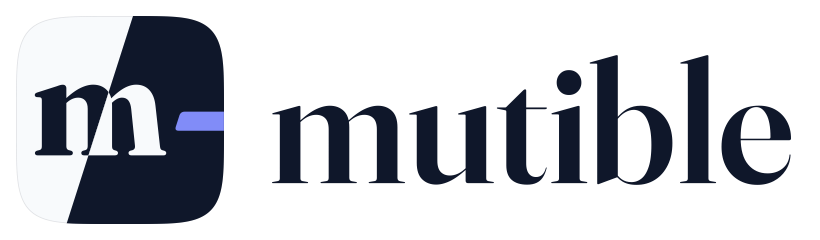
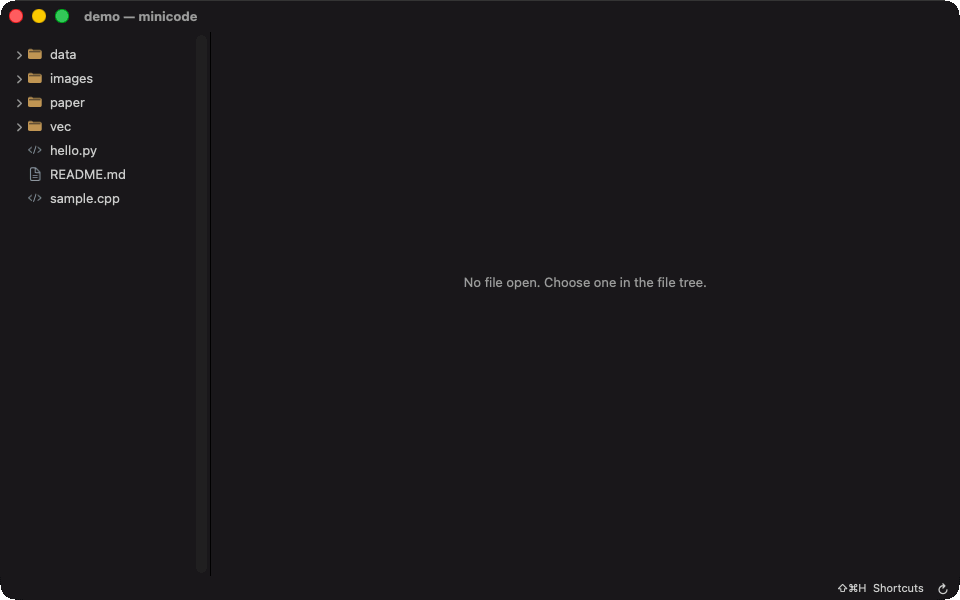
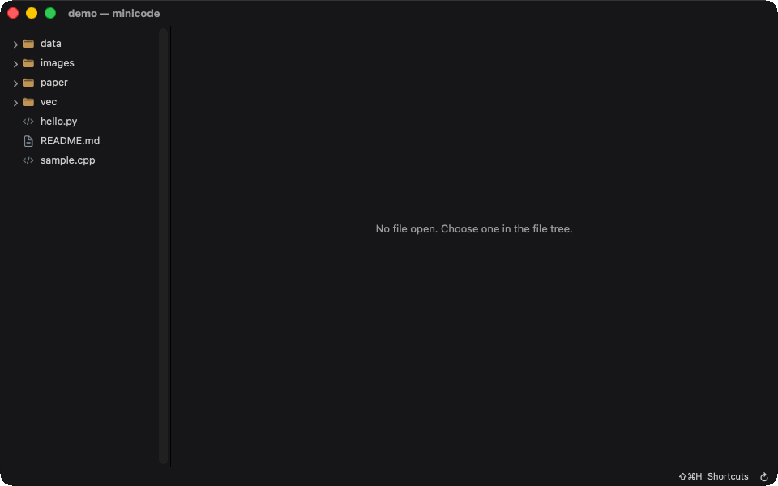
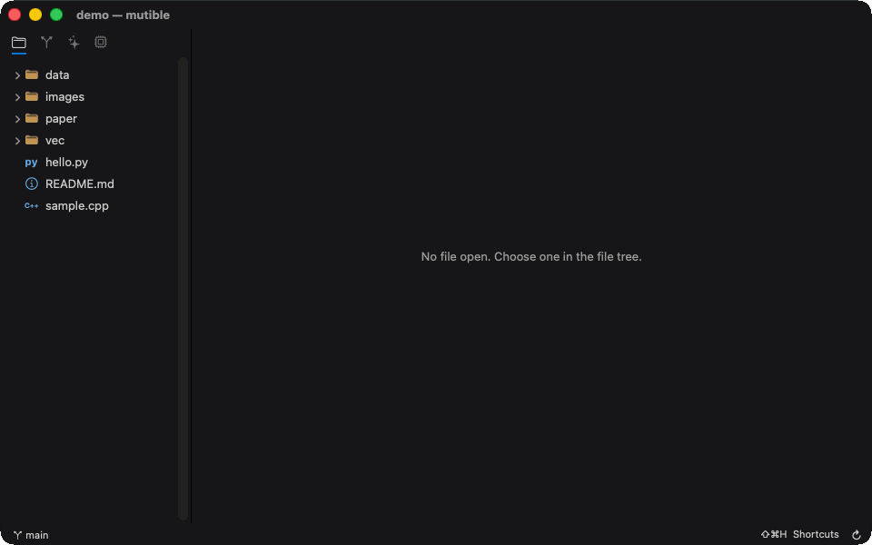
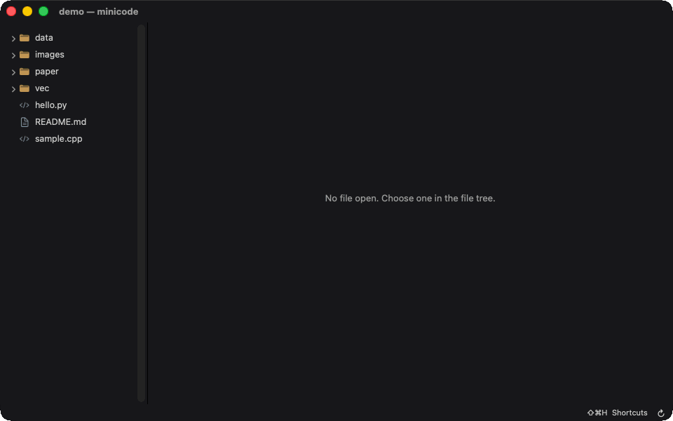
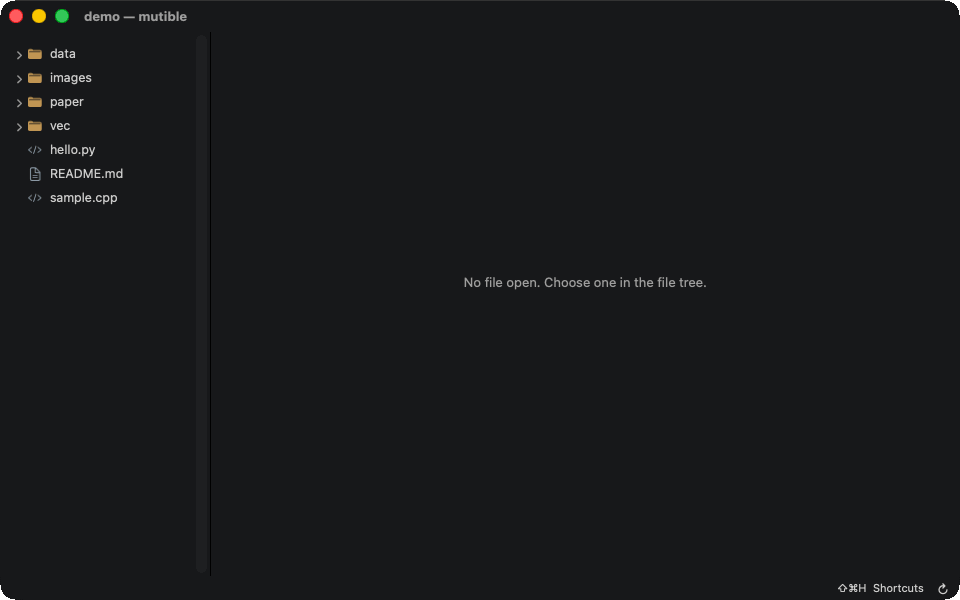
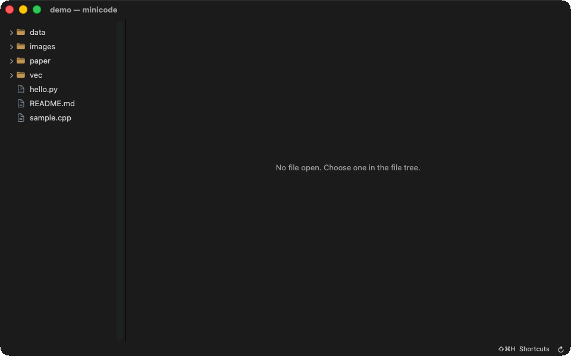
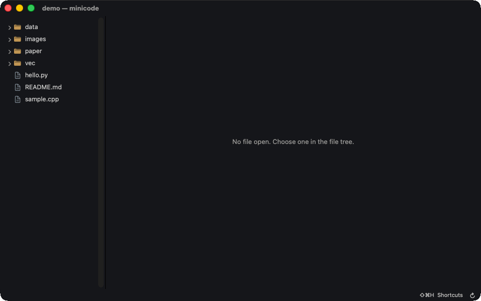
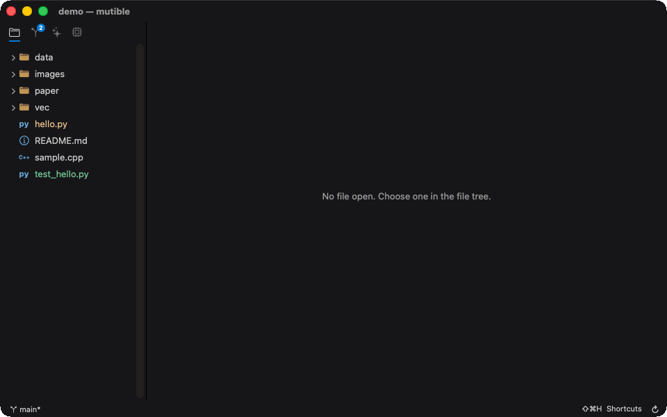

<h1>
<picture>
  <source media="(prefers-color-scheme: dark)" srcset="docs/brand/mutible-header-dark@2x.png">
  
</picture>
</h1>

Take back your space. Quickly explore your files, open and render just about anything, edit it in realtime, or watch your agents work through it all.

mutible is a small native app for macOS and Linux, with no Electron and no third-party libraries. Code opens in an editor with language servers behind it, Markdown and LaTeX as pages you can edit, and PDFs, pictures, video, spreadsheets, and databases in viewers of their own. A terminal, a browser, a git panel, and a dashboard of what your Claude Code sessions did are a keystroke away.

The operating system's own components show web pages, PDFs, video, and documents such as Word and Keynote files; the rest, from the editor to the Markdown renderer, is written from scratch. On the Mac it is a download of under 4 MB, and on the same work it used about a quarter of the memory of VS Code, Chrome, and Preview together.



```
brew install --cask ible-ai/tap/mutible
```

mutible was called minicode until 1.6.0. The `minicode` command still works for now, and on the Mac the first launch brings over minicode's settings, sessions, and backups. <!-- rename-mutible: keep -->

Ubuntu, Android, and building from source are under [Get started](#get-started). Most of what follows works on both macOS and Linux; the [reference](docs/REFERENCE.md) says where the Mac is ahead.

## Highlights

### A folder, opened in place

The file tree follows the disk and colors each name by its git status. A click opens a file in a preview tab, as in VS Code, and a double click keeps it. Tabs come back with the folder, and unsaved changes are backed up as you type, so a crash loses nothing. Shift Command P runs any command by name, and Command P opens any file from a few letters of its name.

### An IDE



With a language server installed (clangd, basedpyright, gopls, rust-analyzer, typescript-language-server, or any other you name), mutible has completion with snippets, errors as you type, hover, go to definition, rename, references, quick fixes, a problems list, semantic colors, and on the Mac inlay hints. Format Document uses your project's formatter. The editor has several cursors, folding, find and replace across the folder, a split editor, and a large-file mode for logs of tens of megabytes. A missing server or formatter comes with the command that installs it.

### Git, down to the line



Shift Command G or Control Shift G swaps the tree for a source control panel: changes and their diffs, the commit graph with what is and is not pushed, and push, pull, and fetch. Stage or discard a file, a hunk, or the lines you select, and a discard can be undone. Bars beside the line numbers mark what changed, and a click on one reverts or stages that change alone.

### A real terminal



Control backtick opens your own zsh, with your prompt, completion, and plugins. On the Mac the terminal emulator is mutible's own: vim, htop, ssh, and Claude Code draw in it as in Terminal.app, lines rewrap when it resizes, and Command Up and Down jump between the commands you ran. Terminals open in tabs and side by side, and Command clicking src/main.cpp:42:7 opens that line.

### A browser beside the code



Shift Command B opens a browser with tabs to the right of the editor, the terminal across the bottom under both. URLs printed in the terminal open there, and so do the local pages that Vite and Claude Code open. Bookmarks are .url files in a folder, and `mutible https://example.com` opens the browser in a window of its own.

### Markdown and LaTeX, edited on the page




Markdown renders as GitHub renders it, with tables, task lists, footnotes, math, and Mermaid diagrams, beside its source or in its place. A .tex file is typeset by tectonic as you type and shown as its PDF. In either, double click a paragraph, a heading, a table cell, or an equation, and a small editor opens on the source behind it.

### Everything else opens in place



Pictures, PDFs, video, and audio open in the editor's pane. CSV files open as a table you can edit, JSON gets an outline, Jupyter notebooks render with their outputs, and SQLite databases open read-only with a box for queries. On the Mac, anything else, from a Word document to a Keynote deck, opens as a Quick Look preview in a tab.

### Claude Code



mutible works with [Claude Code](https://docs.anthropic.com/en/docs/claude-code), which you install yourself. Command I asks it for a change at the cursor and shows the diff before applying it. With the `mutible` command an agent opens a file at a line with a note, shows a side-by-side diff, or runs the tests in a terminal you can watch. The Agents panel lists the sessions that worked in the folder, with the files each changed and the commands it ran, and the Processes panel shows what they left running. Claude Code's /ide can link to mutible too.

### Settings and themes


Settings are one text file, opened by Command comma and applied when saved. Every color shows as a swatch that opens the color picker, panels can be translucent, and View > Theme switches between VS Code's built-in themes. Adjust Settings, at the end of every right click menu, opens the file at that part's keys, and keys.conf changes any shortcut.

## Memory

The benchmark is a simple workload on this repository: clangd on a C++ file, some work in the terminal, typesetting a LaTeX document, and loading a web page. Both sides run the same clangd.

On the Mac, the numbers are the RAM footprint on an M3 Mac with 16 GB, measured after a minute of settling, on 21 September 2026 with mutible 1.3.3, VS Code 1.107.1, and Chrome 153:

|   | Memory |
| --- | --- |
| mutible | 320 MB |
| VS Code, Chrome and Preview | 1,283 MB |

mutible has gained many features since 1.3.3 and has not been measured again on the Mac. On disk, Mutible.app 1.5.15 is 8.6 MB and Visual Studio Code.app 1.107.1 is 659 MB.

On Linux, the numbers are the proportional set size (PSS), the median of five samples after a minute of settling, on an i7-8550U with Ubuntu 26.04 and a virtual display with no GPU, on 14 November 2026 with mutible 1.5.24, VS Code 1.145.2, Chrome 157, and Papers 50.2:

|   | Memory | Without clangd |
| --- | --- | --- |
| mutible | 957 MB | 453 MB |
| VS Code, Chrome and Papers | 2,081 MB | 1,578 MB |

The two systems count memory differently, so compare each table only within itself. `make membench-mac` and `make membench-linux` run the workload on scratch profiles, so you can measure the version you have.

## Get started

On a Mac with Apple silicon and macOS 11 or later:

```
brew install --cask ible-ai/tap/mutible
```

The app is not notarized, which needs a paid Apple Developer account, so the cask clears the quarantine flag for you. On Ubuntu 26.04, use the PPA:

```
sudo add-apt-repository ppa:echansen/minicode
sudo apt install mutible
```

For Android phones with a hardware keyboard, the APK is on the [releases page](https://github.com/ible-ai/mutible/releases/latest); [android/README.md](android/README.md) covers setting it up with Termux.

Either install puts a `mutible` command on your PATH: give it folders, files, or a web address, or nothing for the current folder, and `mutible -h` lists the options. Scripts and agents use the same command to drive a running mutible (`mutible open main.py:42 --note "..."`, `mutible diff`, `mutible term --run "make test"`), as the [reference](docs/REFERENCE.md#driving-mutible-from-the-command-line-and-agents) describes.

To build it on a Mac you need only the Xcode command line tools:

```
git clone https://github.com/ible-ai/mutible.git
cd mutible
make
make run DIR=demo
```

[BUILD-LINUX.md](BUILD-LINUX.md) has the Linux build, and `make test` runs the shared core's tests.

## Keys

Linux uses Ctrl where the Mac uses Command, with VS Code's Linux key where VS Code has the command. Shift Command H shows the keys that apply right now, and the [reference](docs/REFERENCE.md#keyboard-shortcuts) lists every one, Android's included.

| Action | macOS | Linux |
| --- | --- | --- |
| Run any command by name | Shift Command P | Ctrl Shift P |
| Open a file of the folder by name | Command P | Ctrl P |
| Find in the file, or in the whole folder | Command F, Shift Command F | Ctrl F, Ctrl Shift F |
| Toggle the sidebar | Command B | Ctrl B |
| Toggle the terminal | Control backtick | Ctrl backtick |
| Toggle the browser | Shift Command B | Ctrl Shift B |
| Toggle the source control panel | Shift Command G or Control Shift G | Ctrl Shift G |
| Toggle the Markdown or LaTeX preview | Shift Command V | Ctrl Shift V |
| Show the Markdown page beside its source | Control Command V | Ctrl Alt V |
| Split the editor | Command backslash | Ctrl backslash |
| Add the next occurrence to the selection | Command D | Ctrl D |
| Go to definition, rename | F12, F2 | F12, F2 |
| Show quick fixes | Command period | Ctrl period |
| Format the file | Shift Option F | Ctrl Shift I |
| Run the open file in the terminal | Shift Command Return | Ctrl Shift Return |
| Ask the inline agent | Command I | Ctrl I |
| Toggle the Agents panel | Shift Command A | Ctrl Shift A |
| Open the settings file | Command comma | Ctrl comma |
| Show the shortcut hints | Shift Command H | Ctrl Shift H |

## More

- [docs/REFERENCE.md](docs/REFERENCE.md): every feature in detail, the language servers and formatters and how to install them, the settings, the command line and agents, the Linux and Android ports, every shortcut, and the limitations.
- [ROADMAP.md](ROADMAP.md): what is planned.
- [BUILD-LINUX.md](BUILD-LINUX.md) and [linux/README.md](linux/README.md): building and installing the Linux version, and what has been checked on it.
- [android/README.md](android/README.md): the Android version.

## License

MIT; see [LICENSE](LICENSE).
