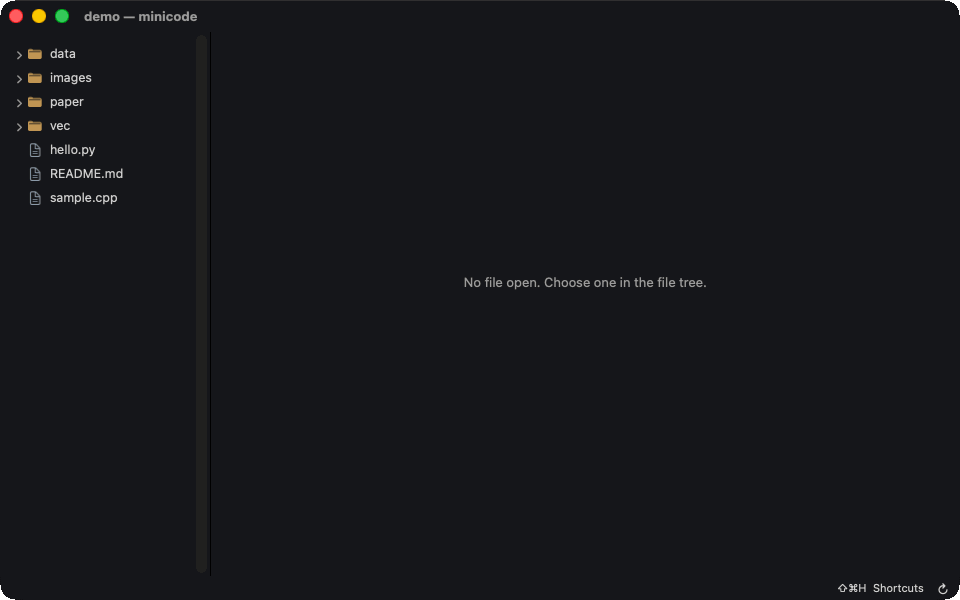
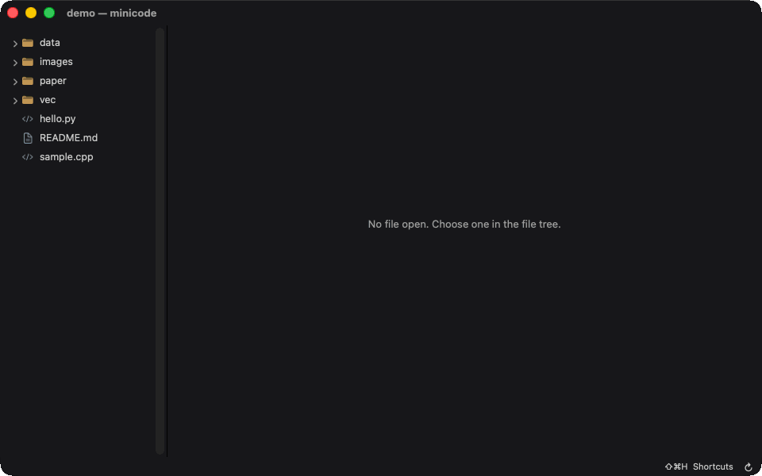
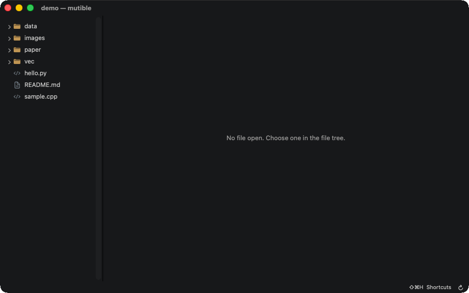
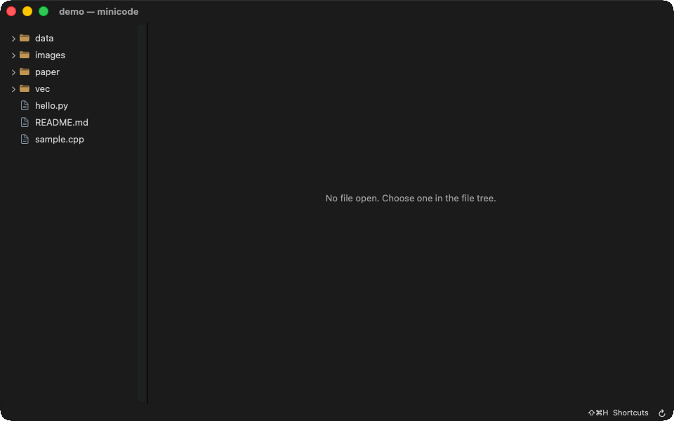
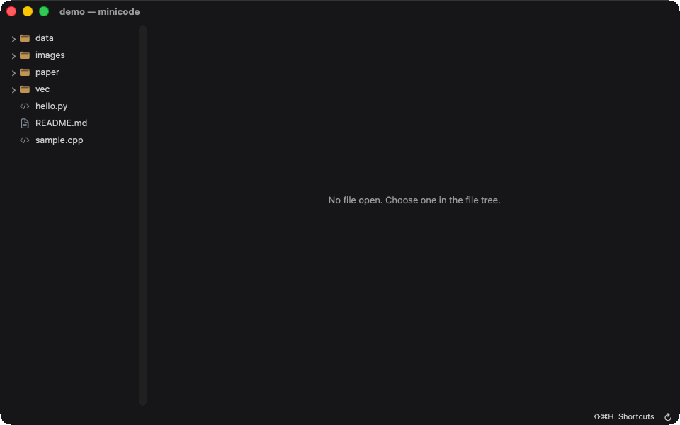
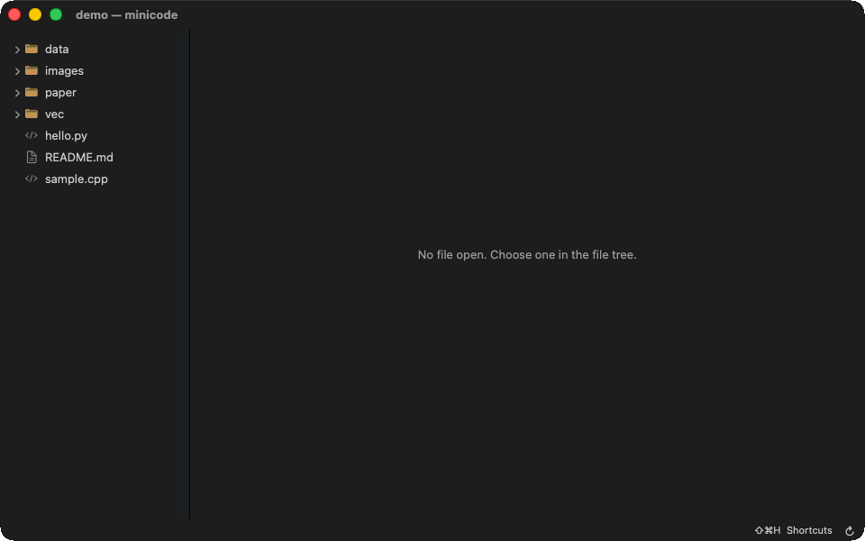

# mutible reference

This is the detail behind the [README](../README.md): every feature, the settings that change it, the language servers and formatters mutible works with, the command line that agents use, the keyboard shortcuts on each platform, and what is still missing.

I built it because I wanted one light place to browse a folder, edit code with a language server behind it, preview Markdown and LaTeX, and keep a terminal and a browser a keystroke away, without a few hundred megabytes of runtime underneath.

The macOS app links only against frameworks and libraries that ship with the system, zlib and SQLite among them. The Linux version is a GTK4 port that uses only what a distribution ships (GTK, VTE, WebKitGTK, and poppler), and the Android version is a Kotlin app that also uses Google's AndroidX and Material Components libraries; all three share the same C++ core. The rest of this reference describes the macOS app, and the [Linux](#linux) and [Android](#android) sections say how the others differ.

## What it does

Open a folder and you get a file tree on the left and the file you click in the main pane. Each file you open gets a tab above the editor, keeping its own unsaved changes, undo history, and place, and a dot on the tab means it has changes to save. On the Mac and on Linux, as in VS Code, tabs keep their whole names (only a very long one is shortened in the middle), and when there are more than fit, the row scrolls sideways with the trackpad or the mouse wheel, with a thin scroll bar while the pointer is over it; the tab on show is always scrolled into view. Files that share a name, such as two index.ts files, show the folders that tell them apart, dimmed, after the name. The terminals' and the browser's tabs scroll the same way, and wherever tabs drag along their row, one held near either end scrolls it. Typing something and deleting it again leaves nothing to save. Undo takes back a run of typing in one step, until you move the cursor, and anything else (a paste, Replace All, formatting, a file reloaded because it changed on disk) in a step of its own, named in the Edit menu on the Mac and in the editor's right click menu on Linux (Undo Typing, Undo Replace All); undoing a reload gives back the text from before it. <kbd>⌘W</kbd> closes the tab, or the terminal or browser when it has the keyboard, and <kbd>⇧⌘W</kbd> closes the window. <kbd>⌘N</kbd> starts a new file, <kbd>⇧⌘N</kbd> (or <kbd>⌥⌘N</kbd>) opens a new window, and <kbd>⌥⇧⌘T</kbd> reopens the tab you closed last, where it was. On Linux a tab drags along its row to a new place, in either group of the split editor, and the folder remembers the order. While the file tree has the keyboard, <kbd>⇧⌘N</kbd> makes a new folder instead. On the Mac and on Linux, as in VS Code, a single click on a file in the tree opens it in the preview tab, its name in italics, and the next file you click replaces it there, so looking through files does not pile up tabs. Double click the file, or <kbd>⌘</kbd>-click it, and it gets a tab of its own; editing or saving the file in the preview tab, double clicking its title, or Keep Open in its right click menu or the File menu keeps it too. A single click on a Find in Folder result and Go to Definition into another file use the preview tab the same way, and the file you started from is kept. Quick Open, <kbd>⏎</kbd> in the tree and links open files in a tab of their own. workbench.enable-preview = off in the settings gives every file its own tab, and workbench.enable-preview-from-quick-open = on sends Quick Open to the preview tab too. The next time you open the folder, its tabs come back, the preview tab still a preview (on Linux each with its caret and scroll, kept in ~/.local/state/minicode). On the Mac, quitting and opening mutible again from the Dock or Finder, with nothing to open, brings back every window that was open, as VS Code does with window.restoreWindows set to all: each at its size and place on the screen (on the main screen when its own screen is gone), on its folder, with its tabs, the one on show, both groups of the split editor, each tab's cursor and scroll and whether it showed its page or its source, the sidebar's width and the panel in it (the tree, source control, agents, or processes), the terminal dock with its height, tabs, splits, and their names, Problems, the folders open in the tree, and its selected row. Closing the last window quits mutible, and that window comes back the same way. The terminals start fresh shells in the folders they were in; programs that were running in them are not brought back. The review page (Uncommitted Changes), a commit's page, and a side-by-side comparison come back as tabs too, read again from git and the disk rather than as they last looked; a worktree's comparison, a merge conflict's two sides, and a change Claude proposed for you to accept do not. Opening a file or folder from Finder, or `mutible path`, opens just that, without the other windows, but a folder that had a window when mutible last quit comes back as that window, with its tabs, pages, terminal dock, panels, and tree, as VS Code reopens a folder. On Linux, starting mutible from the dock or the app grid with nothing to open brings back every window that was open too, each on its folder with its own tabs, cursors, and scroll, at its size, with its sidebar hidden or shown, its terminal and Problems if they showed, and the folders open in its tree, its selected row, and the tree's scroll (the desktop places the window; the terminal's tabs and splits and the sidebar's width start fresh); `mutible` typed in a folder still opens that folder. Unsaved changes are also copied to a backup a second after you stop typing, so if mutible crashes, is force quit, or the computer loses power, the next window on that folder brings them back as unsaved tabs, with the file on disk untouched and a note if it changed in the meantime, and mutible opens a window for each folder that has some when it starts. The backups are in ~/Library/Application Support/Mutible/Backups on the Mac and ~/.local/share/minicode/Backups on Linux. On the Mac, quitting (<kbd>⌘Q</kbd>, the Dock, logging out, or restarting) never asks whether to save, as VS Code's files.hotExit set to onExit: your unsaved changes are written to the backups before mutible quits, and every window comes back the next time it starts, each unsaved tab still unsaved with its text and a note if the file changed on disk meanwhile (its undo history starts afresh). An untitled buffer the session host kept comes back untitled. Two windows on one folder each get their own unsaved changes back, even in the same file. When a window brings back a file that has unsaved changes from another window too, for one that is not coming back or a backup from an older copy of mutible, the other text opens beside it as "a (unsaved copy).txt", unsaved and not on disk until you save it, and the status bar says so; no backup is thrown away before its text is back or saved. If a backup cannot be written, quitting asks as before. Closing a tab or a window with unsaved changes still asks. files.hot-exit = off in the settings brings back the question at quit, where Don't Save throws the backups away. On Linux quitting still asks whether to save, and Don't Save throws the backups away; after a crash or a force quit, two windows on one folder each get their own unsaved changes back there too, even in the same file, and a clash opens beside the file as "a (unsaved copy).txt" in the same way. The tree follows changes made elsewhere, in the terminal, in git or in another program, and right clicking an item offers new file, new folder, rename, move to trash, reveal in Finder, and copy path or the path from the folder. On Linux, moving a file to the trash, or a file deleted elsewhere, takes out just its row: the tree stays where it was scrolled with its folders open, and the row after it is selected, so pressing Delete again trashes that one too. On the Mac, right clicking a tab offers the same for its file, plus showing it in the tree and closing the tab, the others, the ones to its right, or all of them.

On the Mac and on Linux a slim row of icons at the top of the sidebar shows what it can hold: the file tree, Source Control, Agents, and Processes. Each icon's tooltip names its panel and key (Source Control ⇧⌘G on the Mac, Source Control (Ctrl+Shift+G) on Linux, where the icons are your icon theme's), a click shows that panel in the sidebar, a click on the icon of the panel on show gives that panel the keyboard, and the icon of the panel on show is underlined. Source Control's icon carries the number of changed files, Agents' an orange dot while a session in one of the window's terminals waits for you, and Processes' the number of servers running for the folder, looked at every ten seconds. The row hides with the sidebar (<kbd>⌘B</kbd>, <kbd>Ctrl+B</kbd> on Linux), and workbench.sidebar-icons = off in the settings hides it.

On the Mac and on Linux the editor splits in two, as VS Code's does. <kbd>⌘&#92;</kbd> in the editor (or Split Editor in the View menu) opens the file you are in a second group on the right, with its own row of tabs, and moves the keyboard there; in the terminal <kbd>⌘&#92;</kbd> still splits the terminal. A file open in both groups is one document: what you type in one shows in the other as you type, it has one undo history, and closing it in one group asks nothing while the other still has it. Click in the other group, or press <kbd>⌘1</kbd> for the left group and <kbd>⌘2</kbd> for the right, and the keyboard moves there. <kbd>⌃⌘→</kbd> and <kbd>⌃⌘←</kbd> move the tab on show to the other group, making the right group when there is none. A file opens in the group you are in, closing a group's last tab closes the group, the bar between the groups drags to resize them, and the folder remembers the split for next time. Previews, pictures, PDFs, and the other viewers work in either group, while the group without the keyboard shows them as they were when you left it, and its text has no error underlines, folds, or inlay hints until you click into it. <kbd>⌘2</kbd> used to focus the terminal; Focus Terminal is in the Navigate menu, and `cmd+2 = workbench.action.terminal.focus` in keys.conf puts it back. On Linux the keys are <kbd>Ctrl+&#92;</kbd>, <kbd>Ctrl+1</kbd> and <kbd>Ctrl+2</kbd>, and <kbd>Ctrl+Alt+Shift+Page Down</kbd> and <kbd>Ctrl+Alt+Shift+Page Up</kbd> to move a tab (GNOME keeps <kbd>Ctrl+Alt</kbd> with the arrows), and the group without the keyboard shows a text file as it is, with its own cursor and scroll, and names a picture, a PDF, a table, or a preview until you click it.

On the Mac and on Linux, <kbd>⇧⌘P</kbd> opens a command palette, as in VS Code: type a few letters of any command in the menus and press <kbd>⏎</kbd> to run it, with the ones you ran last at the top. <kbd>⌘P</kbd> opens the same box on the folder's files instead, matched by name with the files you opened lately first; the file you pick takes the keyboard, as in VS Code and Zed, wherever it was before (the tree or the terminal, say). <kbd>⌃G</kbd> asks for a line of the open file (42, or 42:7 for a column). Typing > at the start of the box switches to commands, and a colon to a line number. <kbd>⌘P</kbd> and Find in Folder include dotfiles such as .github/workflows/ci.yml and .env, and leave out what the folder's .gitignore and .ignore files ignore, as VS Code does; search.use-ignore-files = false in the settings searches everything. On the Mac, <kbd>⌃R</kbd> lists the folders you opened before, as File > Open Recent does, and so does a right click on mutible's Dock icon, whether mutible is running or not. The Dock's menu also has New Window and Open Folder…, which opens a window on the folder you pick.

On the Mac, Open Folder… (<kbd>⌘O</kbd>) and the Dock's Open Folder… open mutible's own folder picker in the same box rather than the system's open panel. It lists the folders you opened before, then the folders inside the window's folder (or your home folder), and typing a few letters narrows them as the palette does. Type a path instead, such as ~/Code/, /Users/, or ../, and the box lists that folder's folders as you type: <kbd>⇥</kbd> completes the one selected and goes into it, as does typing a slash after a name, <kbd>⏎</kbd> opens the selected folder, and <kbd>⌘⏎</kbd>, or the Open This Folder row, opens the folder you typed. Folders whose names start with a dot are listed only once you type the dot. <kbd>⎋</kbd> closes the box, and the last row, Choose in Finder…, opens the system's panel for the rare case. Open Folder… moves the window to the folder (asking about unsaved tabs once you have chosen), and the Dock's opens a window on it, as before; with no window open, the Dock's Open Folder… still shows the system's panel.

On the Mac each file in the tree, and in Find in Folder's results, has an icon for its type in a muted color for its family, as VS Code's Seti icons do: a language's short name for source files (py, JS, TS, C, C++, rs, go and so on, with Swift's bird and a terminal for shell scripts), M↓ for Markdown, braces for JSON, a table for CSV, a picture, a film strip for video, a waveform for audio, a page for a PDF, a zipped page for an archive, a book for a notebook, a cylinder for a database, a hammer for a Makefile or CMakeLists.txt, a box for a Dockerfile, a seal for LICENSE, an info sign for README, a lock for lockfiles, a branch for git's files, a gear for settings and dotfiles, and a plain page for anything else. The colors are lighter in a dark theme and deeper in a light one. On Linux each file shows the desktop icon theme's own picture for its type: Python, C, C++, Rust, Go, Java, Kotlin, shell, Ruby and other source files, Markdown, HTML, CSS, JSON, YAML, TOML, XML, CSV and SQL, LaTeX, notebooks, pictures, audio, video, PDFs, archives, fonts, programs (a file with no extension that can run, too), office documents, a Makefile, a Dockerfile, LICENSE, README, lockfiles, git's files, dotfiles and other settings, patches and logs. Themes such as Yaru and Papirus draw most of these apart; where the theme has no picture for a type, the row falls back to a broader one (a script, then a plain page), and changing the icon theme changes the tree at once. The file tree can also show up to three columns at the right of each row, each switched on and off by its own key: <kbd>⇧⌘I</kbd> for sizes, <kbd>⌥⇧⌘I</kbd> for when each file was last saved, and <kbd>⌃⇧⌘I</kbd> for when it was created. They use Finder's units ("4 KB", "2 min", "yesterday", "12 Oct"), with the exact figures in the row's tooltip, and when the row gets narrow the rightmost column goes first. A folder's size is the total of everything inside it, hidden files included, as Finder and du count it; it is added up in the background, shows "…" until it is known, and is counted again when something inside changes. A very large folder stops being counted after a couple of seconds and shows "≥" before what it reached. While the last-saved column shows, the status bar also says when the open file was last saved. Sort By in the tree's right click menu orders the tree by name, date modified, size, or date created, ascending or descending, with folders first or mixed in with the files. Dates and sizes start newest and largest first, as in Finder, and each folder remembers its own order. <kbd>⇧F10</kbd> or <kbd>⌃⏎</kbd> opens the right click menu of whatever has the keyboard, at the selected row or the cursor, so all of this works without the mouse.

On the Mac and on Linux the tree follows the file you are working in, as VS Code's explorer.autoReveal does. Whenever another tab comes on show, by a click on its tab, <kbd>⌘1</kbd> to <kbd>⌘9</kbd> (<kbd>Alt+1</kbd> to <kbd>Alt+9</kbd> on Linux), the next or previous tab, a click into the other group of the split editor, closing the tab before it, Quick Open, Go to Definition, or a search result, the tree opens the file's folders, selects its row, and scrolls the row to its middle. When the row is already in view the tree selects it and stays where it is, so clicking between two files on show never makes it jump, and a click on a file in the tree never scrolls it (on Linux a click on a row cut by the tree's edge slides it into view, as GTK's lists do). The keyboard stays in the editor. A file outside the focused folders (see Focus on Folder below) leaves the tree as it is; only Reveal Active File in File Tree widens the focus to show it. Pages, untitled tabs, and files outside the window's folder are not revealed. While the tree is hidden, with the sidebar closed or source control, agents, or processes in its place, nothing moves, and the file on show is revealed once when the tree comes back. explorer.auto-reveal = off in the settings turns this off.

On the Mac the window's title says which file you are in by its path from the window's folder, as VS Code's does: prep/snippets/agentic-system-design.json — mutible. A file outside the folder shows its path with ~ for your home folder, such as ~/notes/todo.md — mutible, and a new file that was never saved its name, such as Untitled-1 — mutible. While the terminal has the keyboard the title is the terminal's, and while the browser has it the page's; click back into the editor and the file's path returns. A dot before the name, and in the window's close button, means the file has changes to save, and ⌘-click on the title shows the folders the file is in.

On the Mac and on Linux, Focus on Folder in a folder's right click menu roots the file tree at that folder, for working in one part of a large project; it is in the File menu and the command palette too, where with a file selected it takes the file's folder, and with nothing selected the open file's. A slim row across the top of the tree shows the way down from the window's folder, such as mutible › mac › src. Click a folder in it to root the tree there, or the first one or the × at its end to see the whole folder again, as Show Whole Folder in Tree does from the palette, the File menu, the tree's right click menu, and the row's own. The folders you had open stay open either way. Only the tree narrows: search, Quick Open, the terminals, source control, and the agents still cover the whole folder. Opening a file outside the focused folder, from Quick Open or Go to Definition, leaves the tree as it is, while revealing one in the tree (Reveal Active File in File Tree, or Reveal in File Tree from source control) widens the focus to the nearest folder that holds both. Each window keeps its focus when it comes back after a restart and when its folder is opened again; a focused folder deleted or renamed in the meantime gives the whole folder back.

On the Mac and on Linux, the tree can also hold several folders at once, for jumping between two parts of a project without the rest in the way. Add to Focus, in a folder's right click menu, the File menu, and the command palette, adds a folder: from the palette or the File menu it takes the selected folder, or the open file's folder when the tree shows that one already. To pick any folder, use Add Folder to Focus… in the File menu and the palette, or the + at the end of the row above a focused tree (Add to Focus opens the same picker when it has nothing new to add). It is mutible's own folder picker, as Open Folder… shows, limited to the window's folder: it lists the folders of your open files first, then the window's folders, by their paths from it; typing narrows them, a path such as linux/src goes deeper (<kbd>⇥</kbd> completes it), <kbd>⏎</kbd> adds the selected folder, and <kbd>⎋</kbd> cancels. Folders outside the window's folder are never offered. On Linux, Add Folder to Focus… opens the system's folder chooser in the window's folder instead, and a folder chosen outside it is refused with a note in the status bar. With two or more folders the tree shows each as a top-level row labelled with its path from the window's folder, such as mac/src and linux/src, in the order you added them, and each opens and closes as usual. The row across the top then has one small label per folder: click a label to go to its folder, or its × to take that folder out; the × at the end, or Show Whole Folder in Tree, shows the whole folder again. A folder's right click in the tree offers Remove from Focus on each top-level row. Focus on Folder still replaces the set with its one folder, and with one folder left the tree goes back to the single folder and its breadcrumb. Adding a folder inside one already focused changes nothing, and adding one that holds a focused folder takes that folder's place, so no file shows twice. Revealing a file outside every focused folder adds the file's folder instead of widening (with one folder focused, it widens as above). The folders come back with the window after a restart and with its folder; those deleted or renamed meanwhile are dropped, and with none left the whole folder shows.

On the Mac and on Linux, in a folder kept in git, the tree colors each name by its status, in VS Code's colors: modified, added, untracked, deleted, in conflict, and dimmed for what git ignores, such as a build folder. A folder takes the color of the strongest change inside it, so after an agent edits a dozen files you can see where without opening source control, and the row's tooltip names the status. The colors follow edits and commits within a second, and the settings file can change each of them (tree.git-modified and the rest). On Linux the tree watches only the folders it has listed, so a file another program changes in a folder you never opened takes its color at the next look: when the window comes back to the front, on a save, or on any change git or a listed folder sees. When something changes on disk, the tree lists again only the folders it changed in, away from the editor, so a build or an install writing inside the folder does not hold up typing.

Source files are highlighted by extension, over 200 of them, from Python, C, C++, Go, Rust, Java, Swift, JavaScript, and TypeScript to shell, YAML, SQL, Lua, and LaTeX. A few general grammars serve them all, so each gets its comments, strings, and numbers colored, while keywords are colored in Python, JavaScript, TypeScript, and the brace languages, which share C++'s list. As in VS Code's themes, a function's name takes the function color where it is called and where it is defined (def area, fn area, func area, function area), so does a Python decorator, a name after class or struct takes the type color, self, cls, this, and super have a color of their own, and an escape inside a string, such as \n or \x41, stands out from the string around it, except in raw strings, which have none; syntax.escape and syntax.self in the settings change those two. HTML, XML, SVG, plist, and Vue files color as VS Code colors them: tag names, attribute names, attribute values as strings, a tag's brackets, comments, entities such as `&amp;`, the doctype, and XML's CDATA, each in its theme color (syntax.tag, syntax.attribute, and syntax.tag-bracket change the first two and the brackets), and in HTML and Vue the contents of a script are colored as JavaScript and those of a style as CSS, up to the end tag that closes them, as a browser reads them; a script whose type is not JavaScript or JSON, such as a template, stays plain. A line ends where the screen shows it ending, at a newline, a Windows carriage return and newline, or an old Mac file's lone carriage return, and a line over 20,000 characters, such as minified JavaScript, is left uncolored, as VS Code leaves it.

On the Mac, misspelled words are marked with a dotted underline, using macOS's own spelling checker and dictionaries, in Markdown and LaTeX files and in the Source Control panel's commit message box. Only prose is checked: in Markdown not code spans, code blocks, math, links' addresses, or HTML tags, and in LaTeX not commands, their options, the names given to \label, \ref, \cite, \usepackage and the like, math, or verbatim text. Right-click a marked word for the checker's corrections, which go in as one step to undo, and for Learn Spelling, which adds the word to your dictionary, and Ignore Spelling, which leaves it alone in that file while its window is open. editor.spell-check = on also checks comments, docstrings, strings that read as sentences, and plain text files, and never identifiers, keywords, paths, or web addresses; off turns checking off everywhere, the commit box included. Only the lines on screen are checked, half a second after you stop typing, so typing costs nothing more, and editor.spell-check-color changes the underline's color.

On the Mac and on Linux, a file over 20 MB or 300,000 lines opens in large-file mode, as in VS Code: no colors, folding, bracket boxes or language server, so a 25 MB log opens in about half a second instead of three and a half, and typing in it is as quick as anywhere. The status bar says "Large file: features off", and a click there turns them all on for that tab; editor.large-file-optimizations = off opens every file in full. On the Mac nothing is asked before such a file opens, as in Zed: an 80 MB log is on screen in under a second and scrolls and searches without a pause, and a file in large-file mode takes about its own size in memory (a 260 MB log of plain ASCII about 280 MB; a file with other characters about twice its size); only a file over 1 GB, which takes several seconds to open, asks first, as VS Code does. On Linux opening a file over 50 MB asks first. On Linux a file in large-file mode does not wrap either, as in VS Code; there a file over 4 MB is read without holding up the window, its tab saying "Opening…" meanwhile, files up to 256 MB open, and a line over 10,000 characters, such as minified JavaScript, is shown 10,000 characters at a time, as VS Code shows it: the part shown follows the cursor, a search or <kbd>End</kbd> takes you anywhere in the line, and a note after it says how much is left out.

On the Mac, editor.session-host = on gives each file's text and undo history to the session's host, a part of mutible running on a thread of its own, which a later release uses to let a second screen edit the same session; the editor keeps a copy it edits at once, so typing feels the same, and Undo and Redo ask the host. Saving goes through the host too: the window asks every question it asked before (a file changed on disk, the formatter's consent, a new file's name), and the host writes the file in its own encoding, so the host is the file's one writer, and a browser page that saves the file and the window agree on whether it has unsaved changes. The host also runs the shell of each terminal opened while the setting is on (in the default grid mode; line-mode terminals keep their own), so a second screen of the session, such as the browser view below or `mutible attach`, sees what the terminal shows and can type into it. It is off by default for now, and a change applies to files and terminals opened after it. On Linux the host always holds them, and writes them when they are saved.

editor.session-host takes three values: off, on, and headless. With headless, the session's host is not a part of the app but a separate `mutible host` process for each folder: a window finds the folder's host, or starts one, and attaches to it, and the host ends by itself once no window has used it for 10 minutes and nothing in it is unsaved or running. If it cannot be started or reached, the window keeps its host inside the app and says why (on Linux on the terminal it was started from, on the Mac in the system log, under ai.ible.mutible). Closing a window leaves its files and terminals with the folder's host: the terminals keep running, and a file with unsaved changes stays unsaved there if you answer Keep Unsaved when the window asks (Save and Don't Save work as before). Quitting asks nothing and keeps them there the same way, besides the backups (files.hot-exit = off asks at quit too). The next window on the folder, even after quitting mutible and opening it again, gets them back: its tabs as the last window left them, each file with its unsaved text, marked unsaved when it differs from the file on disk, and with its undo history, and each terminal with its shell still running and what it printed so far. Two windows on one folder each come back as they were, one per window opened, and two windows that both left one file unsaved never give one window two tabs of it: the next window gets the last one's text, the window after it the other's. The browser view of the folder's host leaves a closed window out of its windows; the files it left are still listed until a window takes them. While no window has them, the host keeps backups of the unsaved files it holds where mutible keeps its own, so if the host is killed or the computer restarts, the folder's next window brings them back as it does after a crash. A buffer with no file that another program left on the host comes back as an unsaved tab named Untitled-1 (then Untitled-2, and so on) in the folder; nothing is written there until you save it. Should the host end while a window uses it, the window says so in its status bar: its files stay open and can still be saved, but Undo and Redo do nothing in them, and its terminals end. Reconnect, in the status bar, or the next window on the folder, finds or starts the host again and opens the files on it as they are, so nothing typed is lost (their undo history starts again), and the terminals start new shells. On Linux, off and on both keep the host inside the app: a closed window's files (those saved or left without changes) and running terminals come back in the folder's next window while mutible runs, and end when it quits. On the Mac, on keeps one host inside the app for every window, and closing a window works the same way: its saved files and its terminals come back in the folder's next window while mutible runs (a file left unsaved is asked about as before, since that host ends with the app). On the Mac, the host a window started runs from `mutible-cli` in the app bundle and writes what it says to ~/Library/Logs/Mutible.

Markdown renders as formatted text, with working links, tables and images, and <kbd>⇧⌘V</kbd> flips to the source. On the Mac, <kbd>⌃⌘V</kbd> (VS Code's <kbd>⌘K</kbd> <kbd>V</kbd>) opens the rendered page beside the source instead, with a bar between them to drag. The page follows your typing a moment after you stop, keeping its place, and even in a file of tens of thousands of lines only the part you changed is built again; the keyboard stays in the source; the same key, a drag of the bar to the right edge, or closing the tab closes it, and a file that had it open gets it back the next time the folder opens. The two scroll together, as in VS Code: scrolling the source brings the page to the same line, scrolling the page brings the source along, and a bar at the page's left marks the block the cursor is in. Double click a block on that page to edit its Markdown, as in the full preview; the change goes into the source beside it as one step for <kbd>⌘Z</kbd>. On the Mac, both pages keep their lines to a readable length in a wide pane, centered, about as wide as GitHub shows a README; the width grows with the zoom, and markdown.max-width in the settings changes it, or turns it off with off.

Footnotes work as on GitHub: a reference shows as a raised number that jumps to its note, the notes are listed at the end of the page, each has an arrow back, and a note can hold code blocks. A task in a numbered list keeps its number before its box. GitHub's alerts, a quote whose first line is `[!NOTE]`, `[!TIP]`, `[!IMPORTANT]`, `[!WARNING]`, or `[!CAUTION]`, show as GitHub shows them on the Mac, in Export as HTML, and on a session's page in a browser, which is the same page: a bar down the left in the kind's color (blue, green, purple, amber, or red, a lighter shade on a dark page), and a title with its icon in the same color; on Linux the title is bold in the kind's color and the text upright, with no bar and no icon, and on Android an alert is a quote with its title in bold. Emoji shortcodes such as `:tada:` and `:white_check_mark:` show as the emoji, for the few hundred of GitHub's names people use most; a name mutible does not know stays as written, and so does one in code. YAML front matter at the top of a file (a `---` line, `key: value` lines, and another `---`) shows as GitHub shows it, a small table of the keys over their values, with a list or a nested value joined in its key's cell; a double click on it edits its lines. On the Mac, Export as HTML in the File menu saves the file as a standalone web page beside it, unsaved changes included: headings keep GitHub's anchors, alerts, task boxes, tables, footnotes and code blocks come through, pictures and links keep their addresses, and math stays as its TeX between \( \) or \[ \] for a page that loads MathJax or KaTeX. The page loads nothing from the web itself.

Pictures with an https address, such as the badges at the top of a README, are downloaded in the background and kept in memory only; markdown.web-images = false in the settings turns that off. On the Mac, video and audio play in the page: a `<video>` or `<audio>` (its src, or a `<source>` inside), or a picture whose address ends in .mp4, .mov, .m4v, .mp3, .m4a or .wav, as GitHub shows uploaded videos. A video shows its first frame at its own size, scaled down to the page, with a play button; a click plays it right there with the system's controls, and it pauses when scrolled out of view and stops when you switch tabs. Audio is a slim bar with its name. A local file plays offline; an https one streams, under the same markdown.web-images switch as web pictures; one this Mac cannot play (WebM, say) shows its name and "cannot play". A `<details>` block folds as on GitHub: its summary shows behind a triangle, closed unless the tag says `open`, and a click on the summary opens or closes it for as long as the tab is open; Export as HTML writes a real `<details>`. A picture written as HTML with a width or height, such as ``, shows at that size (in pixels, or a percentage of the page's width), keeping its proportions when only one is given, and never wider than the page; the zoom scales it with the text. Math written as on GitHub, $x^2$ inline and $$ or a math code block for a display, is typeset by tectonic (the LaTeX preview's engine, below) in the background and kept in a cache, so a page opened again shows its formulas at once. tectonic's first run on a Mac downloads about 290 LaTeX files (some 42 MB, half a minute on a good line); while it does, the page shows each formula as its TeX and the line at its top counts the files as they come, and when mutible downloads tectonic for you it starts that first run straight away, so a page rarely waits for it; markdown.math = false shows them as their TeX instead. Formulas are typeset together, so each is kept from changing the others: one that defines something globally (\gdef, \global, a counter), changes the page (\pagecolor, \special), reads a file, leaves its box, or refers to the batch's own commands is not typeset and shows its TeX with the reason as its tooltip.

On the Mac, a mermaid code block (a flowchart, a sequence diagram, any kind Mermaid draws) shows as its diagram, in the page's theme, with nothing to install. The first time, a line above the page's first diagram offers Download Mermaid: one click fetches mermaid.js 12.3.0 (5.5 MB, once), which mutible checks against the release's published checksum and keeps in ~/Library/Application Support/Mutible, as it does tectonic. It then draws each diagram in a hidden web view that loads nothing from the network, and keeps the pictures in a cache. When mermaid-cli is installed (npm install -g @mermaid-js/mermaid-cli), its mmdc command draws the diagrams instead. Until a diagram is drawn, and with markdown.mermaid = false, the block shows as its source, and a diagram that does not parse shows as its source with the complaint as its tooltip.

You can also edit the rendered page: double click a paragraph, heading, list item or table cell, and an editor opens holding its Markdown, with the word you double clicked selected (and nothing more, so a stray key cannot replace the paragraph). On the Mac it is as wide as the page's lines and lies over them, its text starting where theirs does, set in the page's type size, tall enough to show the whole block; <kbd>⏎</kbd> (or Apply) applies the edit and <kbd>⎋</kbd> (or Cancel) drops it. Applying puts the change into the document, as typing in the source would, one step for <kbd>⌘Z</kbd>; the file is written when you save it (<kbd>⌘S</kbd>, which also applies an edit still open) or when auto-save does. Switching to another app and back leaves the editor open with what you typed. Anything else that closes it, a click elsewhere in the window, another tab, closing the tab or window, or quitting, applies what you typed rather than dropping it, so only <kbd>⎋</kbd> or Cancel throws an edit away. With the editor split, a double click on a page in the group without the keyboard opens the editor at once. If the file changes while that editor is open (an agent rewrites it, say), your edit goes into the block where it now is, and the other change stays; if the block you were editing changed too, your edit is not applied over it: your text is put on the clipboard instead, and the status bar says so.

Images and PDFs open in the same pane, and reload when the file changes on disk. On the Mac so do video and audio files, such as mp4, mov, mp3, wav and flac, in the system's own player; nothing plays until you press <kbd>⇧⌘Space</kbd> or the play button.



On the Mac, a file mutible has no viewer of its own for, such as a Word, Excel, PowerPoint, Pages, Numbers or Keynote document, opens in a tab as a Quick Look preview, the one Finder shows, and so does any binary file: mutible looks at the first few kilobytes, and a file with a zero byte in them is never opened as text, whatever its name says, except UTF-16 text with a byte order mark, which opens as text and is saved back in UTF-16 with its mark. On the Mac and on Linux, a text file that is not UTF-8, such as an old Latin-1 or Windows-1252 file, opens as text too, read as Windows-1252 (the rule Find in Folder searches it by, with the five bytes Windows-1252 leaves undefined read as Latin-1 has them), and is saved back in Windows-1252, byte for byte when nothing changed; a file that is valid UTF-8 is always read as UTF-8, and one that is not UTF-8 and holds a zero byte anywhere is binary. A UTF-8 file with a few bytes that are not UTF-8, such as one Latin-1 character pasted in or a file cut off in the middle of a character, is read as UTF-8 when it has at least as many UTF-8 characters as runs of such bytes: each stray byte shows as a box and is saved back as the byte it was, so the file comes back byte for byte when nothing changed, and an edit changes only what you typed. The status bar names the encoding of a file that is not plain UTF-8: "Windows-1252", "UTF-16 LE", "UTF-16 BE", "UTF-8 with BOM", or "UTF-8, bad bytes kept". If you type a character Windows-1252 cannot store, such as an arrow or an emoji, the file is saved as UTF-8 instead, never with a question mark in its place, and the status bar says so ("Saved notes.txt as UTF-8: Windows-1252 cannot store “→”"). On Linux, UTF-16 with its byte order mark opens as text and is saved back in it too. Pressing <kbd>Space</kbd> on a file in the tree opens the Quick Look panel on it, as in Finder, and <kbd>Space</kbd> again or <kbd>⎋</kbd> closes it; while it is open, the arrow keys move it through the files.

On the Mac and on Linux, an .html, .htm, or .xhtml file opens as its page, the way a Markdown file opens as its preview, and <kbd>⇧⌘V</kbd> flips to the source and back. Its stylesheets, scripts, pictures, and the pages it links to load from the folder, with no server; a link to another page opens that file in a tab of its own, and a web address opens in the browser panel. On the Mac only a link you click, or a form you send, goes anywhere: a page that sends itself elsewhere (a meta refresh, or a script) never opens another app or a file, and goes to a web address only while its scripts run, and the status bar names what it tried to open. A link that would open another app (a zoommtg: or mailto: address, say) asks first, naming the app and the address, since a page whose scripts run can click its own links; ticking Refuse any more from this page turns down the rest it tries until the page loads again. The page is the file as saved, so saving the source, or a change made to the file elsewhere (by an agent, say), shows on the page at once, scrolled where it was. A page's scripts run only once you say so: a page that has any shows with them off, under a bar asking whether to run them, and Remember for every HTML file writes your answer to the settings file as html.scripts = on or off, after which pages run their scripts, or never do, without asking. An answer not remembered holds for that file until mutible quits. Once you answer, the bar stays as a line saying what you chose, so the page does not move under the pointer, until another file shows or you close the line with its ×. The page never takes the keyboard by itself, and nothing it stores outlives it. On the Mac, <kbd>⌃⌘V</kbd> (View > Open Preview to the Side) shows the source with the page beside it, a bar between them to drag; there the page is your text as you type it, shown again a moment after you stop, before you save, scrolled where it was, its stylesheets and pictures still loading from the folder. The same key closes it. View > Open Preview to the Side is off for a file that has no page to show beside it. On Linux the page is WebKitGTK's, with JavaScript turned off until you allow it, and the bar, its line and the remembered answer are the Mac's; the one difference is that WebKitGTK has no folder to confine a page's reading to, so a page's pictures and stylesheets load from wherever it names them, while its scripts still cannot read other files.

On the Mac, CSV and TSV files open as a table, and <kbd>⇧⌘V</kbd> flips to the text and back. Double click a cell, or press <kbd>⏎</kbd> on a row, to edit it; the right click menu inserts and deletes rows and columns. When the first row looks like a header (no field in it empty or a number or a date, while a column under it holds mostly numbers or dates), it names the columns instead of A, B, C, in bold at the top, where it stays as the rows scroll; the rows keep their numbers in the file, so the first under the header is 2. First Row Is Header in the right click menu turns that on or off for a table of text alone or a wrong guess, and the table remembers the choice for that file. A column whose header field is empty keeps its letter, and hovering over a named column's header shows its letter. On Linux the table does the same (the names bold, the menu's First Row Is Header a check, the choice kept for the file in `~/.local/state/mutible/csv-headers.txt`), without the letter in a tooltip. To edit the header row, turn it off or use <kbd>⇧⌘V</kbd>. The table edits the file's text, so it has unsaved changes, undo, backups, and auto-save like any other file, and saving writes back only what you changed: the delimiter (comma, semicolon, tab, or pipe), each field's quotes, and the line endings stay as they were, a file saved with no edits comes back byte for byte, and one changed cell changes one line. A file over 50 MB opens read-only, showing its first 100,000 rows.

A JSON file on the Mac opens as text with an outline of it at the right, its objects and arrays folded and unfolded like folders. Clicking a value, or moving to it with the arrow keys, selects its text in the editor, and moving the cursor in the text selects the value it is in. You edit in the text; the outline catches up a moment after you stop typing, and while the text is not valid JSON it keeps the last good outline and says where the error is. Each value takes one line of the outline: line breaks and tabs inside a string show as a dimmed \n and \t, a long value is cut with an ellipsis, and resting the pointer on a string shows its whole value. <kbd>⇧⌘V</kbd> hides the outline and brings it back. As in VS Code, an error in the JSON is also underlined in red where it is, listed in Problems, and counted in the status bar, a moment after you stop typing, and it goes once the file is valid again; a trailing comma is marked on the comma. Files that are JSON with comments, such as tsconfig.json, a .jsonc file, or the .json files in a .vscode folder, may have comments and trailing commas. A JSON language server, when you give one in the settings (lsp.json with lsp.json.extensions), checks the file instead. Linux marks, lists, and counts these errors the same way.

Jupyter notebooks open on the Mac rendered and read-only, the way the Markdown preview shows Markdown: the text cells as formatted text, the code cells highlighted in the notebook's language, and under each code cell what it printed, its pictures, and its errors, from the outputs saved in the file. As in Jupyter and VS Code, the outputs read as results rather than code: no box, a thin rule at their left, and the page's own text color, with a small In [3] above a cell that has run and Out [3] above its result. On Linux a cell that has run has the same In [3] and Out [3] lines in a small muted type above its code and its result. Nothing is run, since mutible has no kernel; an HTML result, such as a pandas table, shows as its plain text. <kbd>⇧⌘V</kbd> shows the notebook's JSON. Fenced code blocks that name their language, as in ```python, are now highlighted in every Markdown preview on the Mac.

A SQLite database (.sqlite, .db, or any file that starts with SQLite's header) opens on the Mac read-only: its tables and views down the left with the selected one's schema under them, and the first 1,000 rows of the selected one on the right. The box above the rows runs a query of your own when you press <kbd>⏎</kbd>. mutible opens the database in SQLite's read-only mode, so nothing can change the file: a statement that would write is refused before it runs, and a query that runs longer than five seconds is stopped.

On the Mac and on Linux the editor numbers its lines down the left side, with a dot beside any line that has an error or a warning. Clicking or dragging in the numbers selects whole lines; editor.line-numbers = relative in the settings counts from the cursor's line instead, and off hides them. With the cursor beside a bracket, it and its partner are boxed, and <kbd>⇧⌘&#92;</kbd> jumps from one to the other, as in VS Code. Brackets are colored by how deeply they are nested, gold, then violet, then blue and round again in Dark Modern, each theme with VS Code's own colors for it, as VS Code's bracket pair colorization does; a closing bracket with nothing open before it is red, and brackets in strings and comments keep the string's or comment's color. Typing a bracket recolors the ones after it on the screen at once, and the rest as you scroll to them. editor.bracket-pair-colorization = off turns this off, and syntax.bracket-1, syntax.bracket-2, syntax.bracket-3, and syntax.bracket-unexpected change the colors; a file in large-file mode, and a line too long to color, get none. <kbd>⌘=</kbd> and <kbd>⌘-</kbd> make the text bigger and smaller, with the Markdown preview following (the terminals have a zoom of their own), <kbd>⌥⌘0</kbd> puts it back, and editor.font-size sets the size they start from. tabs.font-size sets the size of the tab titles in points; left out, Linux uses the desktop's interface font and the Mac uses 12.

Pressing <kbd>⏎</kbd> indents the way the language expects. In Python a line ending in a colon starts an indented block, the line after return, pass, break, continue, or raise goes back a level, and a new line inside an open bracket lines up with whatever follows the bracket, or is indented one level when the bracket ends its line. The line after a call spread over several lines goes back to where the call started, not to its last argument. In C, JavaScript, Go, Rust, and the other brace languages, <kbd>⏎</kbd> after an opening brace indents, and in YAML so does <kbd>⏎</kbd> after a key that ends in a colon. <kbd>⏎</kbd> between a pair of brackets, as in `foo()`, puts the closing bracket on a line of its own. Typing the colon of else, elif, except, or finally moves the line back under its if or try, and a closing brace typed on an empty line moves back under the line that opened it. How far to indent comes from the file, whether tabs or two or four spaces: <kbd>⇥</kbd> inserts that much, <kbd>⌫</kbd> in leading spaces removes that much, and <kbd>⇥</kbd> and <kbd>⇧⇥</kbd> on a selection indent and outdent its lines.

On the Mac and on Linux, brackets and quotes close as you type them, by VS Code's rules for each language. Typing ( gives () with the cursor between, typing the ) it put there steps over it, and <kbd>⌫</kbd> between the two deletes both. A bracket closes only before a space, the end of the line, or punctuation such as a comma or another closer, and not when a closer is already waiting for it. A quote closes only outside strings and comments, and not after a letter, so don't types as it is; Python's f", r", and b" close, and the third quote of """ closes the docstring. In Markdown, LaTeX, and plain text only brackets close. It works at every cursor at once, and never while an input method is composing. editor.auto-close = off in the settings turns it off; typing a bracket or quote over selected text still wraps it.

On the Mac and on Linux, code folds the way VS Code folds it. An arrow beside the line number, shown while the pointer is over the line numbers, folds or unfolds a block, and a folded line ends in a small ⋯ that unfolds it when clicked. <kbd>⌃⌘[</kbd> folds the block the cursor is in and <kbd>⌃⌘]</kbd> unfolds it; VS Code's <kbd>⌥⌘[</kbd> and ] already move between mutible's terminals. Blocks come from the language server when it offers them, otherwise from brackets in C, JavaScript, Go, Rust, JSON, and the other brace languages, from indentation in Python, YAML, and the rest, from headings and fenced code in Markdown, and from sections and environments in LaTeX. Comments over several lines fold too, and so do #region and #endregion comments. The text itself never changes: copying across a fold copies what it hides, and Find, Go to Line, and go to definition open a fold when what they go to is inside it.

Pressing <kbd>F9</kbd> sorts the selected lines. Lines between a `keep-sorted start` and a `keep-sorted end` comment, as used by Google's [keep-sorted](https://github.com/google/keep-sorted), are sorted the way that tool sorts them, its options included: <kbd>F9</kbd> with the cursor inside such a block sorts it, <kbd>⇧F9</kbd> sorts every block in the file, and editor.keep-sorted-on-save = true in the settings sorts them all whenever the file is saved. A start without an end leaves the file alone and the status bar says which line it is on.

In the settings, editor.auto-save = after-delay saves each file a second after you stop typing (editor.auto-save-delay sets how long, in milliseconds), and editor.auto-save = focus-change saves when the editor loses the keyboard, to another pane, tab, window, or app. That keeps mutible and Claude Code, or anything else editing the same files, from tripping over each other: a file with no unsaved changes follows the disk quietly, keeping your place in it, and an auto-save never writes over a file that changed on disk since mutible read it. It names the file in the status bar instead, and <kbd>⌘S</kbd> asks whether to keep your version or reload (on Linux the tab asks when it is shown). Auto-saves don't run the formatter or sort keep-sorted blocks; <kbd>⌘S</kbd> still does.

On the Mac and on Linux, <kbd>⌘F</kbd> opens a find bar at the top right of the editor, laid out as VS Code's: the chevron on its left shows the replace row, and the query has its options inside it. It finds as you type, highlights every match, and says which one you are on ("3 of 17", or "No results" in red with the query outlined in red). Selected text on one line becomes the query, and with nothing selected the word at the cursor does, as in VS Code. <kbd>⏎</kbd> and <kbd>⇧⏎</kbd>, or <kbd>⌘G</kbd> and <kbd>⇧⌘G</kbd>, go to the next and previous one (on the Mac <kbd>⇧⌘G</kbd> does so only while the bar has the keyboard, and opens source control elsewhere), and <kbd>⎋</kbd> closes it. The three buttons inside the query, or <kbd>⌥⌘C</kbd>, <kbd>⌥⌘W</kbd>, and <kbd>⌥⌘R</kbd>, match case, match whole words only, and read the query as a regular expression in JavaScript's syntax, which VS Code uses too. A regular expression takes time in proportion to the line, whatever it holds, so a pattern such as (a+)+b, which makes most engines try every way of splitting the line, costs no more than any other; one with a backreference or a lookahead needs the slower kind of engine and is given two seconds. The button after the arrows, or <kbd>⌥⌘L</kbd> while the bar has the keyboard, finds only in the text that was selected. <kbd>⌥⌘F</kbd>, or the chevron, adds a second field for the replacement, where $1, $2 and so on stand for a regular expression's groups, and its AB button (<kbd>⌥⌘P</kbd>) keeps each match's case. <kbd>⏎</kbd> there replaces the selected match and moves on, and <kbd>⌥⌘⏎</kbd> or the button beside the field replaces them all in one undo step. On the Mac, <kbd>⌘E</kbd> takes the selected text as the query. On the Mac and on Linux a large file is searched from its bytes, a line at a time only where the query is found: on the Mac, in a 250 MB log the last line is found in about 20 ms, the match is selected at once with "1 of …" while the rest are counted (on Linux the count stops at 20,000, as it does in any file), and the old query's highlights go as soon as the query changes. In a file over 20 MB the word at the cursor goes into the find bar but is not searched until you type or press <kbd>⏎</kbd>, which goes to its next occurrence; selected text is searched at once.

Find in Folder, <kbd>⇧⌘F</kbd>, searches the whole folder with the same three options, in a window laid out as VS Code's search view: the results are a tree of files, each with its number of matches, over the lines that hold them, each with its line number and the line just above and below it, muted, as Zed and VS Code show a hit in its excerpt (a line two hits share is shown once), and the match highlighted; a click opens the file at the hit's line. It reads and matches files on every core, about as fast as ripgrep on a tree of 7,600 files, and stops at 20,000 lines, as VS Code does, saying so. Text in UTF-16 with a byte order mark is searched and replaced in its own encoding, as ripgrep reads it. Large text files, such as an 80 MB log, are searched too, read a piece at a time. Text that is not UTF-8, such as an old Latin-1 or Windows-1252 file, is searched as Windows-1252, so "café" is found in it as VS Code and Zed find it, and a click on its hit opens it as text at the hit's line; a UTF-8 file with a few stray bytes is searched as UTF-8, as the editor reads it. The rare file with a single line longer than 64 MB is left out, and a line under the results names it (one by name, more by count, with their names in its tooltip); binary files are left out without a word. Replace in Folder leaves files larger than 1 MB alone, since it rewrites a file whole, and files that are not UTF-8 or UTF-16, since it writes only those, and names them when it does. The "..." button opens files to include and files to exclude, which take globs as VS Code's do (`*.py`, `src`, `./docs`, `**/test/**`, several at once with commas).

In the folder search, <kbd>⌥⇧⌘F</kbd>, or the window's chevron, adds the replacement. As VS Code's Replace in Files does, <kbd>⌥⇧⌘F</kbd> puts the keyboard in the search field, with its text selected, unless text selected on one line of the editor has just become the search, when it goes to the replacement; <kbd>⇥</kbd> goes from the search to the replacement. Each match in the results shows struck through beside what replaces it, Replace All (its button beside the field, or <kbd>⌥⌘⏎</kbd> anywhere in the window, as in VS Code) counts the matches first and asks ("Replace 42 matches in 7 files?"), the same question either way, and <kbd>⏎</kbd> in the replace field only searches again, so nothing is written without that question. A row's buttons, shown while the pointer is over it or it is selected, or its right click menu replace only that match or only that file, or dismiss it with the ×: a dismissed line, or a dismissed file with all its lines, leaves the results, and Replace All and Replace All in This File leave it alone, the question saying how many matches that keeps. A new search shows every row again. If a file with a dismissed line changed after the search, so that line no longer reads as it did, the file is left alone whole and named. A file open in a tab is changed there, unsaved and undoable, as rename changes it; other files are written to disk whole, so nothing is left half written; and a file whose tab has unsaved changes is left alone and named.

On Linux, <kbd>Ctrl+Alt+Shift+F</kbd> opens the same replace row with the same rules: Replace All is its button or <kbd>Ctrl+Alt+Enter</kbd> and asks the same question, and <kbd>Enter</kbd> in the replace field does what it does in the query, searching again or, when the results already answer the query, moving into them. The results there are a list of lines, each named by its file and line number. A single click on one shows it in the preview tab with the keyboard staying in the results, where the arrow keys move from line to line and <kbd>Enter</kbd> opens a line in a tab of its own, as a double click does. A line's ×, shown while the pointer is over it or it is selected, or <kbd>Delete</kbd>, dismisses it, and its right click menu dismisses it or every line of its file (Dismiss File); Replace All then leaves them alone as on the Mac. In both, a pane's key pressed in the Find in Folder or TODOs window, such as <kbd>Ctrl+&#96;</kbd> for the terminal or <kbd>Ctrl+Shift+P</kbd> for the palette, goes to the editor's window, which takes the keyboard first, so what you type next reaches that pane.

On the Mac and on Linux the editor has VS Code's keys for several cursors. <kbd>⌘D</kbd> selects the word at the cursor, and each press after that adds the next place the word occurs as a whole word, going round to the top of the file at the end; with text already selected, it adds the next place that text occurs. <kbd>⇧⌘L</kbd> selects every place at once, and <kbd>⌥⌘↓</kbd> and <kbd>⌥⌘↑</kbd> add a cursor on the line below or above. Typing, <kbd>⌫</kbd>, Paste, and the arrow keys then work at every cursor, each edit one step to undo, and <kbd>⎋</kbd> goes back to one. Words are what VS Code's default word separators make them, in every language: punctuation such as . - $ and ( ends a word and an underscore does not, so double clicking arr in arr.size selects arr, and <kbd>⌥←</kbd> and <kbd>⌥→</kbd>, <kbd>⌥⌫</kbd>, and <kbd>⌘D</kbd> stop at the dot too (a Markdown preview keeps the system's own words, made for prose). <kbd>⌘L</kbd> selects the cursor's line, and each press after it adds the next line; <kbd>⌃⇧K</kbd> deletes the line, or every line a selection touches (<kbd>⇧⌘K</kbd> stays Request a Change). With nothing selected, <kbd>⌘C</kbd> and <kbd>⌘X</kbd> copy or cut the whole line, and <kbd>⌘V</kbd> puts such a line back above the cursor's line rather than in the middle of it, as VS Code does. A thin line down the editor at column 100 shows where lines get long: editor.ruler in the settings moves it, adds more (80,120), or turns it off, and editor.ruler-color sets its color.

Markdown task lists make a TODO list, written the way GitHub, Obsidian, and VS Code read them: `- [ ] buy milk` is a task still to do and `- [x] buy milk` one that is done. In the preview each task has a box you click (or tap, on Android) to tick or clear it. The file then has unsaved changes, as after any edit made in the preview, until you save it. Done tasks are greyed out and struck through (markdown.done in the settings sets their color), and the title bar says how many of the file's tasks are done. In the source, <kbd>⌥⌘L</kbd> (<kbd>Ctrl+Alt+L</kbd> on Linux) turns the line, or every selected line, into a task, ticks it if it already is one, and clears it if it was ticked. A line written as `[ ] buy milk`, without the dash, is not a task to GitHub or to mutible and shows as plain text, so select such lines and press <kbd>⌥⌘L</kbd> once: each gets its dash and keeps its box. <kbd>⏎</kbd> at the end of a list item starts the next item, with an empty box after a task and the next number after a numbered one, and <kbd>⏎</kbd> on an empty item ends the list. <kbd>⇧⌘D</kbd> (<kbd>Ctrl+Shift+D</kbd> on Linux, the leader key and then W on Android) lists every TODO, FIXME, HACK, XXX, and BUG comment in the folder, along with the open tasks in its Markdown files, and opens the one you pick at its line.

Pressing <kbd>⌃&#96;</kbd> opens a terminal at the bottom. It runs one persistent zsh with your own startup files, so aliases, history and state carry over from one command to the next, and colors come through. On the Mac it is a real terminal: zsh's own line editor runs in it, so your prompt, Tab completion, <kbd>⌃R</kbd> history search, autosuggestions, fzf's key bindings and whatever else your .zshrc sets up work as they do in Terminal.app, and vim, less, htop and ssh draw on the same screen.

Output scrolls up into 10,000 lines of scrollback (terminal.scrollback changes that), which the trackpad, the mouse wheel and <kbd>⇧⇞</kbd> and <kbd>⇧⇟</kbd> page through, and <kbd>⌘↖</kbd> and <kbd>⌘↘</kbd> jump to the top and the bottom; typing takes you back down. <kbd>⌘F</kbd> finds text in it, scrollback included, highlighting every match, and <kbd>⌘K</kbd> clears it. <kbd>⌘↑</kbd> and <kbd>⌘↓</kbd> move between the commands you ran, as in VS Code, putting each one's prompt at the top of the terminal, and with <kbd>⇧</kbd> they select the commands and what they printed; a command that failed has a red mark beside its prompt, and Copy Last Command Output in the Terminal menu copies what the last one printed. On Linux, <kbd>Ctrl+Up</kbd> and <kbd>Ctrl+Down</kbd> do the same in a bash or zsh terminal, outlining the command they move to, and <kbd>Ctrl+Down</kbd> past the newest goes back to the end; selecting them with <kbd>⇧</kbd> is the Mac's only.

Characters take the columns Unicode's data gives them, so Hebrew, Arabic and Thai text lines up, and an emoji sequence such as a family or a flag takes one wide cell, as Claude Code counts it. While zsh's line editor reads a command, from its prompt until the command runs, characters take the columns zsh itself counts instead (its own Unicode 9 table, in which a flag takes four columns and a Devanagari vowel sign such as ि none), so what you type at the prompt stays where zsh thinks it is; a program can ask for either way of counting with mode 2027. At the prompt, <kbd>⌘←</kbd> and <kbd>⌘→</kbd> go to the start and end of the line and <kbd>⌘⌫</kbd> deletes back to its start, as in VS Code and iTerm.

When the terminal gets narrower or wider, long lines wrap again to fit, the scrollback included, and a line the terminal wrapped copies, finds and opens with <kbd>⌘</kbd>-click as one line. Drag to select, double click a word or a path, triple click a line, and <kbd>⌘C</kbd> and <kbd>⌘V</kbd> copy and paste.

As in VS Code, pasting several lines into a program that would run each line as it arrives (cat, an older REPL, anything that has not turned on bracketed paste) first asks whether to paste them, paste them as one line, or cancel, with the first three lines shown (and "…" when there are more), in a sheet that drops down from its window; zsh's prompt takes pasted lines as text, so it is never asked about, and a command copied with its line break goes in without it, waiting for <kbd>⏎</kbd>. A line break at the very end ends the last line, so three copied lines are counted as three. A single line that holds a control character asks as well, since the program takes it as a key (<kbd>⌃O</kbd> runs the line in zsh), and the question shows such characters as symbols. terminal.multiline-paste-warning = always or never changes that. Nothing in pasted text can end a bracketed paste early or send an escape sequence: an <kbd>⎋</kbd> character in it shows as ␛. While a program asks for a password (sudo, ssh, read -s), the terminal turns on secure keyboard entry, so other apps cannot read the keys, and shows a lock in its top right corner until the password is in or the terminal loses the keyboard.

On the Mac, dropping files on the terminal, from Finder or from mutible's file tree, types their paths as Terminal.app and iTerm do: each quoted for the shell with backslashes (a space, a quote, or a $ in a name cannot split it or expand), several separated by spaces, with a space after the last. They go in as a paste, so a program that asked for bracketed paste reads them as one, which is how Claude Code running in the terminal sees a dropped picture's path and attaches the picture. A picture with no file of its own, such as one dragged from a web page or a screenshot's thumbnail, is first saved as a PNG in the Mutible-drop folder of your temporary folder, and its path is typed; files there are deleted a day later. Dropped text is typed as a paste too, and asks first as a paste would. The drop goes to the terminal under the pointer, which takes the keyboard, and the pointer shows the usual copy cursor while you drag. A file dragged from the tree or Finder onto the editor opens in a tab instead, as in VS Code; a folder dropped there is shown in the tree. Rows dragged from the tree onto its own folders still move, and rows dragged out to Finder are copied.

Programs that ask for the mouse, such as vim with mouse=a, htop and less --mouse, get clicks, drags and the wheel; hold <kbd>⇧</kbd> to select text over them instead. Programs can set the cursor's shape, so vim's insert mode shows a bar (terminal.cursor-style = block, bar or underline sets it otherwise), draw curly, double, dotted and dashed underlines in a color of their own, overlines and hidden text, ask for the terminal's colors so they see a light theme as light, and turn on the kitty keyboard protocol's unambiguous keys, so <kbd>⎋</kbd> and <kbd>⌃</kbd> and <kbd>⌥</kbd> combinations reach them as themselves.

A program's own title, such as the file vim has open, names its terminal tab while it runs. The <kbd>⌥</kbd> key works as Meta for the shell's Alt keys, and terminal.option-as-meta = false lets it type the characters your keyboard layout puts on it instead. <kbd>⇧⏎</kbd> sends what Claude Code takes as a new line rather than <kbd>Enter</kbd>. terminal.font-size sets the terminal's text size, and with a terminal's keyboard <kbd>⌘=</kbd>, <kbd>⌘-</kbd>, and <kbd>⌥⌘0</kbd> zoom every terminal in every window, leaving the editor as it is; with the keyboard anywhere else they zoom the editor and the Markdown preview, leaving the terminals as they are. The older design, with the output as a log and an input line under it, is still there for a release with terminal.mode = line.



On the Mac you can have several terminals, each its own shell. <kbd>⌃⇧&#96;</kbd> opens another in a new tab, <kbd>⌘&#92;</kbd> splits the one you are in so two sit side by side, Split Terminal Down in the Terminal menu (or <kbd>⌥</kbd>-clicking the ◫ button) puts a new one below it, and <kbd>⌥⌘]</kbd> and <kbd>⌥⌘[</kbd> move between them. The bars between split terminals drag to resize them, and so do <kbd>⌃⌘←</kbd>, <kbd>⌃⌘→</kbd>, <kbd>⌃⌘↑</kbd>, and <kbd>⌃⌘↓</kbd> for the terminal you are in, as in VS Code; <kbd>⌃⌘↑</kbd> and <kbd>⌃⌘↓</kbd> resize the whole panel when the terminal has none above or below it. No terminal gets narrower than 20 columns or shorter than 5 rows, and each program sees its own pane's size. Tabs you are not looking at keep running. Each tab is titled with the command running in it or the folder it is in, or with a name you give it with Rename Terminal… (in the Terminal menu or the tab's right click menu), which stays until you clear it with an empty name. Tabs drag to a new place along the strip, or move with Move Terminal Left and Right. <kbd>⌃⇧W</kbd>, or the × on its tab, closes a terminal; closing the last one hides the panel. A terminal with something still running in it, a server, vim, or Claude Code, asks before it closes, in a sheet that drops down from its window, with Show in Processes beside Close and Cancel to keep the terminal and see what is running in the Processes panel, the job the question named selected; on Linux the question has the same Show in Processes button, and it selects the program that was running; closing the window and quitting ask too. Holding <kbd>⌘W</kbd> down closes one thing, not everything in turn. On the Mac and on Linux, typing `exit`, or <kbd>⌃D</kbd> at an empty prompt, ends the shell and closes its terminal, as in Terminal.app, VS Code, and Zed: a split closes just that pane, and the panel goes with the last one; a shell on the session's host closes there too. terminal.close-on-exit = off keeps the terminal instead, saying "Process exited" until <kbd>⏎</kbd> starts a new shell. A shell that was killed or crashed never closes its terminal: it says "The shell ended (signal 9). Press Return to start a new one", and nothing starts until you do. Nor does a shell that ends before its first prompt, such as one whose startup file fails, which waits for <kbd>⏎</kbd> to try again. Running a file or a command in a terminal waiting like this starts a new shell for it.

Pressing <kbd>⇧⌘⏎</kbd> runs the open file in the terminal. It saves the file, then types the command into the terminal on show as if you had typed it, so it stays in the shell's history and <kbd>↑</kbd> brings it back. A Python file runs with the python in the project's .venv, venv or env folder when there is one, and python3 otherwise; shell scripts, Go, JavaScript and Ruby have commands too, and run.<language> in the settings changes them or adds others. If that terminal is busy with something else, the file runs in a new one instead, and run.terminal = new gives every run a terminal of its own. On Linux (<kbd>Ctrl+Shift+Enter</kbd>) a window has one terminal for now, so a file is never typed into a terminal that is busy, or whose shell does not report its prompt (a shell other than bash or zsh, ssh, a program started with exec): the status bar says why and nothing is typed. In a Python file, <kbd>⇧⏎</kbd> sends the selected lines, or the line the cursor is on, to a Python REPL in a terminal tab of its own, and moves on to the next line.

On the Mac and on Linux a test file shows a ▶ in the gutter beside each test, as VS Code's Testing view and Zed do: pytest's `test_*` functions and methods of `Test*` and `TestCase` classes in test_*.py, *_test.py, and tests.py files; Go's `func TestX(t *testing.T)` in *_test.go files; Rust's `#[test]` and `#[tokio::test]` functions; and Jest's and Vitest's `test(` and `it(` calls inside their `describe(` blocks, in *.test.* and *.spec.* files and __tests__ folders. Tests in comments and strings are left out, and no language server is needed. Resting the pointer on a ▶ names its test. A click saves the file and runs just that test in the terminal the way Run File does, never in a busy terminal and without taking the keyboard from the editor: `python -m pytest file.py::TestClass::test_name` with the same Python as Run File, `go test -run '^TestX$' ./package`, `cargo test path::to::test -- --exact`, or the project's own vitest or jest from node_modules/.bin (npx otherwise) with `-t` and the test's full name. The command runs from the project's folder, the nearest one holding pyproject.toml, go.mod, Cargo.toml, or package.json. When it finishes the ▶ turns into a green check if it passed (exit status 0) or a red cross if it failed, and stays so until the file is edited. Run Test at Cursor in the Terminal menu runs the test the cursor is in, or every test in the file when the cursor is above the first. test.python, test.go, test.rust, and test.js (which covers TypeScript) in the settings change the commands or turn them off; the settings file lists their placeholders.

A new terminal starts with the folder's Python virtual environment active, as VS Code's shell startup activation does: the same interpreter Run File uses, with its bin folder first on PATH, VIRTUAL_ENV set, its name before the prompt, and deactivate to leave it. Nothing in the environment runs to do this. The folder's own .venv is activated only once you have allowed it for the language servers (the bar over a Python file asks, or on the Mac the Language Servers popover), since programs placed in it would otherwise come first on the terminal's PATH. terminal.activate-venv = false turns it off.


Paths and URLs in the output are links; resting the pointer on one for half a second shows a small "⌘-click to open" beside it on the Mac, "Ctrl+click to open" on Linux, since a plain click selects text as in every terminal, and holding <kbd>⌘</kbd> (<kbd>Ctrl</kbd> on Linux) over one underlines it and shows the pointing hand. <kbd>⌘</kbd>-click src/main.cpp:42:7 from a compiler, or a file Claude Code mentions, and it opens at that line; a URL opens in the browser panel, which <kbd>⇧⌘B</kbd> toggles, and the keyboard stays in the terminal. An address on 0.0.0.0 or [::], which servers listening everywhere print (Python's http.server among them), opens as localhost. On the Mac and on Linux, links whose text is not their address, which Claude Code, `ls --hyperlink`, and gcc print (OSC 8 hyperlinks), open the same way, the hint at rest names the address under its first line, and while <kbd>⌘</kbd> (<kbd>Ctrl</kbd> on Linux) is held over one its address shows beside the pointer. Programs that open a page themselves, such as Claude Code when you click a link in it, Python's webbrowser module, and `vite --open`, find mutible in the BROWSER variable every mutible terminal on the Mac has: a local page (localhost, 127.0.0.1, ::1, a file) opens in the browser panel of that terminal's window, and any other page, a sign-in page for instance, in your default browser, as it does when mutible is not running. A BROWSER set in your .zshrc takes its place. Tools that call the `open` command, or the npm open package, without looking at BROWSER still use the default browser. On the Mac and on Linux the browser sits to the right of the editor rather than in its place, with a bar between them you can drag, and the terminal stays across the bottom under both. On the Mac it has tabs: while it has the keyboard, <kbd>⌘T</kbd> opens one (View > New Browser Tab does from anywhere), <kbd>⌘W</kbd> closes the one on show and the browser with the last, and <kbd>⌃⇥</kbd> moves between them; tabs drag along their row, and <kbd>⌘</kbd>-clicking a link opens it in a tab behind. Its address bar takes file names and paths as well as addresses: index.html, docs/a.html, ~/page.html, or a full path opens that file from the window's folder, its stylesheets, scripts, and pictures loading from beside it, and a name that is not there is said so over the bar rather than sent to the web, while example.com still goes to the site. A long address stays on one line, with … in its middle until you click into it. Only the tab on show and the one you used before it keep their page loaded, and the others load again when you come back to them, so a dozen tabs cost about what two do. Any of the three can be hidden on its own (<kbd>⇧⌘E</kbd> for the editor), and the others take its space. <kbd>⌘1</kbd>, <kbd>⌘2</kbd>, and <kbd>⌘3</kbd> move the keyboard to the editor, the terminal and the browser.

On the Mac and on Linux, the browser can also be used on its own. `mutible https://example.com` opens a window on your bookmark folder, ~/Bookmarks unless browser.bookmarks in the settings names another, with the page in a browser tab that takes the whole right side; give it several addresses and each gets a tab, and while that window is open later addresses join it. The folder is the bookmark manager. The star at the right of the browser's toolbar, <kbd>⌘D</kbd> in the browser, or File > Save Page as Bookmark from anywhere saves the page on show as a .url file named for its title, once: the star fills while the page is bookmarked, and a click on it then moves the bookmark to the Trash. File > Save All Tabs as Bookmarks saves every tab into a new folder. To go back to a page, pick it from the book beside the star or from the Bookmarks menu in the menu bar (the command palette finds bookmarks there too): each folder is a submenu with Open All in Tabs at its end, and a bookmark loads in the tab on show, or in a new tab with <kbd>⌘</kbd> held.

On the Mac and on Linux, bookmarks belong to the folder you are working in. In a window on a folder, a page is saved in that folder's .mutible/bookmarks, which is made on the first save, and the status bar says so; no .gitignore is written, so the bookmarks travel with the repository and can be committed. With several folders in the tree's focus, the window's own folder is still the one that keeps them. The star, the book, and the Bookmarks menu list that folder's bookmarks first, and another folder's window lists its own. The bookmark folder (~/Bookmarks) is shared: every window lists its bookmarks under Shared, a page saved there counts as bookmarked already, and Shared > Move to This Workspace moves one into the window's .mutible/bookmarks. On the Mac, Show Bookmarks Folder at the foot of the menu opens the window's .mutible/bookmarks in Finder, and Show Shared Bookmarks Folder brings up the window on ~/Bookmarks. The file tree hides .mutible as it hides other names starting with a dot, until Show Hidden Files is on. The window on ~/Bookmarks itself keeps working on that folder as before: it saves into the folder selected in its tree and has no Shared part. A .url file is the Internet Shortcut that Windows, Safari, Chrome, and Firefox already know, two lines of plain text you can rename, move, search, and keep in git like any other file. Clicking one in the file tree of any window loads it in that window's browser, a tab already at its address is shown rather than opened twice, and Open as Text in its right click menu shows the file itself. A folder's right click menu has Open All in Browser Tabs. From Finder, a .url file, or the .webloc files Safari and Chrome make when you drag an address out of them, opens in the bookmark folder's window, and several opened together open as tabs of it. Finder still gives these files to your default browser on a double click unless you choose mutible for them in Get Info. Only http and https addresses open from a bookmark. On Linux the file manager offers mutible for .url files without making it their default, and a .webloc that is a binary property list opens as text.

Side by side, everything still fits. Long lines in the editor wrap at the pane's edge, so there is no scrolling sideways; <kbd>⌥Z</kbd> turns wrapping off and on, and editor.word-wrap = off keeps it off. On the Mac and on Linux a wrapped line goes on under its own indentation, as in VS Code, so wrapped Python still reads as a block; editor.wrapping-indent = indent puts it one level further in, none at the left edge, and a line indented more than half the pane's width goes on at the edge either way. Only the display changes: the text, the cursor, and what you copy are as typed. In the browser, a PDF or the LaTeX preview, <kbd>⌘=</kbd>, <kbd>⌘-</kbd> and <kbd>⌘0</kbd> zoom the page as Safari does, while it has the keyboard or right after you scroll or click in it, the terminals' zoom in a terminal, and the editor's zoom everywhere else. The browser keeps each site's zoom, shows the new percentage in its toolbar for a moment, and View > Page Zoom > Zoom to Fit Width shrinks a page that is too wide until all of it shows; Zoom to Fit Page shows a whole PDF page at once. A video's full screen button fills the screen. When one pane needs all the room, <kbd>⌃⌘M</kbd> gives the editor, the browser or the terminal, whichever has the keyboard, the whole right side, and pressing it again puts the others back. <kbd>⌘B</kbd> hides the sidebar and shows it again.



Pressing <kbd>⌃⇧G</kbd> (or <kbd>⇧⌘G</kbd> on the Mac) swaps the file tree for a small source control panel, on the Mac, on Linux and on Android (there the leader key and then V, in the file list's place). It shows the branch, how far it is ahead of or behind its upstream, and the changed files in two lists, staged and not yet staged, each with a one letter status. Arrow keys move through the files, <kbd>⏎</kbd> opens the review of the selected file's changes in the main pane (below), <kbd>Space</kbd> stages or unstages it, and <kbd>⌘⏎</kbd> (<kbd>Ctrl+Enter</kbd> on Linux) in the message box commits, and the panel then says what it did, such as Committed “Fix the stock count” to main, with the commit's short hash after it. On the phone a tap on a file shows its diff, the plus or minus beside it stages or unstages it, and the Commit button, or the leader key and then <kbd>Enter</kbd>, commits; git runs in Termux there, so the project has to be in the phone's shared storage. Git does the work underneath, and when it refuses something, such as a commit with nothing staged, its own message appears in the panel.

Under the changes is the commit graph: the history of the current branch and its upstream, drawn in colored lanes the way VS Code's graph and `git log --graph` draw them, with branch, remote and tag labels on their commits. Commits you have not pushed yet are tinted blue with a hollow dot and an up arrow, commits on the upstream you have not pulled are tinted green with a down arrow, and a line above the graph says how many of each there are, or that the branch has no upstream. A checkbox shows every local and remote branch instead. The graph loads 200 commits at a time, with a row at the bottom for the next 200. <kbd>⇥</kbd> moves between the changes, the graph and the message box, <kbd>↓</kbd> goes from the last changed file into the graph, and <kbd>⏎</kbd> or a click on a commit shows its author, date, message and diff in the main pane. On the Mac, VoiceOver on the Mac and Orca on Linux read each row of the graph as its commit, the subject first, then its short hash, author, age, labels, and whether it is pushed ("Raise the limit, commit a1b2c3d, Ann, 2 hours ago, main (current), not pushed yet"), and pressing it opens the commit as a click does.

On the Mac and on Linux the panel also pushes and pulls. When the branch is ahead of or behind its upstream, a Sync Changes button under Commit shows the counts and pulls, then pushes, without asking first; a branch with no upstream gets a Publish Branch button instead, which pushes it to origin (or the only remote) and tracks it there. A right click on the panel, View > Source Control, and the command palette have Fetch, Pull, Push and Sync, which work with the panel hidden too. They run plain git pull and git push, so your own pull and push settings apply, and nothing is ever forced. mutible never asks for a password: when git needs one, or an ssh key it cannot unlock, the push fails at once and the panel says what git said, with what to set up (a credential helper, or ssh-add). With git.autofetch = true in the settings, as VS Code's git.autofetch, the repository is fetched in the background every three minutes while its window is in front, so the counts stay current; a repository without a remote is never fetched, and one that cannot be is tried less often, up to once an hour. Merging and rebasing are left to the terminal.

On the Mac and on Linux the panel also stages, discards and switches branches. Right-click a changed file for Open File, Open Changes, Open as git Diff, Stage or Unstage Changes, Discard Changes, and Reveal in File Tree; right-click elsewhere in the panel for Stage All Changes, Unstage All Changes, Undo Discard, and Switch Branch, which View > Source Control and the command palette have too. Discard Changes always asks first, naming the file. It puts a changed file back as git has it (its staged version, or else the last commit's), brings back a deleted one, and removes a file git does not track, but the file as it was goes to the Trash first, so Undo Discard, or Put Back in the Trash (Restore From Trash in GNOME Files), brings it back. From the menu bar or the palette it acts on the file you have open. A click on the branch name, or Switch Branch, opens the palette with the branches, the current one first and the rest by their latest commit, followed by remote branches that have no local branch yet. Typing narrows the list, and <kbd>⏎</kbd> switches; a remote branch gets a local branch that tracks it, and a name that is no branch yet gets a last row that creates it from where you are, with spaces made dashes. When git refuses to switch because a change would be lost, the panel shows git's own message and nothing moves.

On the Mac and on Linux the left end of the status bar shows the branch of a window on a git repository, as VS Code's does: a branch glyph on the Mac, then the branch's name (the commit's short hash when HEAD is detached), with * after it while there are uncommitted changes, and, when the branch has an upstream, what there is to push and to pull, such as ↑2 ↓1. A click on the name opens Switch Branch, and a click on the counts syncs (pulls, then pushes) as Sync Changes does; the tooltip says which is which and how far the branch is from its upstream. It reads the same git status as the file tree's colors, so a commit, a switch or a fetch made in the terminal shows there within a second, and it is not shown outside a repository.

On the Mac a click on a changed file (or <kbd>⏎</kbd>, or Open Changes in its right click) opens the review of every uncommitted change, one tab that scrolls through every changed file in turn, as Zed's Uncommitted Changes does. As in the file tree and VS Code, a single click opens it in the preview tab, its name in italics, which the next file or commit you click replaces, and keeps the keyboard in the list; a double click or <kbd>⏎</kbd> gives it a tab of its own. The arrow keys only move the selection, and a <kbd>⌘</kbd>- or <kbd>⇧</kbd>-click chooses rows without opening anything. Review Changes at the top of the panel, and View > Source Control > Review Changes, open it at its top. Staged files come first, then the rest. Each file has a header line with its path, how many lines it adds and removes, and Side by Side, Open, Discard File and Stage File (Unstage File for a staged one), and under it its changes: removed lines tinted red, added lines green with the words that changed marked more strongly, both in the file's syntax colors, and unchanged stretches folded to a row that says how many lines it hides and opens on a click. Every separate change is its own block, even one line from the next, with Stage and Discard beside its first line (Unstage in the staged list), so taking or rejecting one change is one click. VoiceOver reads every one of these buttons by what it acts on ("Stage change 1 in app.py", "Stage File app.py") and presses it; on Linux Orca reads the same names. Discard asks first, keeps a copy of the file in the Trash for Undo Discard (a button at the top of the tab, as well as the panel's menu), and a tab open on the file follows it as one step to undo; a file with unsaved changes in a tab is left alone. After each action the review reads everything again and stays where you were: the next change in the same file takes the place on screen of the one you staged, unstaged or discarded (or the next file, when that was the file's last), even when a list of staged changes appears above it. It says at its top what the action did, until the changes move on (a commit, an edit, git in a terminal). The count at the top is of files: one with both staged and unstaged changes is one file. <kbd>F7</kbd> and <kbd>⇧F7</kbd> step through the changes across files, a double click on a line opens the file there, and a right click on selected lines stages, unstages or discards just those. New, deleted, and binary files and submodules go whole, from their header. A binary file that is a picture (PNG, JPEG, GIF, WebP, TIFF, BMP, HEIC, and icons) shows the picture: a new one alone, a deleted one alone, and a changed one with the version before beside the version after, labeled Before and After, each with its size in pixels and in bytes, drawn at its own size and never taller than 320 points; an SVG is text and shows its text changes. Other binary files say only that they are binary; a file with merge conflicts shows each conflict instead (see below). If a file or what is staged changed after the review was drawn, nothing happens and it says so. Open as git Diff in a file's right click shows git's own diff instead. On Linux, Review Changes (the button at the top of the panel, View > Source Control, and the command palette) opens the same review of the uncommitted changes, with Stage, Unstage and Discard on every block, Stage File, Unstage File and Discard File, Side by Side, Open, and an Undo Discard button at the top; a conflicted file's Keep Current, Keep Incoming, Keep Both and Mark Resolved (see below). A click on a changed file opens the review at that file as on the Mac: a single click in the preview tab, the keyboard left in the list, a double click or <kbd>⏎</kbd> in a tab of its own, and a <kbd>Ctrl</kbd>- or <kbd>⇧</kbd>-click or the arrow keys open nothing; Open as git Diff in its right click shows git's own diff, with the hunk links below. After Stage, Unstage or Discard the review keeps its place as on the Mac, and pictures show the same way, in the formats GTK's image viewer opens (an animated GIF plays on the page while it is on screen). <kbd>F7</kbd> and <kbd>⇧F7</kbd> (while the page has the keyboard) step through the changes across files, and a right click on selected lines offers Stage Selected Lines and Discard Selected Lines (Unstage Selected Lines in the staged list), or Keep Current, Keep Incoming and Keep Both on a conflict, as on the Mac. On the Mac and on Linux a click on a commit in the graph opens it the same way, without the buttons: its subject, who made it and when in words, the rest of its message, then every file it changed (against its first parent for a merge, which is what the merge brought in), colored, in one scroll, its pictures too. A single click shows the commit in the preview tab, and each commit you click replaces the last there; a double click or <kbd>⏎</kbd> keeps it in a tab of its own, so you can keep several commits open.

A file's diff stages part of a file too. Each hunk's header line ends with Stage Hunk and Discard Hunk, or Unstage Hunk in a staged file's diff, and a right click on the diff (or <kbd>⇧F10</kbd>) has the same for the hunk under the pointer and, when you have selected some of the changed lines, Stage Selected Lines and the rest for just those. The diff then shows what is left. Discard Hunk asks first and keeps a copy of the file in the Trash, so Undo Discard brings it back. If the file changed after the diff was shown, nothing happens and the panel says so. New, deleted, and binary files are staged whole.

In the panel's lists, <kbd>⌘</kbd>-click (<kbd>Ctrl</kbd>-click on Linux) and <kbd>⇧</kbd>-click choose several files, and <kbd>⇧</kbd> with the arrow keys does too. <kbd>Space</kbd>, Stage, Unstage and Discard then act on all of them; Discard asks once, naming how many, and each file is its own Undo Discard. A submodule is staged like a file, as the commit it points to, but Discard refuses it and says to discard inside it (open it as a folder) or run git submodule update, since putting it back would empty its folder. The panel's right click, View > Source Control, and the command palette also have Commit and Amend, which rewrites the last commit with what is staged and the message box's text (or keeps its message when the box is empty); Undo Last Commit, which takes the last commit back with its changes left staged and its message back in the box; Stash, which puts every change, new files included, away under the message box's text; and Pop Stash, which brings the newest stash back. Amend and Undo ask first when the commit is already pushed, and Undo asks first for a merge commit.

On the Mac and on Linux the editor marks what changed since git last staged a file (or since the last commit, when nothing is staged), as VS Code does: a green bar beside added lines, a blue bar beside changed ones, and a small red triangle where lines were deleted, in a lane left of the line numbers. The bars follow your typing and are worked out again a moment after you stop. A click on one shows the lines as they were, with Revert Change, which puts them back in the editor as one step to undo, and Stage Change, which stages that change alone, even before you save. <kbd>⌥F5</kbd> and <kbd>⌥⇧F5</kbd> (<kbd>Alt+F5</kbd> and <kbd>Shift+Alt+F5</kbd> on Linux) go to the next and previous change, and View > Source Control has Revert Change and Stage Change for the change at the cursor. There are no bars for a file git does not track, in large-file mode, or with editor.git-gutter = off; editor.git-added, editor.git-modified and editor.git-deleted change their colors.

On the Mac and on Linux, when a merge, pull, rebase, cherry-pick or stash stops on a conflict (or Apply to Main brings a change in with conflict marks), a file that holds the marks shows each conflict as VS Code and Zed do. In the editor, the current side (yours, after <<<<<<<) is tinted green-blue and the incoming side (theirs, before >>>>>>>) blue, the marker lines more strongly, and the common ancestor gray when git writes it (merge.conflictStyle diff3 or zdiff3). On each <<<<<<< line, after its label, are Keep Current, Keep Incoming and Keep Both, and "Conflict 2 of 3". A click replaces the whole conflict with the side kept (Keep Both: yours, then theirs) as one step to undo, and the status bar says how many conflicts are left in the file; once none are, stage the file to tell git it is resolved. The conflicts follow your typing, and <kbd>⌥F5</kbd> and <kbd>⌥⇧F5</kbd> (<kbd>Alt+F5</kbd> and <kbd>Shift+Alt+F5</kbd> on Linux) go to the next and previous one. On the review page a conflicted file shows each conflict whole, markers and all, with the same three buttons beside it (and in its right click on the Mac), its header says how many are left, and Side by Side shows every current side against every incoming one. A choice there writes the file (a tab open on it follows, as one step to undo; a tab with unsaved changes is left alone, and it says so). When none are left, the header has Mark Resolved, which stages the file without asking. editor.merge-current and editor.merge-incoming change the two colors.

On the Mac, <kbd>⇧⌘K</kbd> (Request a Change to mutible, in the mutible menu) changes mutible itself. A bar opens across the top of the window, marked in amber with a DEV tag so it is never mistaken for an ordinary field, and names the source folder Claude will work in. Describe the change in its box, which wraps your text and grows with it (<kbd>⇧⏎</kbd> starts a new line), and press <kbd>⏎</kbd>, and a terminal tab opens in mutible's source folder running [Claude Code](https://docs.anthropic.com/en/docs/claude-code) with your request, so you can follow it, answer its questions, and approve its edits right there. When Claude has rebuilt the app with make, the bar offers to restart into the new build. The restart asks nothing about unsaved files: their backups come along, and the new build reopens every window as it was, with its tabs, unsaved changes included, and continues the conversation with Claude in a terminal, so a follow-up request is one more message away. The source is the folder this mutible was built in; a copy installed from Homebrew has none, so the first request clones the release you are running into ~/Library/Application Support/Mutible/source, in the same terminal, before Claude starts (this needs git, from Apple's command line tools). develop.source in the settings points it at a clone of your own instead, and develop.command sets the command, claude by default. Nothing is committed or released unless you ask Claude to.

Pressing <kbd>⌘I</kbd> calls up the inline agent, as it does for VS Code's inline chat, wherever the keyboard is in mutible (Show Hover Info moved to <kbd>⌥⌘I</kbd> to make room). It asks [Claude Code](https://docs.anthropic.com/en/docs/claude-code), so that needs to be installed and signed in, and what it does depends on where you are:

- In a file, a bar opens under the cursor's line. Ask for a change ("add type hints", "handle the empty list") and the bar shows Claude's reply as it is written, and what Claude is reading while it looks around the project. Its edit, on the selection if there is one, is shown before it is made: the lines it would replace are tinted in the file, and the bar shows the change, old lines and new, with the words that changed marked. <kbd>⏎</kbd> makes the change, as one <kbd>⌘Z</kbd>, and <kbd>⎋</kbd> drops it; the file is untouched until you choose. Ask again in the same bar and the next change builds on the one waiting. When the part Claude means to change appears in more than one place and the cursor or selection is in none of them, nothing is changed and the bar says so: select the part you mean and ask again. A question gets its answer in the bar instead, and the file is left alone. The agent sees the file as it is in the editor, unsaved changes and all, and may read the rest of the project, but it changes only this file and saves nothing. The Markdown preview works the same way, on the file's source.
- In a terminal, it writes the command you describe and types it at the prompt, for you to read and run with <kbd>⏎</kbd>. It sees the folder and the last lines on the screen, so "rerun that with verbose output" works.
- Anywhere else, the file tree, the browser, the source control panel, a picture or a PDF, it hands your request to Claude Code in a new terminal tab of the open folder, with a note of where you asked from (the selected file, the page's address), so you can follow along and answer its questions. <kbd>⌘⏎</kbd> does the same from the other two, with the selection or the terminal's last lines included.

The answers in the bar come from Claude Code's print mode, allowed to read the project but not to change anything; the edit is mutible's to make. agent.command in the settings is the command it runs, claude by default, with flags such as --model if you want them.

Restart mutible, in the mutible menu or the ↻ at the right end of the status bar, does the same restart on demand, as VS Code's Reload Window does: the same bundle opens again with every window as it was (its size and place, folder, tabs with their cursors and scroll, panels, terminals, and tree), unsaved changes and browser pages, and a conversation with Claude from Request a Change goes on where it was. The browser panel comes back with its tabs, each on the page it was showing with its back and forward history and its scroll position, after a restart and after an ordinary quit too.

Pressing <kbd>⇧⌘H</kbd> lists the shortcuts that apply right now.

## LaTeX

Open a .tex file and mutible typesets it and shows the PDF where the editor sits, again after every change. <kbd>⇧⌘V</kbd> flips between the page and the source, keeping your place: from the page, the source opens at the line at the top of what the page showed (or with the cursor where you left it, when that line is still on show), and from the source, the page comes up showing the cursor's line.

On the Mac, <kbd>⌘</kbd>-click anything on the page, as in TeXShop or LaTeX Workshop, and the source opens with the cursor on the word you clicked and its line lit for a moment; text from a file brought in with \input or \include opens in that file's tab. Show in Source in the page's right click menu does the same. When mutible cannot place the word itself, it goes to the line SyncTeX names.

<kbd>⌃⌘V</kbd> (View > Open Preview to the Side) puts the page beside the source instead, with a bar between them to drag, and the keyboard stays in the source. The page typesets when you save (<kbd>⌘S</kbd>), not on every keystroke, and keeps the cursor's line in view as you move through the source. <kbd>⌘</kbd>-click on that page moves the cursor to the word, <kbd>⌥⌘J</kbd> lights the cursor's line on it, and a double click edits there as in the full preview, the change going into the source beside it as one step for <kbd>⌘Z</kbd>. If you have typed since the last save, a double click typesets your text first and asks you to click again once the page is up to date. The same key, or dragging the bar to the right edge, closes it.

You can also edit from the page. Double click some text (a heading, a sentence, a table cell, a list entry, an equation) and a small editor opens holding the LaTeX behind it, with the word you clicked selected. Change it, press <kbd>⏎</kbd> (or Apply), and only those bytes of your document are replaced, so macros and packages mutible does not understand are left alone. Inside a list it also offers to add an entry. If mutible cannot tell which piece of source a word came from, it opens nothing rather than the wrong text. Nothing is written to disk until you press <kbd>⌘S</kbd>, and <kbd>⇧⌘S</kbd> exports the PDF. On the Mac what you type in that editor is never lost: switching to another app and back leaves it open, <kbd>⎋</kbd> or Cancel is the one way to drop it, and anything else that closes it (a click elsewhere, another tab, <kbd>⌘S</kbd>, closing the tab or quitting) applies it, one step for <kbd>⌘Z</kbd>. If the file changes while it is open (an agent rewrites it, say), the edit goes into the text where it now is and the other change stays; if the text you were editing changed too, nothing is applied, your text goes to the clipboard, and the preview's status bar says so. On the Mac and on Linux this works for text from a file the document brings in with \input or \include too: the editor names that file ("Editing text in chapter1.tex"), the word you clicked selected there as well (on Linux the whole piece is selected, as for the document's own text), and the change goes into its tab, opened behind the preview if it was not open, unsaved. tectonic reads those files from disk, so the preview's status bar says which have unsaved changes (on the Mac, a double click on text whose unsaved changes the page does not show yet opens nothing and says to save first), and <kbd>⌘S</kbd> (<kbd>Ctrl+S</kbd> on Linux) with the preview showing saves the document and each of them, after which the page typesets again with the change.

Pressing <kbd>⌥⌘J</kbd> goes the other way: from the line the cursor is on to the page, where what that line typeset lights up for a moment. It works from a file the document brings in with \input or \include too: mutible shows the line in the main document's preview, the one a % !TEX root = main.tex comment at the file's top names (LaTeX Workshop's convention), or else the open preview that read the file. When a document does not typeset, the preview shows tectonic's log with the problems it found listed above it; clicking a problem's line number opens the source there, and while the source is on show the gutter marks that line with a red dot. A document that typesets can still have warnings: undefined references and citations, labels defined twice, lines too wide for the page (overfull boxes), and packages' warnings about a line. The status bar counts them, its Warnings button lists them in yellow in the page's place, each opening its line when clicked, and the gutter marks those lines with yellow dots. Two windows can preview the same file, each with its own unsaved changes, without getting in each other's way.



Typesetting is done by [tectonic](https://tectonic-typesetting.github.io/). If it is not installed, the preview offers to download it (about 22 MB), checked against the checksum the tectonic project publishes for that release, or you can run brew install tectonic. tectonic runs with shell escape off, so a document cannot run programs. The first document downloads the packages it needs, and after that it works offline.

## Language servers

With a language server installed, mutible gives you completion, errors as you type, hover and go to definition. It knows clangd (C, C++, Objective-C), basedpyright, pyright, pylsp or jedi-language-server (Python), gopls (Go), rust-analyzer (Rust) and typescript-language-server (JavaScript and TypeScript), and finds them on your PATH and in the usual Homebrew, npm (nvm, fnm and volta included), pipx, uv, Cargo and Go folders. mutible never installs one itself, but it tells you how when one is missing; see [Installing servers and formatters](#installing-servers-and-formatters). On the Mac, files that change on disk without a tab, such as a module Claude Code writes, a branch you check out, or a package you pip install, are reported to the servers that ask for them, so basedpyright sees the new code and Ruff rereads its ruff.toml without a restart. Also on the Mac, rust-analyzer would build and run a crate's build scripts and proc macros as it loads, and typescript-language-server would run the folder's own copy of TypeScript, so until you allow the folder's tools (a bar over the editor asks, as it does for a Python environment below), rust-analyzer runs with those off and typescript-language-server uses a TypeScript installed outside the folder. rust-analyzer waits for your answer when the project could change what it runs, such as a crate with its own rust-toolchain.toml or .cargo/config.toml, and typescript-language-server waits when no TypeScript is installed outside the folder.

On the Mac, a server that says what each name is (semantic tokens, as basedpyright, clangd, rust-analyzer and gopls do) colors it so, over mutible's own colors, as VS Code's semantic highlighting does: a parameter, a variable, a property, a class or type, a constant, a function. Each theme gives them VS Code's colors for that theme, and syntax.parameter, syntax.variable, syntax.property, syntax.class and syntax.constant in the settings file change them. The server's colors come a moment after you stop typing; until then the line you typed in has mutible's own. editor.semantic-highlighting = off leaves only mutible's colors, and a file in large-file mode never gets them.

Problems get a red or yellow squiggle, and the status bar counts them, for the file on show and for every open file. <kbd>⇧⌘M</kbd> on the Mac, <kbd>Ctrl+Shift+M</kbd> on Linux, or a click on those counts, lists every problem the servers report, grouped by file with errors first, between the editor and the terminal; <kbd>⏎</kbd> opens the one you pick, and <kbd>⎋</kbd> goes back to the editor. <kbd>F8</kbd> and <kbd>⇧F8</kbd> go to the next or previous problem in the file, with its message shown at the cursor. Files a server checks without your opening them are listed too. On the Mac, clang's "too many errors emitted, stopping now", which clang puts on a file's first character whatever is there, is counted and listed but gets no squiggle, gutter dot or <kbd>F8</kbd> stop.

clangd compiles each file with the flags a compilation database gives it, a compile_commands.json or compile_flags.txt in the file's folder or any folder above it (or in a build folder of one of them). Without one it guesses, the file alone with no include paths, so a header in another folder is "file not found" and a cascade of errors follows that are not real. On the Mac, when clangd has no flags for the file on show, the status bar says so once for the folder, and clangd's card in the Language Servers popover (a click on the server in the status bar) says so for as long as it holds. Projects usually generate compile_commands.json: CMake with `-DCMAKE_EXPORT_COMPILE_COMMANDS=ON`, and [Bear](https://github.com/rizsotto/Bear) for make (`bear -- make`); Meson writes one in its build folder by itself.

Completion opens as you type, after a dot, an arrow or a double colon and on the second letter of any word, and <kbd>⌃Space</kbd> opens it anywhere. <kbd>⇥</kbd> and <kbd>⏎</kbd> take the selected item whenever the list shows, as in VS Code, and <kbd>⇧⏎</kbd> closes the list and starts a new line. On the Mac, beside the list, the selected item's signature and documentation show, fetched as you move through it. Taking an item that needs an import, such as Path from pathlib in Python or a function from another header in C++, adds the import or the #include the server suggests too, in the same undo step.

An item the server sends as a snippet, such as a function call from clangd, rust-analyzer or gopls with its arguments as placeholders, goes in with its first placeholder selected and the others outlined: type over it, then <kbd>⇥</kbd> moves to the next one and <kbd>⇧⇥</kbd> back, a placeholder repeated in the snippet changes everywhere at once, a placeholder with a list of options shows them in the completion list, and the last <kbd>⇥</kbd> leaves the cursor where the snippet ends. <kbd>⎋</kbd>, or moving the cursor out of the placeholder, ends it, and <kbd>⌘Z</kbd> (<kbd>⌃Z</kbd> on Linux) takes the whole snippet back in one step. Python's servers insert the bare name, without parentheses or arguments (basedpyright's completeFunctionParens is left off, and so are pylsp's and jedi-language-server's argument snippets).

Typing an opening parenthesis or a comma shows the call's signature above the line, with the argument you are on in bold. <kbd>F12</kbd> or <kbd>⌘</kbd>-click jumps to a definition. On the Mac, resting the pointer on a name for a moment shows its type and documentation, with any problem reported there, as VS Code does; the pointer can move into that box to scroll a long docstring, and moving away, typing or <kbd>⎋</kbd> closes it. <kbd>⌥⌘I</kbd> shows the same for the name at the cursor.

Also on the Mac, <kbd>F2</kbd> opens a small field over the name itself, as VS Code's rename does, with the old name selected and the line below left in view; <kbd>⏎</kbd> renames it everywhere the server finds it, and <kbd>⎋</kbd> or a click elsewhere in the window cancels. Switching to another app and back keeps the field, with what you typed, and gives it the keyboard again. The rename reaches unsaved changes in other tabs too, since every open tab's text is kept open on its server: files that were not open get a tab, and every changed file is left unsaved for you to look over, with one undo step per file. <kbd>⇧F12</kbd> lists every reference to the name, grouped by file, and <kbd>⏎</kbd> opens the one you pick. <kbd>⌘.</kbd> lists the server's quick fixes for the line, such as adding a missing import or semicolon, and <kbd>⌥⇧O</kbd> (<kbd>Shift+Alt+O</kbd> on Linux) organizes the file's imports. The hover box, the completion list and its documentation, the signature hint, the references and quick fix lists, and the rename field take the theme's colors, light on a light theme and dark on a dark one, from the colors VS Code's theme gives its editor widgets and inputs. <kbd>⇧⌘O</kbd> lists the file's functions, classes and other symbols in the command palette, the one at the cursor selected, and shows each in the editor as you move through the list; without a server it reads Markdown headings, LaTeX sections, Python and the C family's functions itself. <kbd>⌘T</kbd> looks for a symbol across the folder in every server the window runs. <kbd>⌃-</kbd> goes back to where you were before a jump, and <kbd>⌃⇧-</kbd> forward again, as in VS Code.

On the Mac, inlay hints show what the server knows between the words, as in VS Code: a variable's type after its name (total: int) and a function's return type after its signature, in gray on a faint box. A parameter's name before each argument (area(width= 3, height= 4)) shows too with editor.inlay-hint-parameter-names = on; it is off by default, since those names lengthen calls the most and a formatter cannot count them, as they are not in the file. They are drawn in room opened between the characters and are not part of the text, so copying, Find, the cursor's steps and the file on disk never see them. They follow your typing at once and are asked for again a moment after you stop, for the lines on show. The cursor is drawn where the next character you type goes, before a type that follows a name and after a parameter's name, and a click anywhere on a hint puts it there. Double-click a hint to write it into the text, with any import it needs, in one undo step. basedpyright, clangd and rust-analyzer send them. View > Inlay Hints turns them on and off; editor.inlay-hints takes VS Code's values (on, off, on-unless-pressed to hide them while you hold <kbd>⌃</kbd> and <kbd>⌥</kbd>, off-unless-pressed to show them only then), and editor.inlay-hint-color and editor.inlay-hint-background change their colors.

The status bar shows the open file's server with a colored dot: green when it is running, yellow while it starts, red when it failed or crashed, and gray when there is none. While a server says it is working, indexing a project for instance, the status bar shows what it reports ("basedpyright: Indexing 40%") until it is done, on the Mac. Click it, or choose Language Servers in the mutible menu, to see every language's server, the command and program it runs, its process id, and why it stopped, with buttons to restart, stop and start it, and the command that installs a missing one. A server that crashes is started again after one, two and then four seconds, and after a fourth crash it waits for you. Restart Language Server in the same menu restarts the open file's.

For Python, basedpyright is the one to install, with `uv tool install basedpyright`, which brings its own copy of Node. The server reads your code with a Python interpreter, so it finds the packages installed there: by default the folder's own .venv, venv or env, then the active virtual environment. The server runs that interpreter and anything installed beside it, so the first time a folder's own environment would be used, a bar over the editor asks whether to use it, saying what the server is missing without it, and nothing runs from it until you say Use It; the answer is kept for that folder. On the Mac, basedpyright reads the packages of a .venv at the top of the folder by itself, without running anything, so completions and checks already see them and no bar asks; the Language Servers popover (the server's item in the status bar) says so and offers Allow and Don't Allow, which decide whether mutible runs the .venv's own Python for the server's exact import paths and for new terminals. Ask Again About This Folder's Tools in the mutible menu (the Edit menu on Linux), or Ask Again in the Language Servers popover on the Mac, takes the answer back, and the bar asks again. Select Python Interpreter in the mutible menu, or Change in the Language Servers popover, lists the project's environments, conda, pyenv, poetry, pipenv, uv and the Pythons on your PATH, and keeps the choice for that folder. python.interpreter in the settings file sets the default for folders without one.



A language can have a second server beside its main one. In a Python project that configures Ruff, with a ruff.toml, a .ruff.toml, or a [tool.ruff] table in pyproject.toml, mutible runs Ruff's own server (ruff server) beside basedpyright whenever ruff is installed (`uv tool install ruff`). basedpyright still answers completion, hover, definitions, references and rename; both servers' problems are underlined and listed together, each saying which server it came from, and <kbd>⌘.</kbd> offers both servers' fixes in one list, Ruff's Fix all among them. <kbd>⌥⇧O</kbd> organizes the file's imports, with Ruff's rules when Ruff runs. The status bar names both servers, and on the Mac the Language Servers popover gives each its own card, with its state, restart, stop and start, and the install command when it is missing. On both, files changed on disk outside mutible (a branch switch, a pip install, an agent's edits) reach the servers that asked to hear of them, as VS Code tells them.

The settings file can pick a different server or turn one off (lsp.python = pylsp, lsp.go = off, lsp.enabled = false), and give a language a second server or none (lsp.python.also = ruff server, lsp.python.also = off).

On the Mac, a few more servers start whenever they are installed, and are never offered for installing unasked, since many people edit these files without wanting one: texlab for LaTeX and BibTeX, marksman for Markdown, taplo for TOML, and bash-language-server for shell scripts. The Language Servers popover lists them with their install commands. Any other server can be added in the settings file with a name of your own, its command, and the extensions of its files, on Linux too, where those four run when the settings name a command for them; the name is also the language it is told the files are in:

```
lsp.yaml = yaml-language-server --stdio
lsp.yaml.extensions = yaml yml
```

lsp.python.extensions = pyw gives a built-in server more files the same way.

## Formatting

Format Document, <kbd>⌥⇧F</kbd> (<kbd>Ctrl+Shift+I</kbd> on Linux), formats the file with the formatter you have installed for its language. If a project has its own configuration, such as a .clang-format, a [tool.pyink], [tool.black], or [tool.ruff] table in pyproject.toml, a .style.yapf, or a ruff.toml, that formatter runs with the project's style. Ruff's lint settings alone are enough, since a project that lints with Ruff nearly always formats with it too, unless the same folder also configures pyink, yapf, or Black. JavaScript and TypeScript projects set up for Prettier (a .prettierrc, a prettier.config.js, a "prettier" key in package.json, or Prettier among its dependencies, since it needs no configuration file) or Biome (a biome.json) are formatted with that, and so are their Markdown, YAML, CSS, SCSS, Less, and JSON files (JSON and CSS with Biome too). Without a project set up for one, those files are not formatted unless the settings say so: format.markdown = prettier (or format.json, format.yaml, or format.css) runs your own Prettier on them, keeping Markdown's line breaks as written, and a whole command of your own runs as written. LaTeX is formatted with latexindent, with the project's .latexindent.yaml or localSettings.yaml when it has one. Otherwise mutible follows Google's style guides: clang-format with Google's style for C, C++, Objective-C, Java, JavaScript, TypeScript, Protocol Buffers, and C#; pyink at 80 columns for Python, or yapf's google style when pyink is not installed; gofmt for Go; rustfmt for Rust; and shfmt with two-space indents for shell scripts.

Python formatters in the project's .venv or venv are used first, and Prettier or Biome in its node_modules. Those are programs the folder supplies, and they run with your rights, so the first time one would run mutible asks whether to allow the folder's own programs. A Prettier configuration that runs code counts the same, whichever Prettier reads it: a prettier.config.js or .prettierrc.mjs (any JavaScript or TypeScript one), a .prettierrc or package.json "prettier" key that names plugins or a shared configuration package, a biome.json that names plugins or extends a package's configuration, and a .latexindent.yaml or localSettings.yaml with a replacement given as a Perl substitution. Prettier and Biome look for their configuration in the folders above the open one too, and such a file there counts the same. A formatter started through npx, pnpm exec, bunx, or yarn counts as the folder's own when the folder holds it. Nothing from the folder runs until you say Allow, and the answer is kept for that folder; it is the same answer the bar over the editor asks for before the language servers use the folder's Python environment, and Ask Again About This Folder's Tools takes it back. With Don't Allow, a formatter installed in the folder is looked for outside it instead, and one that would read a configuration that runs code does not run at all. A formatter command of your own in the settings file (format.python = ruff format -) never asks while that program is installed outside the folder.

A file that nothing above formats, such as TOML, or a README in a project not set up for Prettier, is formatted by its language server when a running one can, taplo for TOML for instance (on Linux, a server the settings name for it). A server never formats a file whose project chose a formatter, or one whose language has a formatter of its own that is not installed: it would format in a style the project never chose, so the note says what to install instead.

With some lines selected, clang-format, pyink, and yapf format only those lines. The change is one step to undo, the cursor stays on the code it was on, and a file the formatter cannot parse is left alone, with the formatter's complaint shown next to the cursor. When the formatter is not installed, the note next to the cursor says how to install it, as below.

The settings file can give a language its own command (format.python = yapf --style=google), turn one off (format.cpp = off), or format each time you save. Edit > Format on Save turns that on and off (on the Mac and on Linux, with no key): checked, <kbd>⌘S</kbd> (<kbd>Ctrl+S</kbd> on Linux) first formats a file with the formatter its project sets up (ruff, black, Prettier, a .clang-format, and the like) or one a format.<lang> line names, and saves other files as typed (format.on-save = project); format.on-save = true in the settings also formats the rest in Google's style, as Format Document does. The first time <kbd>⌘S</kbd> saves a file whose project sets up a formatter that is installed, while format on save is off, a line over the editor offers it ("This project formats Python files with ruff, set up in pyproject.toml. Format them each time you save?"): Turn On, Don't Ask Again, or × until mutible starts again. It comes once each time mutible starts, and nothing is formatted until the next save. editor.organize-imports-on-save = true organizes the imports first each time <kbd>⌘S</kbd> (<kbd>Ctrl+S</kbd> on Linux) saves, as VS Code's source.organizeImports on save does, with Ruff's rules when Ruff's server runs; a save made by auto-save does neither.

## Installing servers and formatters

mutible installs nothing itself, but it says what to install at the moment you need it, on the Mac and on Linux. Open a Python file with no Python language server and a line over the editor says so, with an Install button. That line shows once per language each time mutible starts, its × closes it, and Don't Show Again keeps it away for that language; the status bar keeps offering the same help as long as the server is missing. Format Document does the same when the formatter is missing, and so does each missing server in the Language Servers popover.

The help shows the command to run, with a Copy button and a Run in Terminal button. Run in Terminal types the command into mutible's terminal and leaves it for you to read and press <kbd>⏎</kbd>; it never runs anything on its own. mutible suggests the first command your Mac can run: with uv installed it suggests uv, without it pipx or npm, and with none of them it adds the step that installs uv. The other ways are listed under it. Once the program is installed, mutible notices when the command finishes in its terminal, or when you come back to the window, and starts the server without a restart.

On Linux the help is the same, except that the line over the editor is the bar under the tabs, and the commands are Linux's: the distribution's packages through apt where the Mac's come from Homebrew or the command line tools, and uv, pipx, npm, go, rustup, and cargo where they work on both. A terminal running a program is left alone, and Run in Terminal puts the command on the clipboard instead.

| Language | Server | Install it with |
|---|---|---|
| Python | basedpyright | `uv tool install basedpyright`; or `pipx install basedpyright`, `npm install -g pyright`, or `pipx install python-lsp-server` |
| Python, beside basedpyright, in projects that configure Ruff | Ruff (ruff server) | `uv tool install ruff`, `pipx install ruff`, or `brew install ruff` |
| C, C++, and Objective-C | clangd | `xcode-select --install` (the command line tools), or `brew install llvm`; on Linux, `sudo apt install clangd` |
| Go | gopls | `go install golang.org/x/tools/gopls@latest`, or `brew install gopls`; on Linux, `sudo apt install gopls` |
| Rust | rust-analyzer | `rustup component add rust-analyzer`, or `brew install rust-analyzer` |
| JavaScript and TypeScript | typescript-language-server | `npm install -g typescript-language-server typescript`, or `brew install typescript-language-server` |
| LaTeX and BibTeX, when installed | texlab | `brew install texlab`; on Linux, `sudo apt install texlab` |
| Markdown, when installed | marksman | `brew install marksman`; on Linux, `sudo snap install marksman` |
| TOML, when installed | taplo | `brew install taplo`; on Linux, `cargo install taplo-cli --locked` or `npm install -g @taplo/cli` |
| Shell scripts, when installed | bash-language-server | `npm install -g bash-language-server`, or `brew install bash-language-server` |

| Formatter | Formats | Install it with |
|---|---|---|
| pyink | Python, in Google's style | `uv tool install pyink`, or `pipx install pyink` |
| yapf | Python, when pyink is missing | `uv tool install yapf`, or `pipx install yapf` |
| Black | Python projects set up for it | `uv tool install black`, `pipx install black`, or `brew install black` |
| Ruff | Python projects set up for it | `uv tool install ruff`, `pipx install ruff`, or `brew install ruff` |
| clang-format | C, C++, Objective-C, Java, JavaScript, TypeScript, Protocol Buffers, and C# | `xcode-select --install`, or `brew install clang-format`; on Linux, `sudo apt install clang-format` |
| Prettier | JavaScript, TypeScript, Markdown, JSON, YAML, and CSS in projects set up for it | `npm install -g prettier`, or `brew install prettier` |
| Biome | JavaScript, TypeScript, JSON, and CSS in projects set up for it | `npm install -g @biomejs/biome`, or `brew install biome` |
| gofmt | Go | `brew install go`; on Linux, `sudo apt install golang-go` |
| rustfmt | Rust | `rustup component add rustfmt` |
| shfmt | shell scripts | `brew install shfmt`, or `go install mvdan.cc/sh/v3/cmd/shfmt@latest`; on Linux, `sudo apt install shfmt` |
| latexindent | LaTeX | `brew install latexindent` (TeX distributions such as MacTeX include it); on Linux, `sudo apt install texlive-extra-utils` |

The installers come from Homebrew: `brew install uv`, `brew install pipx`, `brew install node` for npm, and `brew install go`. Rust's rustup comes from [rustup.rs](https://rustup.rs), and Homebrew itself from [brew.sh](https://brew.sh). On Linux they come from the distribution: `sudo apt install pipx`, `sudo apt install npm`, and `sudo apt install golang-go`; uv from its own page, and rustup, which brings cargo, from rustup.rs.

mutible looks for these programs on your PATH, in Homebrew's folders, in ~/.local/bin (where uv and pipx put them), in npm's global folder (nvm, fnm, and volta included), and in ~/go/bin and ~/.cargo/bin, after the project's own: its .venv or venv for the Python formatters, and its node_modules for Prettier and Biome. To use something else, give its command in the settings file: lsp.python = pylsp, or format.python = yapf --style=google. A command there always wins over these.

## Settings and transparency

Settings… (<kbd>⌘,</kbd>) opens ~/.config/mutible/settings.conf, written the first time with every setting listed and commented out. Changes apply as soon as the file is saved. Each panel has its own background color, opacity and text color; opacity applies only to the background, so text stays solid, and window.blur frosts what is behind the window. Syntax and Markdown colors can be changed too.

```
window.blur = true
editor.opacity = 70%
sidebar.opacity = 0.5
terminal.text = #E0E0E0
```

Every color in the file shows as a swatch, and clicking one opens the color picker, with an opacity slider for see-through colors; the window follows along as you drag. An opacity value is underlined (with dots on the Mac), and clicking it opens a slider. Either way the line is switched on for you if it was still commented out. A line with a mistake is ignored, and the status bar says which one and why.

The colors start from a theme, one of VS Code's built-in ones: Dark Modern (VS Code's own default, and mutible's when none is set), Dark+, Monokai, Solarized Dark, Tomorrow Night Blue, Light Modern, Light+, Quiet Light and Solarized Light. View > Theme switches between them, and so does typing the theme's name into the command palette; either way it is one line in the settings file, which you can also write yourself:

```
theme = light-modern
```

Any color the file sets of its own wins over the theme's, so you can take a theme and change the few colors you would rather have. When you pick a theme and the file already sets colors, mutible asks whether to comment those lines out so the whole theme shows; they stay in the file to switch back on. A light theme gives the window light scroll bars, fields and menus too.

On the Mac, to see the themes before you pick one, press <kbd>⌃⌘T</kbd> (VS Code's Preferences: Color Theme, which is <kbd>⌘K</kbd> <kbd>⌘T</kbd> there; mutible has no two-key shortcuts), or choose View > Theme > Choose Theme…, or type "choose theme" into the command palette. The palette lists the themes, the dark ones and then the light ones, with the one in use selected. As you move through the list with <kbd>↑</kbd> and <kbd>↓</kbd>, type to narrow it, or rest the pointer on a row, that theme shows at once in every window: the editor, the file tree, the terminals, the pages, and the palette itself. <kbd>⏎</kbd> keeps it and writes the theme line into the settings file as View > Theme does, leaving the rest of the file, comments included, as it was. <kbd>⎋</kbd>, or a click outside the palette, puts back the theme you had and leaves the file untouched.

You don't have to find the right line yourself. Right-click the file tree, the editor, the Markdown preview, the tabs, the terminal, the browser, the status bar, the source control panel, or on the Mac the title bar, and choose Adjust Settings at the bottom of the menu. The settings file opens with that part's keys in view and briefly highlighted, its first value selected; a settings file older than some of those keys gets their commented-out defaults added at its end. View > Adjust Settings lists the same parts.



## Next to VS Code and Zed

mutible isn't VS Code or Zed, but I use it every day. Hotkeys alone move between writing code, running it in the terminal and reading GitHub in the browser pane. I edited my own resume in it, in LaTeX, and Claude Code runs fine in its terminal. It leaves out a good deal that VS Code and Zed offer, mostly to keep the footprint small: a debugger, extensions, and Windows. Its AI features hand the work to Claude Code, which you install yourself, rather than building an assistant in. The git panel is small on purpose. It shows status, diffs and the commit graph with what is and isn't pushed, stages and unstages files, commits, and on the Mac pushes, pulls, fetches, discards changes and switches branches, while merging and rebasing stay in the terminal. For those, VS Code or Zed is the better choice.

Zed set out with a similar goal, a lighter and more usable IDE, and it does much of what mutible does. As of Zed 1.15 it has no built-in browser, which has been an open [feature request](https://github.com/zed-industries/zed/issues/10533) since 2024. LaTeX goes through an [extension](https://github.com/rzukic/zed-latex/wiki/Preview) that builds the PDF and shows it in a separate viewer such as Skim, with SyncTeX jumps between the two. VS Code works the same way, through extensions and outside viewers. mutible builds the browser, the PDF viewer and the LaTeX preview into the window instead, and text on the typeset page can be edited where it is.

| | mutible | Zed | VS Code |
| --- | --- | --- | --- |
| Language server | completion, diagnostics, hover, definition, rename, references, quick fixes, symbols, and a problems list; on the Mac also inlay hints | full | full |
| Browser in the window | yes | no | a basic one |
| LaTeX | typeset in the window, edit on the page | extension, external PDF viewer | extension, PDF in a tab |
| Git | status, diffs, staging, committing and a read-only commit graph (macOS, Linux, and Android through Termux), pushing, pulling, autofetch, staging and discarding hunks or lines, discarding files and switching branches on the Mac; merges in the terminal | full | full |
| Debugger | no | yes | yes |
| Extensions | no | yes | yes |
| Platforms | macOS, Linux, Android | macOS, Linux, Windows | macOS, Linux, Windows |

## Installing and building

```
brew install --cask ible-ai/tap/mutible
```

mutible was called minicode until 1.6.0. Moving from the old cask takes `brew uninstall --cask minicode` before the install above, since both put a `minicode` command on your PATH. The install puts `mutible` there, `mbl` as a short alias, and `minicode`, which still works for a while and, typed in a terminal, says it is now mutible (never when a Claude Code hook runs it). MINICODE_ environment variables are read when the MUTIBLE_ ones are not set, and keys.conf may name commands either minicode.x or mutible.x. The first launch copies what minicode kept to mutible's places, when mutible has nothing there yet: ~/Library/Application Support/MiniCode (sessions, backups, the downloaded tectonic), ~/.config/minicode (settings.conf and keys.conf), the browser's sign-ins and site data, and the window sizes, recent folders, and zoom. The old copies are left where they were, and a note in ~/Library/Application Support/Mutible/.migrated-from-minicode lists what was copied. macOS asks again for the permissions it had given minicode, such as folders in Documents or the microphone, since it keeps those by app. Run `mutible install-skill` again for the Claude Code skill under its new name, and remove ~/.claude/skills/minicode once you have. <!-- rename-mutible: keep -->

The download is built for Macs with Apple silicon and runs on macOS 11 and later. The app is not notarized, since that needs a paid Apple Developer account, so the cask clears the quarantine flag and it opens without a Gatekeeper warning. The install also puts a mutible command on your PATH: give it folders or files, or nothing for the current directory, and `mutible -h` lists its options. In Finder, Open With offers mutible for text and source files, Markdown, LaTeX, images, PDFs, video, audio, web bookmarks and folders, and you can drop any of them on its Dock icon. A file opens as a tab in the window whose folder already holds it, or else in the window in front, so `mutible notes.md` typed in mutible's own terminal opens it in that window; only with no window open does it get a new one. These are the rules VS Code's `code` command follows. As with `code`, `mutible -r` puts everything in the window in front, a folder included, and `mutible -n` opens a new window of its own. mutible never makes itself the default app for a kind of file; pick it under Open With in Finder's Get Info if you want a double click to use it.

To build it yourself you need only the Xcode command line tools.

```
git clone https://github.com/ible-ai/mutible.git
cd mutible
make
```

macOS remembers what an app may do, such as reading a folder in Documents or letting a program in its terminal use the microphone, by the app's signature. Run `scripts/make-signing-identity.sh` once before building and make signs with a certificate of your own in your login keychain, so those answers carry over from one build to the next; without it each build is signed ad hoc and asks again.

make also writes compile_commands.json at the top of the checkout, with the flags it compiles each file with, so clangd (in mutible or any editor) reads mutible's own sources without false errors; it is rewritten only when the flags or the list of files change, git ignores it, and `make compdb` writes it alone. The demo folder has a Python file, C++, Markdown, a short LaTeX paper in demo/paper and a two file C++ example in demo/vec for trying clangd. make test runs the unit tests of the shared core. To run it:

```
make run DIR=demo
```

## Driving mutible from the command line, and agents

The same mutible command drives the copy that is running, which is how a coding agent such as Claude Code can show its work in mutible rather than describe it in a chat. Each command acts in the window in front (or the one named with `--window` or `--folder`), never takes the keyboard, and only ever adds: no tab or terminal you have is closed, replaced or moved.

```
mutible open mac/src/main.mm:100              # a file at a line, by the usual open rules
mutible open mac/src/Lsp+WorkspaceEdit.mm:88 --to 160 --note "Applies rename edits to every file"
mutible diff mac/src/Lsp.h                    # side by side against HEAD; --base REF, or two files
mutible term --run "make test"            # a new terminal, the command typed and run in plain sight
mutible term-output 3 --lines 50          # what a terminal shows, scrollback included
mutible browse localhost:5173 --wait      # the agent page in the browser pane; prints the status
mutible page --text                       # that page's text; --console, --screenshot out.png, --url
mutible window --folder ~/project         # the window on a folder, opened if none shows it
mutible tour tour.json                    # a sequence of notes
mutible state | jq .windows[0].tabs       # windows, tabs, selection, terminals, browser
mutible selection                         # the selected text
mutible procs                             # what the window's terminals left running, with ports
mutible statusline --then 'my-status.sh'  # Claude Code's status line: logs plan usage, then runs yours
```

A diff, from `mutible diff`, Compare with Main or Claude Code, shows the two versions side by side in the file's syntax colors, changed lines tinted and the words that changed inside them marked more strongly, as in VS Code's diff editor. <kbd>F7</kbd> and <kbd>⇧F7</kbd> go to the next or previous change, wrapping at the ends, and the count over the right side says which one you are on.

A note is a line or two of plain text in a box above a highlighted range, labelled with who wrote it (`--from`, Claude by default). The box sits in space of its own, pushing the range down rather than covering the lines above it, as VS Code's comment boxes do. It is never written into the file or its undo history, and it goes, with its space, when you press <kbd>⎋</kbd>, click its ×, or edit inside its lines. When an agent opens a note while you are typing in another file, it waits in a tab beside yours, and that tab carries a blue dot, its tooltip saying who left the note, until you look at it. Files opened with a note share one agent preview tab per window, its title in italics, which the next such open replaces, so an agent's output never piles up tabs; edit in it, or double-click its title, and it becomes an ordinary tab. It is not the preview tab your own clicks in the file tree use: a click there never closes a note you have not read, and an agent's file never takes the place of the one you were looking at. A tour is a list of `{"path", "line", "to", "note"}` stops; <kbd>⌥]</kbd> and <kbd>⌥[</kbd> step through it, and the note says where you are ("2 of 5"). `mutible help` describes every command, and they exit with 0 when done, 1 when the command failed, 2 for a usage error, and 3 when there is no mutible to talk to. A command that opens or shows something starts mutible when none is running; `state`, `selection`, `term-output`, `procs`, and `page` exit with 3 instead.

Each running mutible listens on a socket in your own temporary folder that only your user account can open, and nothing in mutible runs a command or a script by itself: `term --run` types what it was given into a terminal you can see. A script that sets up a workspace (a server in a terminal, its page in the browser, the README open) is just these commands in a file you run yourself.

Pages an agent opens go in an agent page of the browser pane, beside yours, with a switcher between Yours and Agent; closing it brings back your page as it was. An agent can read that page's text, its console messages and uncaught errors, and pictures of it, but only for pages on your own Mac (localhost, 127.0.0.1, ::1, *.localhost and file addresses) unless the settings file has `control.page-any-origin = true`, and no command runs JavaScript an agent sends. `--yours` reads your own page the same way, so an agent can look at what you are looking at without reaching sites you are logged in to.

A folder's session can also live with no window: `mutible host --folder ~/project` runs the session's host for that folder in the foreground (start it with `&` or under `nohup` to leave it running), and windows attach to it and detach from it as tmux's clients do, so its unsaved buffers and running terminals outlive the window that made them. One host serves a folder; a second `mutible host` for the same folder says that one is running and exits. The host stops by itself once it has had no window for ten minutes (`--idle-minutes N` changes that) and nothing in it is unsaved or running, a terminal's foreground program included; until then it stays, however long that is. `mutible attach --folder ~/project --dump` prints what the host holds, every open document's text and every terminal's screen, and detaches, so a shell over SSH can see a session without a window; it exits 3 when no host serves the folder. The Mac and GTK apps attach to it with editor.session-host set to headless (see the settings above), and other programs can too, speaking the session's protocol over its socket, which sits beside the control channel's in the same private folder.

On the Mac, `mutible ssh://thinkpad/~/proj` opens a window on a folder of another machine: its files are read and saved there, and its terminals run there, while the Mac only draws them and takes your typing. The address is `ssh://[user@]host[:port]/path`; a path starting with `/~` is in that machine's home, and an address that names a file opens its folder's window with that file shown. Opening another file of the same folder the same way brings that window forward with it. mutible runs your own `ssh`, with your ~/.ssh/config, keys, and agent, and starts `mutible host --stdio PATH` on the other machine, which serves the window over that connection and ends when it closes. The other machine needs mutible installed (from the PPA on Ubuntu, or a build) and on the PATH that a command run over ssh gets. A window cannot answer ssh's questions, so ssh is told never to ask: when it would need a password, a key's passphrase, or a new host key confirmed, the window says so and nothing opens; run `ssh thinkpad` once in a terminal (and `ssh-add` for a key with a passphrase), then open the address again. It also says when mutible is missing there or too old for this. The window's title shows the host and folder (`main.c — thinkpad:~/proj — mutible`). Its terminals run your login shell on that machine, in that machine's environment, without the Mac's shell integration (so no command marks there yet); the Mac's own settings and theme still draw them. If the connection drops, the window says it is disconnected (in its title and status bar), keeps every file's text, and lets you go on typing; Reconnect, in the status bar, runs ssh again and opens your files there as they are, so nothing typed is lost (their undo history starts again, and the terminals start new shells). Saving needs the connection: while it is gone, a save says to reconnect first. The window's file tree shows the folder on that machine, folders first, with what its .gitignore ignores dimmed and dotfiles as Show Hidden Files says, and it follows changes made there, in its terminals or by anything else; clicking a file opens it from there. <kbd>⌘P</kbd> lists that machine's files and <kbd>⇧⌘F</kbd> searches them there, and New File in the tree, or an address naming a file that is not there yet (), opens an empty tab that saving makes on that machine. New Folder, Rename, Move to Trash, dragging files in the tree, Reveal in Finder, Replace in Folder, and the TODO list say they do not work over SSH yet; the terminal, which runs there, does those. For now Source Control and language servers of such a window are not the other machine's yet, pictures, PDFs, and media files there do not open, and the browser pane gets no forwarded ports.

With `control.page-input = true` in the settings file, `mutible page --paste --all` shows the agent page, gives it the keyboard and types Cmd+A then Cmd+V into the field you last clicked into there, so a script can put your code from the clipboard into a site's editor (practising in an online code pad, say). It types nothing when no field on that page has the keyboard, never into a password field, and never into your own page; it is off by default.

With several Claude Code sessions in terminal tabs, mutible can show which one wants you. Turn it on once: the first time Claude Code starts in a mutible terminal, a bar over the terminals offers it (Turn On…, Not Now), and mutible > Install Claude Code Hooks… and a line in the Agents panel's header offer it at any time. On Linux the bar is the same (Not Now is kept between launches), and `mutible hooks --install` is how to turn it on later; the menu item and the Agents panel's line are the Mac's for now. Turn On shows exactly what goes into ~/.claude/settings.json and writes it only when you say yes again, keeping a backup of the file and saying where; `mutible hooks --install` in a terminal does the same. From then on Claude Code's hooks tell mutible what each session is doing: a tab whose session asks for permission (or has been idle at its prompt) gets an orange dot, with Claude's message as the tab's tooltip, and one that has finished gets a green dot. Typing in the terminal, or the session going on, takes the dot away. The Dock icon counts the waiting terminals in every window, and <kbd>⌃⌘W</kbd> goes to the next one. The command backs up ~/.claude/settings.json first and only adds to it, so your own hooks stay as they were, and running it twice changes nothing; `mutible hooks --print` shows what it adds. Every mutible terminal has `MUTIBLE_TERMINAL_ID` and `MUTIBLE_PID` set, which is how the hook (`mutible notify --from-hook`) finds its tab, and outside mutible the hook does nothing and exits quietly. mutible never installs the hooks unless you ask it to, and when `mutible` is not on your PATH (an app copied by hand) the hook names the launcher inside the app by its full path.

On the Mac, mutible can also answer Claude Code's /ide, the link VS Code and JetBrains offer it. Turn on View > Claude Code IDE Link (agent.ide-link = on in the settings), and Claude Code started in a window's folder lists that window under /ide, while one started in the window's own terminals joins it by itself. Claude then sees the file and the text you have selected, and the problems your language servers report, without being asked; files it opens come up in a tab beside yours, never under your typing; and when it wants to edit a file, the change can show as a side-by-side diff with Accept and Reject over it (when Diff tool in Claude Code's /config is auto), while its own prompt waits in the terminal as usual. Each change in it also has its own ✓ and ✕ between the two sides, so you can keep some of Claude's changes and turn down others; once every change is decided, or you press Accept the Rest or Reject the Rest, Claude Code gets the file made of the changes you accepted. Claude Code writes the file itself once you accept. Each window listens on 127.0.0.1 only and admits nothing without the secret it writes, readable by you alone, to ~/.claude/ide/<port>.lock; that file goes when the window closes or the link is turned off, and it is the only thing mutible writes for the link. It is off until you turn it on.

The repository has a skill for Claude Code in skills/mutible that teaches it all of this: when reporting work, open the changed lines with a note, show the diff and run the tests in a terminal; when asked "where is X", open it rather than quote a path; read `state` and `selection` when you say "this". The app carries it too: `mutible install-skill` copies it to ~/.claude/skills/mutible (run it again after an upgrade), and `make install` does the same from a checkout.

## Remote sessions (early)

A session that `mutible host` keeps can be looked at, and if you allow it edited, from a browser on any machine: the open files, the session's tabs, and its terminals, following edits and output as they happen. The browser draws what the host describes, laid out for its own window or phone screen; nothing is a picture of a screen. Files are colored by mutible's own highlighter in the host's colors: its theme and every color and font size its settings file sets for the editor, the syntax, Markdown, and the terminal, and a change to that file recolors an open page at once. Markdown files show as the page Export as HTML makes, and each terminal's screen keeps its colors, its cursor, and its scrollback (scroll up in it to read back). A file tree in a sidebar on the left lists the session's folder in the sidebar's colors, as the app's tree does: folders first and then files, dotfiles left out (on the Mac, shown when Show Hidden Files is on), and what the folder's .gitignore and .ignore files ignore dimmed rather than hidden. A click on a folder opens it, listed by the host as it opens, so a folder opened again shows what is in it now, and ↻ at the top of the tree lists every open folder again (the page does too when you come back to it). On a host started with `mutible host`, and on the Mac, the tree also follows the disk by itself: a folder you have open is listed again within a moment of a file being made, renamed, or deleted in it, by an agent or anything else. A folder the .gitignore ignores, such as node_modules or build, is watched only while it is open in the tree. Only the session's folder is listed: a link that leads out of it shows dimmed and does not open. A click on a text file shows it in a tab of the page's own, read from the disk as it is, which its × closes. A click on a picture (PNG, JPEG, GIF, WebP, SVG, and the like), a PDF, an audio or video file, or an HTML page shows it in a tab of the page's own too, with the browser's own viewers: a video or song plays and seeks there, and an HTML page shows with its scripts off and the pictures and style sheets beside it in the folder. A CSV or TSV file shows as a table, its first row in bold (the first 4 MB of a larger one, with a line saying so). A Jupyter notebook (.ipynb) shows as the page the app's preview draws: its Markdown cells rendered, its code with each cell's In and Out prompts, text outputs, and pictures, with nothing in it run (the page shows notebooks up to 32 MB). An SQLite database (.sqlite, .sqlite3, .db, .db3) shows its tables and views in a menu above the rows of the one picked, 100 rows at a time with Previous and Next; the database is opened read-only, so nothing on the page can change it, and each read stops after 2 seconds, so a program writing to the database never waits on the page longer than that. There is no query box on the page; that is the app's. A Markdown file shows as its page, and Show Source (Edit Source on an editable page, Show Page to go back) shows its text. The page reads these files only inside the session's folder (no link out of it, and no dotfile unless the tree shows them), with the same cookie as the rest of the page, and an "Open in a new tab" link above a picture, PDF, media file, or HTML page shows it in a tab of the browser's own. A LaTeX document (.tex, .ltx, .latex) shows as the pages mutible's LaTeX preview typesets for it, and Show Source (Edit Source on an editable page, Show Page to go back) shows its text. The pages come from the app, so a page on a host started with `mutible host` shows the text and says that the window's own page shows the pages. Source Control, beside Files at the top of the sidebar, lists the folder's uncommitted changes as the window's Source Control does: the staged files, then the changed ones, each with its status letter in the tree's git colors, under the branch. A click on one shows the review page of those changes in a tab of the page's own, at that file: each file's changed lines, removed above added, with the words that changed marked and the file's syntax colors, and the unchanged lines between folded to a line you click to show them; Side by Side shows a file's two versions next to each other, and Inline goes back. It is read-only on every page: nothing there stages, unstages, discards, or commits, and git runs only to read. It shows only the session's folder (a folder inside a larger repository shows only its own files), no dotfile unless the tree shows them, and a link as a link, never the file it points to. The list and the review follow changes on disk, an agent's edits and git in a terminal included, within a second or so, on the Mac and on a host started with `mutible host` alike; a folder inside a larger repository sees a commit made elsewhere at its next change. A commit page or a worktree's Compare with Main that the window has open shows as a tab beside the window's files, and a click on it shows that page here too, read-only: a commit's subject, who made it and when, the rest of its message, and every file it changed; a worktree's changes against the main branch where its branch left it, following the agent's edits as the window's own page does (a worktree outside the session's folder on ↻, or when you come back to the page). Apply to Main and the rest of the window's buttons stay in the app, and the tab goes when the window closes the page. In every review on the page, a picture shows as the window shows it: a new or deleted one alone, a changed one with Before beside After, each labeled with its size in pixels and bytes, drawn at its own size and never taller than 320 pixels (PNG, JPEG, GIF, WebP, BMP, and icons; a TIFF or HEIC picture keeps the note that it is binary). At phone width the tree hides behind the ☰ button in the header, which also hides and shows it on a wide screen. Unless you start it able to edit, the page has no way to type, run, or change anything, and the host refuses anything the view's connection sends that would change the session.

Go to File in the page's header, or <kbd>⌘P</kbd> on the page (<kbd>Ctrl+P</kbd> elsewhere), opens Quick Open over it: the session's files by name, listed and ranked as the app's Quick Open lists and ranks them (nearer files first, what .gitignore and .ignore ignore left out, no dotfile unless the tree shows them, and nothing a link leads to outside the folder), with the letters that matched in bold. The arrows move through them, <kbd>⏎</kbd> or a click opens the file as a click in the tree does, and <kbd>⎋</kbd> closes it. Search, beside Files and Source Control at the top of the sidebar, or <kbd>⇧⌘F</kbd> (<kbd>Ctrl+Shift+F</kbd> elsewhere; a selection on one line becomes the query) is Find in Folder: what you type is searched for across the folder by the host, as the app's Find in Folder searches, with Match Case, Match Whole Word, and Use Regular Expression beside the field, and with Quick Open's rules for what it reads. The lines come in as they are found, under each file's name with its count of matches, each with the line above and below it and the matches marked, and typing a new query stops the search before it. A line clicked opens its file at that line, marked, with the caret at the match. A search stops at 20,000 lines, and after 30 seconds, keeping what it found. Both run on the host away from its main thread, so typing in a window or the page never waits for them, and a read-only page has both, since they only read. In the terminal, off a Mac, <kbd>Ctrl+P</kbd> and <kbd>Ctrl+Shift+F</kbd> go to the shell.

An editable page can also make files and replace across the folder. New File, in the page's header (or <kbd>⌘N</kbd> where the browser lets the page have it; most keep it for a new window), makes an untitled tab: on the Mac's and the GTK app's page the window's own, Untitled-1 and so on, and on a headless host's page a document the host keeps, which goes again if nobody typed into it. Save As… beside Save, or <kbd>⇧⌘S</kbd> (<kbd>Ctrl+Shift+S</kbd> elsewhere), and Save on an untitled tab, ask for the file's path in the session's folder, starting from its name now, with the folder's files and folders under the field as you type (from the host's listing; <kbd>⇥</kbd> or a click completes one): the text is written there, the tab is that file from then on, for the window and every page, and the old file stays as it was on disk. A page saves only inside the folder, into a folder that is there already, and no dotfile unless the tree shows them; a file there already is written over only after the page asks, as for a file changed on disk. In the Mac's and the GTK app's window the tab is written through the host, after the page asks, with no question on that screen. With a replace field under the query, Find in Folder replaces too: each match is struck through beside what replaces it, each result line has a box that leaves its line out (every match on it) and each file a box for all its lines, and Replace All asks first, naming how many matches in how many files; <kbd>⏎</kbd> in the replace field searches again and never replaces. The host replaces only on the lines the search showed: a file open in a window or a page is edited in place, one undoable step per file named Replace in Folder, so every window and page sees it and it is saved when you save it, and one with unsaved changes is left alone; any other file is rewritten in its own encoding and line endings. A file that changed since the search, or whose encoding cannot store the replacement (Windows-1252 and an arrow, say), is left alone and named in the note that follows, and the search runs again; a search cut short, at 20,000 lines or 30 seconds, cannot replace at all. A read-only page has neither.

Start the host with a port for the browser, or give one to a host already running:

```sh
mutible host --folder ~/project --web 8123
mutible attach --folder ~/project --web 8123    # a host that is running already
```

Either prints an address such as `http://127.0.0.1:8123/v/5e1d…/?t=3f0c…`. Open it as printed. The part after `t=` is a secret of 48 hex digits, and the address is good for one browser: the page's first load trades the secret for a cookie that the browser keeps for that page alone and that scripts cannot read, then takes the secret out of the address bar and the browser's history entry. Reloading the page keeps working through the cookie, while the address itself, opened again anywhere, is refused as used. The host prints the next address each time one is used, so another browser can open the page. Without the secret, or with a wrong one, the page answers only with a refusal. A page goes on only while its browser uses it: after an hour with nothing from it (no reload, no file opened, nothing typed or clicked on the page), it says "This view has expired; open a new link from mutible." and lets go of the session. editor.session-web-idle-minutes in the host's settings file sets how long, and 0 keeps a page open for good. A host started with `mutible host` has no window to ask whether a browser may connect (the Mac's app does, below), so its address alone lets a browser in. The view listens on 127.0.0.1 alone, never on another interface, and answers only requests whose Host is 127.0.0.1, localhost, or [::1], and its connection opens only from its own page, so other machines on the network, and pages on other sites (even ones that rename themselves to 127.0.0.1), get nothing. It keeps at most 64 connections at once and closes one that has not sent its request within 5 seconds, so another program on the machine cannot hold connections open until the host, or the Mac's app, runs out of files it may open.

Add `--edit` after `--web PORT` to let the page edit. Editing is real control of the machine, so it is never on unless asked for: with it, the page types into the file on show (<kbd>⏎</kbd>, <kbd>⇥</kbd>, and <kbd>⌫</kbd> keep indentation as the editor does), selects with the mouse and <kbd>⇧</kbd>, copies, cuts, and pastes, undoes and redoes through the session's own history (so <kbd>⌘Z</kbd> in the page and in a window take back the same steps), and types into the terminal on show, keys and <kbd>⌃</kbd> keys encoded as the program running there expects. A terminal takes the size of whichever screen typed into it last, as tmux's `window-size latest` does: typing in the page fits the terminal to the page, and typing in the window gives the window its size back, so a phone that only watches never shrinks the window's terminal. A screen showing a terminal larger than itself shows part of it (the page scrolls sideways; the Mac's window keeps the cursor in view), and one showing a smaller terminal draws it at the top left with the rest empty. Your typing shows at once and reaches the host a moment later; what someone types meanwhile in a window, or in another page, merges with it and every screen ends on the same text. Each tab shows a dot while its file has unsaved changes, and the dot comes and goes as soon as anyone's typing, undo, or save changes that. <kbd>⌘S</kbd> in the page (<kbd>Ctrl+S</kbd> elsewhere), or the Save button above the file, saves the file on show. A host started with `mutible host` writes it itself, by the app's rules: in the file's own encoding (UTF-16, Windows-1252, and a UTF-8 file with stray bytes stay as they were; a Windows-1252 file that now holds a character Windows-1252 lacks is saved as UTF-8, and the page says so), with its line endings untouched, and never by halves, so a reader sees the old file or the new one. If the file changed on disk since it was read or last saved, by an agent or another program, or was deleted, the page says so and asks before it writes over it. On a host started with `mutible host`, a file no mutible window has open also follows the disk: while it has no unsaved changes, a change made on disk shows on every page at once, as one step Undo takes back. With unsaved changes it is never written over: the bar above it says Changed on disk (or Deleted on disk), and Reload puts the file's text in place of yours, again as one step Undo takes back. A file that a mutible window also has open is saved the same way, and the window shows it saved at once, its dot gone as the page's is, since the windows save through the host too. A file outside the session's folder is saved only from a window. Input methods work, sending only the finished text.

To look from another machine, carry the port over SSH. On the ThinkPad (or whichever machine holds the folder):

```sh
mutible host --folder ~/project --web 8123
```

Then on the Mac:

```sh
ssh -L 8123:127.0.0.1:8123 thinkpad
```

and open the printed address in Safari or Chrome on the Mac, with the same port. The page reconnects by itself when the tunnel drops and comes back, and it says so when the host ends. It works at phone width too, through any SSH client that forwards ports. Reordering tabs from the page, several carets, find in a file, and completion are planned.

On the Mac, a window can show its own tabs this way with no `mutible host` at all. Choose View > Show Session in Browser…: it asks whether the page may edit (Editable, the first choice until you pick the other, or Read-Only; it remembers your answer and offers it first next time), then starts the view of the app's own session host on 127.0.0.1, on a free port, and opens a fresh link to it in your default browser. View > Copy Session Browser Link copies a fresh link instead, editable or not as you last chose. Each link opens the page in one browser, as described above. When a browser this Mac does not remember opens a link, the window asks on a sheet whether it may connect, naming the browser (Safari on macOS, Chrome on Android, and so on) and where it connects from: this Mac, or the far end of an SSH tunnel into it. Until you answer, the page says "Waiting for approval in mutible". Allow lets the page in; Deny turns it away, and the page says mutible refused it; Always Allow also remembers that browser, so its later links open without asking. View > Remembered Browsers… lists the browsers remembered, and Forget All forgets them. The window asks about one browser at a time; at most three wait for an answer, and at most ten are asked about in ten minutes, past which a page asks you to try again later. The page shows the window's tabs and their files, colored as in the editor and following your typing as you type, laid out as the window is: the editor, the browser pane to its right at the width the window gives it (below the editor at phone width), and the terminal across the bottom, each shown while the window shows it. On an editable page, a click on a file in the page's tree opens it in the window, as a click in the window's own tree does (the preview tab, or a tab of its own for a double click), and the page shows that tab; each tab has a × that closes it in the window, as its × there does, except a tab with unsaved changes, which stays, the page saying to save it first or close it in the window. A read-only page changes nothing in the window: a file clicked in its tree opens in a tab of the page's own, read from the disk as it is, in italics, with a × that closes it on the page, and the window's tabs have no ×. A file the window already has open shows from the window's tab instead, live. A picture, a PDF, audio, video, an HTML page, a CSV or TSV file, a notebook, or an SQLite database shows in a tab of the page's own as described above, and an editable page opens it in the window too. A LaTeX document shows the same PDF the window's preview typeset for it, and the new pages each time the window typesets it again. The app draws each page as a picture for the page, sharp at the screen's own scale, and a new typeset swaps them in place, so you stay where you were reading: on the same page, as far down it, or on the last page when the new typeset is shorter. While a typeset runs, the page keeps the last pages and says so, and when one fails, it shows tectonic's log. A LaTeX document the window does not have open is typeset for the page as the window would, from the file as it is on disk. An archive or another file only the window can show opens there from an editable page, and the page says so in a muted line under its tree, while a read-only page says it shows only what a browser can. A page on a host started with `mutible host` reads files for tabs of its own the same way. An editable page types into the window's files as described above, and <kbd>⌘S</kbd> in it saves the file through the window, exactly as <kbd>⌘S</kbd> there would, asking the same questions if the file changed on disk; the window and the page follow each other's typing live, and undo in either takes back the same steps. The page also shows the window's browser pane in a pane of its own, with the web pages open there as its tabs, by title, following the tab on show in the window until you pick one. The page shows it in a frame, with an "Open in a new tab" link above it, since many sites refuse to be shown inside another page and stay blank there; an address on localhost or 127.0.0.1 is the Mac's own, so a muted line says it shows only when the browser runs on that Mac, not through a tunnel from elsewhere. A page that is not http or https, such as a file, is listed but shows only in the window. The × at the right of the page's browser pane hides it on the page alone, read-only or editable, and the Browser button in the page's header shows it again; the window's own pane stays as it is, since the page's screen is not the window's. Hiding or showing the pane in the window hides or shows it on the page too. The terminal pane has the same × and a Terminal button. An editable page has an address field beside the browser's tabs that opens an address in the window's browser pane (a tab already at it, else a new one); it takes only http and https addresses, and refuses javascript:, file:, data:, and every other kind. A read-only page lists and shows the browser tabs but cannot open addresses. A page on a host started with `mutible host` has no browser pane. Terminals opened while the setting is on run through the session host and show on the page, only the window's own (another window's terminals never reach it), and an editable page types into them; a terminal the window opens or closes appears on the page or leaves it within half a second, one that ends leaves it at once, and Toggle Terminal hiding the window's terminal panel hides the page's terminal pane while its shells keep running; until there is one, the page says so in one muted line where they would be. The window keeps one such view while it is open (both items reuse it) and stops it when it closes. It needs `editor.session-host = on`: with the setting off, either item says so and offers to turn it on, which writes the setting. Only tabs opened while the setting is on are on the session host, so a tab that was already open shows on the page once you close it and open it again.

On Linux the same three items are in View > Session Browser, and work as on the Mac with these differences. The window always has a session host there, so nothing needs turning on. The question about a browser is a dialog on the window, naming where it connects from: this computer, or the far end of an SSH tunnel into it. Always Allow remembers the browser in ~/.local/state/mutible/session-browser.json, with the Editable or Read-Only answer. A LaTeX document, a commit or worktree page, and Source Control are not on the Linux page yet.

## Seeing what agents did

When Claude Code works in a folder, much of what it does never shows in the folder itself: subagents work in worktrees under .claude/worktrees, notes and reports go to scratchpads in /tmp, and the paths it mentions may be in any of them. On the Mac, mutible reads Claude Code's transcripts in ~/.claude/projects to show where that work is. It only reads them; nothing of Claude Code's is ever written, moved, or deleted, and nothing leaves your Mac.

Pressing <kbd>⇧⌘A</kbd> swaps the file tree for the agents panel, the way <kbd>⌃⇧G</kbd> swaps in source control. Each session that worked in the folder or below it gets a row, newest first, with its subagents under it: what it was asked to do, whether it is still running, the branch it worked on, how long ago it was last active, and how many files it wrote and commands it ran. Opening a row lists the files it wrote or edited, in three groups: in the folder, in its worktree, and outside the folder. A file that has since gone is struck through. A click or <kbd>⏎</kbd> on any other shows what that session changed in it, in a tab titled "hello.py, changed by" and the session's task: each edit in order with its time, as a small diff in the file's syntax colors with the old lines red, the new ones green, and the words that changed marked, and a note on any edit that is no longer in the file because something changed it since, or that Claude Code refused. An edit with no result yet, one still waiting at Claude Code's permission prompt, is listed with a note and not counted as made. When the edits can be undone in order from the file as it is, the top says how the file differs from before the session, and Compare Before and Now shows the two side by side. The file's right-click menu still has Open. The panel keeps up as sessions write, within a second or two.

On the Mac, mutible can also say who last changed each line of the file you are editing, whether a commit or a Claude Code session. Rest the pointer on a line's number in the gutter and a small box beside it says one of three things: for a committed line, the commit's short hash, its author, how long ago it was made, and its subject, as git blame has it (your unsaved edits are taken into account); for a line a Claude Code session wrote and nobody has committed yet, the session's title, the first line of the prompt that edit answered, and when it was made; and otherwise, "Not committed". A line counts as a session's only when that session's edit is found exactly in the file as it is, with nothing changed in it since, and only the lines the edit actually changed, not the unchanged lines it quoted around them; when that cannot be told for certain, the line just reads "Not committed". A click in the box opens the commit in the commit page, the same view a commit in the source control graph opens, or the session's page for the file, which shows everything that session changed in it. Show Line History in the View menu (no key, as VS Code's git blame toggle has none) puts the same words beside every line, muted, the way GitLens and Zed's inline blame do, in every window until you turn it off; a click on them opens the commit or the session the same way, and resting on them shows the box. The work happens off the main thread, and only while the words are on show or the box is asked for: a line you edit loses its words until a moment after you stop typing, when they come back on whichever lines they belong to now. Going back to a tab you have not changed shows its answer at once.

A click on a session, or <kbd>⏎</kbd>, shows its evidence in a tab of its own: the session's last message at the top, beside the result of the last test command it ran and the test runner's own summary ("2 failed, 10 passed"; pytest, python -m unittest, tox, nox, make test, ctest, npm test, jest, vitest, cargo test, and go test are recognised), then the whole session in order. What you asked and what Claude said are drawn as Markdown, as the Markdown preview draws them (headings, lists, bold, code in its colors). Every shell command shows the description the agent gave, the command in monospace in its own color, whether it reported an error, a mark on the ones that ran tests, and the first and last 20 lines of what it printed in a box of their own, with what went to stderr and a failed command's exit line in the error color. Show all brings in the rest, read from the transcript only when asked, so a run that printed megabytes opens as quickly as any other. Other tool calls take a line each: the files it edited (each a link to what the session changed in that file), the files it read (each a link to the file), searches, web pages, and the like, with a refusal or error in the error color under the line. Subagents it started, messages it sent to them or to other Claude Code sessions and messages those sessions sent back are marked as such and name the session, a background task's end is a quiet line, and what a hook printed shows under its name. The colors come from the theme, so the page reads in light and dark themes alike. mutible reports what was run and printed and draws no conclusions; whether that matches the last message is for you to judge. Open in Terminal types a command into a new terminal in the session's folder and leaves it for you to run.

The worktrees under .claude/worktrees appear as one Worktrees node at the top of the file tree, whether hidden files are shown or not, each named after the task its agent was given, with how many commits it is ahead of the main branch and whether it has changes not yet committed. Right-click one for Compare with Main, or Open in New Window. Compare with Main shows every file the agent changed, committed, uncommitted, and new, in one scroll, against the main branch as it was where the worktree's branch left it, so main's later work is left out, with Side by Side and Open on each file, in the same review view as source control's. Apply to Main… at its top brings those changes into the main checkout as uncommitted changes, after a question naming the files, for you to review and commit in Source Control; nothing is committed and the worktree is left as it is. Afterwards the page says how many files came in, on a line of its own under the title with Show in Source Control beside it, which opens source control and the main checkout's uncommitted changes, and the button reads Applied to Main until the worktree's changes are different again. If the main checkout has changes of its own in any of those files, it names them and does nothing, and a change that no longer applies cleanly comes in with conflict marks and is listed as a conflict. Only the files the question named come in: if the agent changed or made another file after the page was read, nothing comes in, and the page names that file and shows it, to look over before you apply again. A worktree is never renamed or moved to the Trash from the tree: its menu leaves those out, and <kbd>F2</kbd> and <kbd>⌘⌫</kbd> on it only say why, since whatever its agent left uncommitted would go with it.


New Agent Task (<kbd>⌥⇧⌘A</kbd>, or Edit > New Agent Task…) starts Claude Code on a worktree of its own in one step, so it can work on a task while you go on with yours. A bar opens across the top of the window, in blue where Request a Change's is amber, with a box for the prompt, which wraps and grows (<kbd>⇧⏎</kbd> starts a new line), and a name made from the prompt's first words ("add-dark-theme" for "Please add a dark theme"), which follows the prompt until you type a name of your own. The line beside the heading says where the task starts from, the last commit on the branch you are on, and that any uncommitted changes stay where they are and are not in the task's worktree. <kbd>⏎</kbd> makes a worktree from that commit in .claude/worktrees under the folder, where Claude Code puts its own, on a new branch with the task's name (a name already taken as a branch or a folder gets -2, -3, and so on), and opens a terminal tab there running claude with your prompt, which it gets exactly as you typed it, quotes and all: a short prompt is quoted on the command line, and a long one or one of several lines is read from a file. The task is listed at the top of the agents panel, with a ring where a session has a dot, until Claude Code's session for it shows up there and takes its place; a click on it shows its terminal, and its right-click menu, like that of any session that worked in a worktree, has Compare with Main…, the review with Apply to Main… described above. mutible adds the folder .claude/worktrees to the repository's own exclude file (.git/info/exclude, never .gitignore), so the worktrees stay out of the main checkout's changes. The bar says so, and makes nothing, when the folder is not in a git repository, the repository has no commit yet, or Claude Code is not installed (agent.command in the settings names the command, claude by default).

The Agents panel also forecasts your Claude Code plan usage (on the Mac and Linux), under its heading: how much of the 5-hour window and of the week is used now, when each would reach 100% at the current rate (with a range, from the last 15 minutes, the last hour, and the window so far), or where the rate leaves it when the window resets, and the burn rate, in dollars an hour at Anthropic's API prices, with the sessions active in the last 15 minutes. It reads two things, both only on your own computer. Claude Code's transcripts in ~/.claude/projects give every reply's tokens (input, cache writes kept 5 minutes or an hour, cache reads, and output, per model and per session, each reply counted once however many times Claude Code wrote it), priced at the API's list prices, so a model weighs against another as their prices do. The plan's own percentages come from Claude Code's status line, which is handed them after each reply on Pro and Max plans: "Log plan usage from Claude Code's status line…" in the panel shows the change to ~/.claude/settings.json and makes it only when you say yes again, backing up the file first. Your status line then runs as `mutible statusline --then '<your command>'`, which notes the two windows' percentages in ~/Library/Application Support/Mutible/usage on the Mac and ~/.local/state/mutible/usage on Linux ($XDG_STATE_HOME/mutible/usage when that is set; never under ~/.claude), runs your own command with the same input, and shows what it prints; with no status line before, it prints the model and both windows. "Stop logging plan usage…" puts the status line back as it was, byte for byte while the file is as mutible left it, and otherwise only the status line. Each Claude Code session's status line reports the percentages of that session's own last reply, so a session left idle for an hour reports an hour-old reading when you type into it again; mutible notes which session each reading came from and places it at that session's last reply, so the newest reading is the one used and a stale, lower one changes nothing (nor is it logged again). From the readings mutible fits one number per window, how much of it a dollar at API prices is, as a median that a few odd readings do not move. A rise that this computer's transcripts do not explain (another computer, claude.ai, or the cloud) is shown as unseen usage instead of being folded into the fit. The rules for reading the transcripts, counting each reply once, pricing cache writes by how long they are kept, and the 5-hour blocks and burn rate are ported from [ccusage](https://github.com/ccusage/ccusage) (MIT License, by ryoppippi); nothing of it is linked. The transcripts' format is Claude Code's own and changes, so a line mutible cannot read is skipped. mutible never reads Claude Code's credentials.

A <kbd>⌘</kbd>-click on a path in the terminal also looks in those places: the terminal's own folder first, then the window's folder, the worktrees under it, and the scratchpads of the sessions found for it. When a path is in more than one of them, such as a file an agent changed in its worktree, a small list offers each copy with its full path and when it was modified, newest first. When it is in none, the status bar says so and lists where it looked.

## What is still running

Agents leave dev servers, watchers, headless browsers and language servers running, along with local ports nobody remembers opening. <kbd>⇧⌘J</kbd> (View > Toggle Processes) swaps the file tree for a list of them, for the window's folder: a group for each terminal with what was started from it, then orphans, which outlived the terminal that started them, then programs started elsewhere (in Terminal.app, say) whose working folder is in this one. Each process shows its memory, its CPU use, and the TCP ports it listens on, with the processes it started folded under it, and the heading gives the total ("1.8 GB in 14 processes"). Running processes come first in each group; a process that exited stays for a minute below them, and the short helpers a command ran (exited, and never listening on a port) fold into one dim "3 exited" row that opens to list them, while a stopped server keeps a row of its own. The Stop button at the right of a process, shown while the pointer is over its row or the row is selected, stops it (SIGTERM, then SIGKILL three seconds later, after asking unless it is an orphan); right-click it to stop it too, open one of its ports in the browser pane, or show the terminal it came from. VoiceOver reads each row as its command, ports, and whether it runs, and finds its Stop button, named for the process and its port ("Stop python3 on port 8123"), whether or not the pointer is over it. On Linux Orca reads each row the same way, with the Stop named for the process and its port as the row's description. The right-click menu acts on the process it was opened on, even when the list has changed under it since; if that process has exited by then, mutible says so and stops nothing. Nothing is ever stopped otherwise.

mutible looks at the process table every two seconds while the list is on show, and every ten otherwise. A program detached from its terminal before a look saw it there (started with `( server & )`, or with nohup or disown just before `exit`) is still that terminal's, since it keeps the session of the terminal's shell, and it shows as an orphan once the terminal is closed, never as started elsewhere; one that starts a session of its own (a daemon) between two looks can be missed. `mutible procs` prints the same list, or JSON with `--json`, so an agent can check what it left behind; the skill tells agents to stop only what they started, with `kill`.

## Linux

The Linux version, in the linux folder, is built on GTK4 with a VTE terminal, a WebKitGTK browser and poppler for PDFs, with Control where the Mac uses Command; the Linux column of the table below has its keys, VS Code's on Linux where VS Code has the command. It has the file tree with its git colors; the editor with tabs and the preview tab, the split editor, tabs that come back with the folder, backups of unsaved changes, and auto-save; the same highlighting, indentation, and keep-sorted sorting; line numbers, change bars, brackets boxed, colored by depth, and closing as you type them, folding, several cursors and the line commands, the find bar with replace and its options, word wrap, zoom, Go Back and Forward, and large-file mode; the command palette with Quick Open, Go to Line, and symbols of the open file and the folder from the language servers or mutible's own outline; Find and Replace in Folder; several terminals, in tabs and side by side; the browser beside the editor with the terminal below both, as on the Mac, with its tabs, find in the page, page zoom, web bookmarks and the browser window, and Maximize Pane; the Markdown and LaTeX previews with editing from the page, the Markdown preview beside its source, math, Mermaid diagrams, Export as HTML, task lists, and LaTeX's problems, warnings, and forward search; the viewers for CSV, JSON, notebooks, and SQLite, and the compare view; language servers for completion with snippets, errors and warnings, hover, go to definition, rename, references, quick fixes, Organize Imports, and semantic colors, and Format Document; the source control panel and its graph, with push, pull, the branch picker, Discard, and staging by hunk and line; the inline agent, the Agents panel with its plan usage forecast, notes and tours, the Processes panel, the Claude Code IDE link, and the command line control; recent folders in File > Open Recent and in the right click menu of mutible's icon in the dock, with Open Folder… there to choose a folder in the system's folder chooser (window.dock-menu = false in the settings leaves the dock's menu as installed); and the settings file, its themes, and keys.conf.

Recordings of the Linux version: [a tour](demos/linux/tour.gif), [the terminal](demos/linux/terminal.gif), [Markdown](demos/linux/markdown.gif), [git](demos/linux/git.gif), [files](demos/linux/files.gif), and [settings](demos/linux/settings.gif).

What the sections above describe as being on the Mac alone and the list above leaves out is not there yet, such as inlay hints, which GTK gives no way to leave room for beside a character, the terminal's marks between commands, which were left out, and Zoom to Fit Width in the browser. A tab's folds hide at most 5,000 lines, since GTK draws hidden lines too: a fold that would pass that stays open, and the status bar says why. Replace in Folder does not yet show each replacement in its results, and a result has no right click menu. There is no blur behind the window, which GNOME gives applications no way to ask for.

Video and audio files play in the editor's pane through GTK's own GStreamer support. A stock Ubuntu plays WebM, Ogg, MP3 and FLAC out of the box; H.264 video and AAC audio, which most .mp4 and .m4a files hold, need `sudo apt install gstreamer1.0-libav`, and mutible says so when it meets one.

```
sudo apt install build-essential meson libgtk-4-dev \
    libvte-2.91-gtk4-dev libwebkitgtk-6.0-dev libpoppler-glib-dev pkg-config
cd linux
meson setup build
meson compile -C build
```

To run the demo:

```
./build/mutible ../demo
```

You can alias the local build, if you'd like:

```
alias mutible="$PWD/build/mutible"
```

As on the Mac, `mutible` typed in a terminal gives the terminal back as soon as the window is up, and closing the terminal leaves mutible open, with no warning about a running process. A mutible that is already running opens the path itself. `mutible --foreground` keeps it in the terminal, with its output there, until it quits, and `mutible -h` lists the options.


mutible can also be the whole desktop: a minimal Ubuntu 26.04 that boots straight into it, full screen under the cage compositor, with no desktop environment, for cheap or old hardware. One script sets it up and undoes it; [linux/desktop/README.md](../linux/desktop/README.md) has the steps, the keys, Wi-Fi, sound, power, and what it saves.

[BUILD-LINUX.md](../BUILD-LINUX.md) covers installing it as a desktop app, what has been checked on it, and what still needs a person at the desktop.

## Android

The Android port is made for phones with a physical keyboard, such as the Unihertz Titan 2 Elite. It's built around the same C++ core and has the basics of the desktop versions: file tree, editor with syntax highlighting, images and PDF rendering, video and audio in Android's own player, a browser pane, and a terminal on a real shell, including all the special characters you need. The Markdown preview is the desktop's: links you can tap, real tables, pictures with GIFs playing, and a double tap on a paragraph, heading, list item, quote, code block or table cell opens a small box holding its Markdown to edit. Pictures with an https address are downloaded as on the desktop; since Android has no settings file, Web images in Markdown in the ⋮ menu turns that off. You can even tap links in the terminal for specific lines within files and go straight to them, like "main.cpp:42:7". The keyboard shortcuts work here too, so the browser, the editor, the file list and the terminal are each a key away. It feels like a tiny operating system.

With [Termux](https://f-droid.org/packages/com.termux/) installed, the terminal is Termux's own bash, in the folder you have open, so python, git, clang and anything else you installed with pkg run there, and vim, less and the Python prompt get a real terminal. Without Termux it is the phone's own shell, which has the basic file tools and nothing more. Termux also runs your language servers (clangd, pylsp and the rest) for squiggles, completion, hover and go to definition, typesets LaTeX with tectonic, including double tapping the page to edit the source behind it, and runs git for the same source control panel and commit graph the desktop has. The file list keeps up with the disk, so a file made in the terminal shows up in it straight away.

To install it, download MiniCode-*version*.apk from the [latest release](https://github.com/ible-ai/mutible/releases/latest) on your phone and open it; Android asks once whether your browser may install apps. [Obtainium](https://github.com/ImranR98/Obtainium) can install it from this repository's releases and keep it updated. It is not on the Play Store. [android/README.md](../android/README.md) covers setting up Termux, the keyboard shortcuts, and building it yourself.

## Keyboard shortcuts

⌘ is Command, ⇧ Shift, ⌥ Option, ⌃ Control.

Pressing <kbd>⇧⌘H</kbd> shows the shortcuts that apply where you are, in a panel at the top right of the window. The panel has as many columns as fit the window's width, ending at about the same height, so on a wide window every shortcut is on one screen; it scrolls only when even those columns are taller than the window, and it grows and shrinks with the editor's zoom and with the window as you resize it. Its keys are drawn the way each system's keyboard prints them. On the Mac they are Apple's symbols, as the menus draw them: ⌃ ⌥ ⇧ ⌘ for the modifiers, ⏎ for Return, ⌫ for Delete, ⌦ for forward delete, ⇥ for Tab, ⎋ for Escape, and arrows for the arrow keys. On Linux Ctrl, Alt and Super stay words, each in a color of its own taken from the theme's syntax colors and the same all through the panel, and Shift is ⇧; Enter, Tab, Esc, Backspace, Delete and the arrows are ⏎, ⇥, ⎋, ⌫, ⌦ and the arrows, while Home, End, Page Up, Page Down, Space and Menu stay words, and a thin space parts the pieces of a key: Ctrl ⇧ P, Ctrl ⏎, Alt Z. On the Mac and on Linux (<kbd>Ctrl+Shift+H</kbd>) it also has a search box: once it is open, whatever you type goes into the box, wherever the keyboard was, and a click puts the keyboard there too. Every word you type must be found in a shortcut's keys or its name, without regard to case, and the places found are marked. The shortcuts found move to the top, under their sections' headings, so you never scroll to find them, and everything else follows them, dimmed, in as many columns as before; emptying the box puts the list back as it was. Keys can be typed by name: cmd or command finds ⌘, shift ⇧, opt, option or alt ⌥, ctrl or control ⌃, and return, esc, tab, delete, and the arrows' names theirs, and a key written with plus signs, such as shift+cmd+h, finds that key whatever order its modifiers are in; on Linux ctrl, control, cmd or command finds Ctrl, alt, opt or option Alt, super, win or meta Super, shift ⇧, and shift+ctrl+h finds Ctrl ⇧ H. <kbd>⎋</kbd> empties the box, and pressed again closes the panel, giving the keyboard back. Keys with <kbd>⌘</kbd> or <kbd>⌃</kbd> (on Linux <kbd>Ctrl</kbd> or <kbd>Super</kbd>), and the function keys, still do what they do, so <kbd>⇧⌘H</kbd> also closes it; on Linux an <kbd>Alt</kbd> key types its letter into the box.

A blank cell means that port does not have the action yet. On Android, a letter alone means the leader key and then that letter, because a phone keyboard often has no Control: on a Unihertz Titan 2 the leader is the unlabelled key left of the right <kbd>Shift</kbd>, and elsewhere the <kbd>Menu</kbd> key. A held <kbd>Ctrl</kbd> works too, on a USB or Bluetooth keyboard or a phone whose Fn key is set to act as Ctrl. While the terminal has the keyboard, <kbd>Ctrl</kbd> and a letter go to the shell, so add <kbd>Shift</kbd> there. [android/README.md](../android/README.md) has the rest.

On the Mac every key below can be changed in ~/.config/mutible/keys.conf, which mutible > Keyboard Shortcuts… opens, written the first time with every command, its ID and its keys, commented out. The IDs are VS Code's where VS Code has the command. A line gives a command another key, and a minus takes a key away, from every command or from one:

```
ctrl+alt+cmd+k = editor.action.deleteLines
ctrl+shift+k = -
cmd+k = -workbench.action.terminal.clear
```

The menus, the command palette and the shortcut hints follow the file as soon as it is saved. A key given to a command is taken from whatever had it before, unless the two never work in the same place: one only in the editor and the other only in the terminal, say, or one only in a web page or a PDF and the other everywhere else, or the terminals' zoom and the editor's. Two lines giving one key to two commands are a mistake, and the status bar says so, as it does for the settings file. The few keys the editor and the terminal handle themselves, such as moving lines with <kbd>⌥↑</kbd> and <kbd>⌥↓</kbd>, are listed at the end of the file and cannot be changed yet.

On Linux the same file holds the Linux keys: Keyboard Shortcuts… in the Edit menu opens it, written the first time with the commands mutible for Linux has. Its modifiers are ctrl, alt, and shift; a line with cmd, from a Mac's file, is refused. While the terminal has the keyboard, plain <kbd>Ctrl</kbd> keys (unless terminal.mac-style-keys is on, below), function keys, and <kbd>Alt</kbd> with a letter (as Meta) go to the program in it, except <kbd>Ctrl+&#96;</kbd>, <kbd>Ctrl+0</kbd>, <kbd>Ctrl+1</kbd>, <kbd>Ctrl+2</kbd>, <kbd>Ctrl+Tab</kbd>, <kbd>Ctrl+Page Down</kbd>, and <kbd>Ctrl+Page Up</kbd>, the ways out of it, <kbd>Ctrl+I</kbd>, the inline agent, and <kbd>Ctrl+=</kbd>, <kbd>Ctrl+-</kbd>, and <kbd>Ctrl+Alt+0</kbd>, which zoom the terminals. So a shell's own keys work there as on the Mac, where mutible's keys are on <kbd>⌘</kbd>: <kbd>Ctrl+W</kbd> deletes the word before the cursor rather than closing the tab, and <kbd>Ctrl+A</kbd>, E, U, K, R, L, D, C, Z, Y, P, N, B, and F reach the shell too. VS Code's terminal on Linux sends keys to the shell the same way, apart from its terminal.integrated.commandsToSkipShell, which keeps Quick Open's <kbd>Ctrl+P</kbd> and <kbd>Ctrl+E</kbd> and its terminal find's <kbd>Ctrl+F</kbd> for itself; mutible leaves those to the shell, and Find… in the Edit menu finds in the terminal. Other keys with <kbd>Shift</kbd> or <kbd>Ctrl+Alt</kbd> still work there, except <kbd>Ctrl+Shift+C</kbd> and <kbd>Ctrl+Shift+V</kbd>, the terminal's copy and paste, <kbd>Ctrl+Shift+G</kbd>, <kbd>Ctrl+Shift+Space</kbd>, and <kbd>Ctrl+Shift+-</kbd>, which a shell reads as <kbd>Ctrl+G</kbd>, <kbd>Ctrl+Space</kbd>, and <kbd>Ctrl+_</kbd>, and the editor's own commands, such as folding, the line commands, and the task key, which are not bound there at all.

A Mac-style key remapper, such as Toshy or Kinto, sends the key beside the space bar, where a Mac has <kbd>⌘</kbd>, as <kbd>Ctrl</kbd>, and the physical <kbd>Ctrl</kbd> key as Super, in every window it does not list as a terminal, mutible's among them. In mutible's terminal your <kbd>⌘W</kbd> then deletes a word, and your <kbd>Ctrl+W</kbd> types a w. With terminal.mac-style-keys = true in the settings (Linux only, off by default), the terminal takes those keys as the Mac's Terminal does. Every <kbd>Ctrl</kbd> key is mutible's there, as <kbd>⌘</kbd> keys are on the Mac: <kbd>Ctrl+W</kbd> closes the terminal (asking first while a program runs in it), <kbd>Ctrl+C</kbd> copies what is selected in it, <kbd>Ctrl+V</kbd> pastes into it, <kbd>Ctrl+A</kbd> selects all of it, and <kbd>Ctrl+F</kbd>, <kbd>Ctrl+S</kbd>, <kbd>Ctrl+P</kbd>, and the rest do what they do in the editor. A <kbd>Ctrl</kbd> key that no command has there does nothing rather than reach the program, and <kbd>Ctrl+Shift+C</kbd> and <kbd>Ctrl+Shift+V</kbd> still copy and paste. Super keys go to the program as the <kbd>Ctrl</kbd> keys they are on your keyboard: Super+W deletes a word, Super+C interrupts, Super+R searches the shell's history, and so on for every letter, with <kbd>Shift</kbd> too. Super with [, ], &#92;, and Shift+- sends what <kbd>Ctrl</kbd> with them sends (<kbd>Esc</kbd>, ^], ^&#92;, and ^_), and Super+Space and Super+Shift+2 send ^@. Super with <kbd>Alt</kbd> and a letter sends that letter's <kbd>Ctrl</kbd> key as well, for the keys a remapper or the desktop would otherwise take: Toshy's general keymap turns Super+K and Super+D into editing keys and GNOME locks the screen on Super+L, so Toshy's keymap for VS Code's terminal sends the physical <kbd>Ctrl+K</kbd>, D, and L as Super+Alt+K, D, and L, and a keymap of the remapper's own for mutible's window (its class is ai.ible.Mutible) can do the same. Toshy also turns the physical <kbd>Ctrl+A</kbd>, E, B, F, N, and P into <kbd>Home</kbd>, <kbd>End</kbd>, and the arrow keys, which a shell takes the same way. The editor and the other panes are the same with the setting on or off. Without the setting, a keymap of the remapper's for mutible's window that turns Super and a letter back into <kbd>Ctrl</kbd> and that letter gives the shell its keys too, in the editor as well, where they then do what <kbd>Ctrl</kbd> does.

| Action | macOS | Linux | Android |
| --- | --- | --- | --- |
| Add a cursor on the line below or above each cursor, at the same column | <kbd>⌥⌘↓</kbd>, <kbd>⌥⌘↑</kbd> | <kbd>Ctrl+Shift+Down</kbd>, <kbd>Ctrl+Shift+Up</kbd> |  |
| Add a cursor, or take one away, to type in several places at once | <kbd>⌥</kbd>-click | <kbd>Alt</kbd>-click |  |
| Add the next place the selected text occurs to the selection, or select the word at the cursor | <kbd>⌘D</kbd> | <kbd>Ctrl+D</kbd> (in the terminal the program has it) |  |
| Ask the inline agent: change the file at the cursor, write a terminal command, or hand a task to Claude Code | <kbd>⌘I</kbd> | <kbd>Ctrl+I</kbd> (edits in the editor so far) |  |
| Browse the file tree and open the selected file | <kbd>↑</kbd>, <kbd>↓</kbd>, <kbd>⏎</kbd> | <kbd>Up</kbd>, <kbd>Down</kbd>, <kbd>Enter</kbd>; <kbd>Left</kbd> and <kbd>Right</kbd> close and open folders |  |
| Choose a color theme, each one showing as you move through the list | <kbd>⌃⌘T</kbd> |  |  |
| Clear the terminal's last command and its output, as Terminal.app's Clear to Previous Mark does; again for the one before | <kbd>⌘L</kbd> in the terminal (Select Line in the editor) |  |  |
| Clear the terminal, its scrollback included | <kbd>⌘K</kbd> | Clear Terminal in the Terminal menu or the command palette, which clears the screen and keeps the scrollback; it has no key, since the key it would take is the shell's kill-line |  |
| Close an agent's note (`mutible open --note`) in the editor | <kbd>⎋</kbd>, or its × |  |  |
| Close every tab but the one on show | <kbd>⌥⌘T</kbd> | Close Other Tabs in the File menu or the tab's right click menu |  |
| Close the active terminal | <kbd>⌃⇧W</kbd> | <kbd>Ctrl+Alt+Shift+W</kbd> |  |
| Close the application | <kbd>⌘Q</kbd> | <kbd>Ctrl+Q</kbd> (in the terminal the program has it) |  |
| Close the tab, the terminal the keyboard is in, or the browser's tab when it has the keyboard (the browser panel with its last tab) | <kbd>⌘W</kbd> | <kbd>Ctrl+W</kbd> or <kbd>Ctrl+F4</kbd> (the browser panel when it has the keyboard, the window when no tab is open; in the terminal the shell has them) |  |
| Close the window | <kbd>⇧⌘W</kbd> | <kbd>Ctrl+Shift+W</kbd> |  |
| Comment or uncomment the selected lines | <kbd>⌘/</kbd> | <kbd>Ctrl+/</kbd> |  |
| Complete the word at the cursor, with a language server | <kbd>⌃Space</kbd>, or <kbd>⌥⎋</kbd> | <kbd>Ctrl+Space</kbd> | <kbd>N</kbd>, or <kbd>Ctrl+N</kbd> |
| Copy or cut the line the cursor is on when nothing is selected, and paste such a line above the cursor's line | <kbd>⌘C</kbd>, <kbd>⌘X</kbd>, then <kbd>⌘V</kbd> | <kbd>Ctrl+C</kbd>, <kbd>Ctrl+X</kbd>, then <kbd>Ctrl+V</kbd> (in the terminal the program has them, and <kbd>Ctrl+Shift+V</kbd> pastes) |  |
| Copy the line, or the selected lines, below or above | <kbd>⌥⇧↓</kbd>, <kbd>⌥⇧↑</kbd> | <kbd>Shift+Alt+Down</kbd>, <kbd>Shift+Alt+Up</kbd> |  |
| Copy what the terminal's last command printed | Copy Last Command Output in the Terminal menu, or the command palette |  |  |
| Delete the line, or every line the selection touches, at every cursor | <kbd>⌃⇧K</kbd> | <kbd>Ctrl+Shift+K</kbd> |  |
| Delete to the start of the line, at every cursor | <kbd>⌘⌫</kbd> |  |  |
| Delete the word before the cursor in the terminal's input line, or everything before it | <kbd>⌃W</kbd>, <kbd>⌃U</kbd> | <kbd>Ctrl+W</kbd>, <kbd>Ctrl+U</kbd>, the shell's own, which reach it while the terminal has the keyboard (with the editor focused <kbd>Ctrl+W</kbd> closes the tab) |  |
| Dismiss a result of Find in Folder, so Replace All leaves its matches alone until the next search | The row's ×, or Dismiss in its right click menu (on a file's row, the whole file) | <kbd>Delete</kbd> on the selected result, its ×, or its right click menu (Dismiss File for its whole file) |  |
| Edit a column: a cursor on every line between two points, so typing adds the same text to each | <kbd>⇧⌘</kbd>-click at one end and <kbd>⇧⌘</kbd>-click (or drag) to the other; <kbd>⌥⇧</kbd>-click (or drag) for a column from the cursor, as in VS Code; <kbd>⌥</kbd>-drag, or a middle-button drag; <kbd>⎋</kbd> goes back to one cursor | <kbd>Shift+Alt</kbd>-click (or drag) for a column from the cursor, as in VS Code; <kbd>Alt</kbd>-drag, or a middle-button drag (a middle click still pastes the primary selection); <kbd>Escape</kbd> goes back to one cursor |  |
| Export a Markdown file as a standalone HTML page | Export as HTML in the File menu, or the command palette |  |  |
| Export the typeset PDF of a LaTeX file | <kbd>⇧⌘S</kbd> | <kbd>Ctrl+Shift+S</kbd> |  |
| Find across the whole folder | <kbd>⇧⌘F</kbd> | <kbd>Ctrl+Shift+F</kbd> |  |
| Find every reference to the name at the cursor, with a language server | <kbd>⇧F12</kbd> | <kbd>Shift+F12</kbd> |  |
| Find in the current file, every match highlighted, <kbd>⏎</kbd> and <kbd>⇧⏎</kbd> for the next and previous one | <kbd>⌘F</kbd> | <kbd>Ctrl+F</kbd> (in the terminal the program has it) |  |
| Find with match case, whole word, or a regular expression, in the find bar or Find in Folder | <kbd>⌥⌘C</kbd>, <kbd>⌥⌘W</kbd>, <kbd>⌥⌘R</kbd> | <kbd>Alt+C</kbd>, <kbd>Alt+W</kbd>, <kbd>Alt+R</kbd> |  |
| Find only in the selected text, while the find bar has the keyboard | <kbd>⌥⌘L</kbd> | <kbd>Alt+L</kbd> |  |
| Find in the browser's page, while the browser has the keyboard (<kbd>⏎</kbd> and <kbd>⇧⏎</kbd> for the next and previous match, <kbd>⎋</kbd> to close) | <kbd>⌘F</kbd>, then <kbd>⌘G</kbd>, and <kbd>⇧⌘G</kbd> while the find bar has the keyboard |  |  |
| Find in the terminal, its scrollback included (<kbd>⏎</kbd> and <kbd>⇧⏎</kbd> for the next and previous match, <kbd>⎋</kbd> to close) | <kbd>⌘F</kbd>, then <kbd>⌘G</kbd>, and <kbd>⇧⌘G</kbd> while the find bar has the keyboard | Find… in the Edit menu or the command palette while the terminal has the keyboard, since <kbd>Ctrl+F</kbd> is the shell's, then <kbd>Enter</kbd> and <kbd>Shift+Enter</kbd>, and <kbd>Escape</kbd> to close; no count of matches |  |
| Find next, find previous (on the Mac <kbd>⇧⌘G</kbd> only while a find bar or Find in Folder has the keyboard, and Find Previous in the Edit menu from anywhere) | <kbd>⌘G</kbd>, <kbd>⇧⌘G</kbd> | <kbd>F3</kbd>, <kbd>Shift+F3</kbd> |  |
| Focus the browser's address bar, opening the browser if it is hidden | <kbd>⌘3</kbd> |  |  |
| Focus the editor (its left group when split), or the player when a video or audio file is open | <kbd>⌘1</kbd> | <kbd>Ctrl+1</kbd> |  |
| Focus the file tree (outside the browser and PDFs, where it is Actual Size) | <kbd>⌘0</kbd> | <kbd>Ctrl+0</kbd> |  |
| Focus the editor's right group, splitting the editor if it is not split | <kbd>⌘2</kbd> | <kbd>Ctrl+2</kbd> |  |
| Focus the terminal, opening it if it is hidden | Focus Terminal in the Navigate menu |  |  |
| Fold every region, every one at a level, or every comment, or unfold them all | <kbd>⌃⌘0</kbd>, <kbd>⌃⌘1</kbd> to <kbd>⌃⌘7</kbd>, <kbd>⌃⌘/</kbd>, <kbd>⌃⌘J</kbd> | <kbd>Ctrl+Alt+0</kbd>, <kbd>Ctrl+Alt+1</kbd> to <kbd>Ctrl+Alt+7</kbd>, <kbd>Ctrl+Alt+/</kbd>, <kbd>Ctrl+Alt+J</kbd> (a tab's folds hide 5,000 lines at most, so on a long file what would pass that stays open, and the status bar says how many) |  |
| Fold the region the cursor is in and every region inside it, or unfold them all | Fold Recursively and Unfold Recursively in View > Folding | <kbd>Ctrl+Alt+[</kbd>, <kbd>Ctrl+Alt+]</kbd> |  |
| Fold the region the cursor is in, or the next one out with each press; unfold the fold on the cursor's line | <kbd>⌃⌘[</kbd>, <kbd>⌃⌘]</kbd> (<kbd>⌥⌘[</kbd> and <kbd>⌥⌘]</kbd> are the terminals); or click the arrow beside the line number, or the ⋯ after a folded line | <kbd>Ctrl+Shift+[</kbd>, <kbd>Ctrl+Shift+]</kbd>; or click the arrow beside the line number, or the ⋯ after a folded line |  |
| Format the file, or the selected lines where the formatter can | <kbd>⌥⇧F</kbd> | <kbd>Ctrl+Shift+I</kbd> (in the terminal the program has it) |  |
| Go back to where you were before a jump (a definition, a symbol, a line, a problem, another tab), or forward again | <kbd>⌃-</kbd>, <kbd>⌃⇧-</kbd> | <kbd>Ctrl+Alt+-</kbd>, <kbd>Ctrl+Shift+-</kbd> (in the terminal <kbd>Ctrl+Shift+-</kbd> is the program's) |  |
| Go to a line of the open file, by its number (42:7 for a column too) | <kbd>⌃G</kbd> | <kbd>Ctrl+G</kbd> (in the terminal the program has it) |  |
| Go to a symbol anywhere in the folder, from the language servers running in the window (outside the browser and the terminal, where it opens a tab) | <kbd>⌘T</kbd> | <kbd>Ctrl+T</kbd> (in the terminal the program's) |  |
| Go to a symbol of the open file (its functions, classes and headings, or @: grouped by kind), from its language server or mutible's own outline | <kbd>⇧⌘O</kbd> | <kbd>Ctrl+Shift+O</kbd> |  |
| Go to definition | <kbd>F12</kbd>, or <kbd>⌘</kbd>-click (<kbd>F12</kbd> may need <kbd>fn</kbd> on a laptop) | <kbd>F12</kbd>, or <kbd>Ctrl</kbd>-click | <kbd>G</kbd>, or <kbd>Ctrl+G</kbd> |
| Go to tab 1 to 8, or the last tab | <kbd>⌃1</kbd> to <kbd>⌃9</kbd>, or <kbd>⇧⌘1</kbd> to <kbd>⇧⌘9</kbd> (macOS keeps <kbd>⇧⌘3</kbd>, <kbd>⇧⌘4</kbd>, and <kbd>⇧⌘5</kbd> for screenshots) | <kbd>Alt+1</kbd> to <kbd>Alt+8</kbd>, and <kbd>Alt+9</kbd> or <kbd>Alt+0</kbd> for the last |  |
| Go to the matching bracket, or to the closing bracket of the pair around the cursor | <kbd>⇧⌘&#92;</kbd> | <kbd>Ctrl+Shift+&#92;</kbd> |  |
| Go to the next or previous change bar in the file (lines changed since git last staged it), or merge conflict in a file that has them | <kbd>⌥F5</kbd>, <kbd>⌥⇧F5</kbd> (<kbd>F5</kbd> may need <kbd>fn</kbd> on a laptop) | <kbd>Alt+F5</kbd>, <kbd>Shift+Alt+F5</kbd> (GNOME's own keys give <kbd>Alt+F5</kbd> to Restore Window unless it is turned off in GNOME's keyboard settings; the Navigate menu has both) |  |
| Go to the next or previous change in a side-by-side diff | <kbd>F7</kbd>, <kbd>⇧F7</kbd> (<kbd>F7</kbd> may need <kbd>fn</kbd> on a laptop) |  |  |
| Go to the next or previous problem in the file, with its message at the cursor | <kbd>F8</kbd>, <kbd>⇧F8</kbd> (<kbd>F8</kbd> may need <kbd>fn</kbd> on a laptop) | <kbd>F8</kbd>, <kbd>Shift+F8</kbd> (in the terminal the program has them) |  |
| Go to the next or previous result in Find in Folder, shown in the preview tab | <kbd>⌘G</kbd>, <kbd>⇧⌘G</kbd> |  |  |
| Go to the next or previous stop of an agent's tour (`mutible tour`) | <kbd>⌥]</kbd>, <kbd>⌥[</kbd> | <kbd>Alt+]</kbd>, <kbd>Alt+[</kbd> |  |
| Go to the start or end of the file, or select to it (with several cursors, one is left) | <kbd>⌘↑</kbd>, <kbd>⌘↓</kbd>, <kbd>⇧⌘↑</kbd>, <kbd>⇧⌘↓</kbd>; or <kbd>⌘↖</kbd>, <kbd>⌘↘</kbd>, <kbd>⇧⌘↖</kbd>, <kbd>⇧⌘↘</kbd> (<kbd>fn⌘←</kbd>, <kbd>fn⌘→</kbd> on a laptop) | <kbd>Ctrl+Home</kbd>, <kbd>Ctrl+End</kbd>, <kbd>Ctrl+Shift+Home</kbd>, <kbd>Ctrl+Shift+End</kbd> |  |
| Go to the start or end of the line, or select to it, at every cursor (as in VS Code: the first non-blank character, then the line's very start; with word wrap, the end of the row on screen first, then the line's end; <kbd>⇞</kbd> and <kbd>⇟</kbd> still scroll) | <kbd>↖</kbd>, <kbd>↘</kbd>, <kbd>⇧↖</kbd>, <kbd>⇧↘</kbd> (<kbd>fn←</kbd>, <kbd>fn→</kbd> on a laptop) | <kbd>Home</kbd>, <kbd>End</kbd>, <kbd>Shift+Home</kbd>, <kbd>Shift+End</kbd> |  |
| Indent or outdent the selected lines, or the cursor's line | <kbd>⇥</kbd>, <kbd>⇧⇥</kbd> (the selected lines); <kbd>⌘]</kbd>, <kbd>⌘[</kbd> | <kbd>Tab</kbd>, <kbd>Shift+Tab</kbd> | <kbd>Tab</kbd>, <kbd>Shift+Tab</kbd> |
| Insert a line below the cursor's line, wherever the cursor is in it | <kbd>⌘⏎</kbd> (Insert Line Above is in the Edit menu) |  |  |
| Keep each match's case when replacing, in the find bar or Replace in Folder | <kbd>⌥⌘P</kbd> | <kbd>Alt+P</kbd> |  |
| Keep a preview tab (its title in italics) as an ordinary tab | Double-click its title, edit or save it, or Keep Open in its right click menu or the File menu | Double-click its title, edit or save it, or Keep Open in its right click menu or the File menu |  |
| List every problem the language servers report, grouped by file | <kbd>⇧⌘M</kbd>, or click the problem counts in the status bar | <kbd>Ctrl+Shift+M</kbd>, or click the problem counts in the status bar |  |
| List the TODO comments and open Markdown tasks in the folder | <kbd>⇧⌘D</kbd> | <kbd>Ctrl+Shift+D</kbd> | <kbd>W</kbd>, or <kbd>Ctrl+Shift+L</kbd> |
| Make the selection, or the word at the cursor, bold or italic in Markdown, or plain again | Toggle Bold, Toggle Italic in the Edit menu (no key by default: <kbd>⌘B</kbd> is the sidebar and <kbd>⌘I</kbd> the inline agent, as in VS Code; keys.conf can give them one) |  |  |
| Move a word left or right at the terminal's prompt | <kbd>⌥←</kbd>, <kbd>⌥→</kbd> |  |  |
| Move by words, delete a word, or select one by a double-click, with VS Code's word separators in source text (arr.size is two words, value_2 one) | <kbd>⌥←</kbd>, <kbd>⌥→</kbd>, <kbd>⌥⌫</kbd>; double-click | <kbd>Ctrl+Left</kbd>, <kbd>Ctrl+Right</kbd>, <kbd>Ctrl+Backspace</kbd>, <kbd>Ctrl+Delete</kbd>; double-click |  |
| Move the line, or the selected lines, down or up, at every cursor | <kbd>⌥↓</kbd>, <kbd>⌥↑</kbd> | <kbd>Alt+Down</kbd>, <kbd>Alt+Up</kbd> |  |
| Move the selected file to the Trash | <kbd>⌘⌫</kbd> or <kbd>⌘⌦</kbd>, in the file tree | <kbd>Delete</kbd>, in the file tree |  |
| Move the tab on show to the other editor group, making one on the right if the editor is not split | <kbd>⌃⌘→</kbd>, <kbd>⌃⌘←</kbd>, in the editor | <kbd>Ctrl+Alt+Shift+Page Down</kbd>, <kbd>Ctrl+Alt+Shift+Page Up</kbd> |  |
| Move to the next or previous placeholder of a snippet completion, or leave the snippet | <kbd>⇥</kbd>, <kbd>⇧⇥</kbd>, or <kbd>⎋</kbd> | <kbd>Tab</kbd>, <kbd>Shift+Tab</kbd>, or <kbd>Escape</kbd> |  |
| Move to the next or previous terminal, across split panes and tabs | <kbd>⌥⌘]</kbd>, <kbd>⌥⌘[</kbd> | <kbd>Ctrl+Alt+Page Down</kbd>, <kbd>Ctrl+Alt+Page Up</kbd> |  |
| Move to the next terminal waiting for you, in any window (a Claude Code session asking for permission, once the hooks are on) | <kbd>⌃⌘W</kbd> | <kbd>Ctrl+Alt+W</kbd> |  |
| Move to the previous or next command in the terminal, its prompt at the top | <kbd>⌘↑</kbd>, <kbd>⌘↓</kbd>, in the terminal | <kbd>Ctrl+Up</kbd>, <kbd>Ctrl+Down</kbd>, in the terminal |  |
| Move to the start or end of the line at the terminal's prompt, or delete back to its start | <kbd>⌘←</kbd>, <kbd>⌘→</kbd>, <kbd>⌘⌫</kbd> |  |  |
| New agent task: Claude Code on a fresh worktree of the folder's repository, from a prompt | <kbd>⌥⇧⌘A</kbd> |  |  |
| New file | <kbd>⌘N</kbd> | <kbd>Ctrl+N</kbd> (in the terminal the program has it) | New file in the ⋮ menu |
| New folder | <kbd>⇧⌘N</kbd>, in the file tree | <kbd>Ctrl+Alt+N</kbd> |  |
| New tab in the browser, while it has the keyboard (View > New Browser Tab anywhere) | <kbd>⌘T</kbd>, or the + at the end of its tabs | <kbd>Ctrl+T</kbd>, or the button at the end of its tabs |  |
| New window | <kbd>⇧⌘N</kbd> (outside the file tree) or <kbd>⌥⌘N</kbd> | <kbd>Ctrl+Shift+N</kbd> |  |
| Next tab, previous tab (the browser's, while it has the keyboard and more than one tab) | <kbd>⌃⇥</kbd>, <kbd>⌃⇧⇥</kbd>, or <kbd>⇧⌘]</kbd>, <kbd>⇧⌘[</kbd>, or <kbd>⌥⌘→</kbd>, <kbd>⌥⌘←</kbd> | <kbd>Ctrl+Page Down</kbd>, <kbd>Ctrl+Page Up</kbd>, or <kbd>Ctrl+Tab</kbd>, <kbd>Ctrl+Shift+Tab</kbd> |  |
| Open a file of the folder by typing part of its name, recently opened files first | <kbd>⌘P</kbd> | <kbd>Ctrl+P</kbd> (in the terminal the program has it) |  |
| Open a file or URL named in the terminal, such as src/main.cpp:42:7 | <kbd>⌘</kbd>-click it | <kbd>Ctrl</kbd>-click it | Tap it |
| Open a file from the file tree in a tab of its own, not the preview tab | Double-click it, or <kbd>⌘</kbd>-click it | Double-click it, <kbd>Ctrl</kbd>-click it, or select it and press <kbd>Enter</kbd> |  |
| Open a folder | <kbd>⌘O</kbd> | <kbd>Ctrl+O</kbd> (in the terminal the program has it) | <kbd>O</kbd>, or <kbd>Ctrl+O</kbd> |
| Open a folder opened before, in this window | <kbd>⌃R</kbd> (File > Open Recent lists them too) | <kbd>Ctrl+R</kbd> (the File menu lists them too; in the terminal the program has it) |  |
| Open a new terminal in a new tab | <kbd>⌃⇧&#96;</kbd>, or <kbd>⌘T</kbd> in the terminal | <kbd>Ctrl+Shift+&#96;</kbd> |  |
| Open the command palette, to find any menu command by name and run it | <kbd>⇧⌘P</kbd>, or <kbd>F1</kbd> | <kbd>Ctrl+Shift+P</kbd>, or <kbd>F1</kbd> (in the terminal only <kbd>Ctrl+Shift+P</kbd>) |  |
| Open the page of a Markdown, LaTeX, or HTML file beside its source, or close it (off for any other file) | <kbd>⌃⌘V</kbd> | <kbd>Ctrl+Alt+V</kbd> (Markdown) |  |
| Open the right click menu of what has the keyboard, at the selected row or the cursor | <kbd>⇧F10</kbd>, or <kbd>⌃⏎</kbd>, or the <kbd>Menu</kbd> key of a PC keyboard |  |  |
| Open the settings file | <kbd>⌘,</kbd> | <kbd>Ctrl+,</kbd> |  |
| Organize the file's imports, with a language server (Ruff's, when it runs) | <kbd>⌥⇧O</kbd> | <kbd>Shift+Alt+O</kbd> (in the terminal the program has it) |  |
| Page through the terminal's scrollback, or jump to its top or bottom | <kbd>⇧⇞</kbd>, <kbd>⇧⇟</kbd>, <kbd>⌘↖</kbd>, <kbd>⌘↘</kbd> |  |  |
| Play or pause a video or audio file | <kbd>⇧⌘Space</kbd> | <kbd>Ctrl+Shift+Space</kbd> | <kbd>Space</kbd> in the player, or <kbd>Ctrl+Shift+Space</kbd> |
| Preview the selected file in the tree with Quick Look, as in Finder, and close the preview | <kbd>Space</kbd>, then <kbd>Space</kbd> or <kbd>⎋</kbd> |  |  |
| Refresh the file tree | <kbd>⌘R</kbd> |  |  |
| Rename the name at the cursor wherever it is used, with a language server | <kbd>F2</kbd> | <kbd>F2</kbd> (in the editor) |  |
| Rename the selected file or folder | <kbd>F2</kbd>, in the file tree | <kbd>F2</kbd>, in the file tree |  |
| Rename the terminal, so its tab keeps the name over what the program running in it calls itself (an empty name gives that back) | Rename Terminal… in the Terminal menu or the tab's right click menu, or the command palette |  |  |
| Reopen the tab closed last, where it was | <kbd>⌥⇧⌘T</kbd> | <kbd>Ctrl+Alt+Shift+T</kbd> |  |
| Reorder the terminal tabs | Drag a tab along the strip, or Move Terminal Left and Move Terminal Right in the Terminal menu or the tab's right click menu |  |  |
| Replace across the whole folder, after a count of what will change | <kbd>⌥⇧⌘F</kbd> | <kbd>Ctrl+Alt+Shift+F</kbd> |  |
| Replace All in Find in Folder, after the same question its button asks (<kbd>⏎</kbd> in the replace field only searches) | <kbd>⌥⌘⏎</kbd>, while the Search window has the keyboard | <kbd>Ctrl+Alt+Enter</kbd>, while the Find in Folder window has the keyboard |  |
| Replace in the current file: the selected match and on to the next, or every match | <kbd>⌥⌘F</kbd>, then <kbd>⏎</kbd> (or <kbd>⇧⌘1</kbd>) for one, <kbd>⌥⌘⏎</kbd> for all | <kbd>Ctrl+H</kbd>, then <kbd>Enter</kbd> (or <kbd>Ctrl+Shift+1</kbd>) for one, <kbd>Ctrl+Alt+Enter</kbd> for all |  |
| Request a change to mutible itself, made by Claude Code in a terminal | <kbd>⇧⌘K</kbd> |  |  |
| Resize the terminal the keyboard is in, against its neighbor (<kbd>⌃⌘↑</kbd> and <kbd>⌃⌘↓</kbd> resize the panel when nothing is above or below it), or drag the bar between two terminals | <kbd>⌃⌘←</kbd>, <kbd>⌃⌘→</kbd>, <kbd>⌃⌘↑</kbd>, <kbd>⌃⌘↓</kbd> |  |  |
| Restart mutible, keeping its windows, tabs, unsaved changes and browser pages | The ↻ in the status bar, or Restart mutible in the mutible menu |  |  |
| Run the open file in the terminal | <kbd>⇧⌘⏎</kbd> | <kbd>Ctrl+Shift+Enter</kbd> |  |
| Run the test the cursor is in, or every test in the file when the cursor is above the first (the ▶ beside a test runs that one) | Run Test at Cursor in the Terminal menu, or the command palette | Run Test at Cursor in the Terminal menu, or the command palette |  |
| Run the selected lines, or the cursor's line, in a Python REPL in a terminal tab of its own | <kbd>⇧⏎</kbd>, in a Python file |  |  |
| Save | <kbd>⌘S</kbd> | <kbd>Ctrl+S</kbd> (in the terminal the program has it) | <kbd>S</kbd>, or <kbd>Ctrl+S</kbd> |
| Save every tab with unsaved changes | <kbd>⌥⌘S</kbd> | <kbd>Ctrl+Alt+S</kbd> |  |
| Save the browser's page as a bookmark, while the browser has the keyboard (the toolbar's star, or File > Save Page as Bookmark anywhere) | <kbd>⌘D</kbd> | <kbd>Ctrl+D</kbd> |  |
| Save the file under another name, the tab then showing the new file | Save As in the File menu (<kbd>⇧⌘S</kbd> is Export PDF) |  |  |
| Scroll the editor a line up or down, the cursor staying where it is |  | <kbd>Ctrl+Up</kbd>, <kbd>Ctrl+Down</kbd> |  |
| See the language servers, restart one, or choose the Python interpreter | Click the server in the status bar, or the mutible menu |  |  |
| Select a line, or every line dragged over, by its number | Click or drag in the line numbers, <kbd>⇧</kbd>-click to extend | Click or drag in the line numbers, <kbd>Shift</kbd>-click to extend |  |
| Select all the text | <kbd>⌘A</kbd> |  |  |
| Select every place the selected text, or the word at the cursor, occurs | <kbd>⇧⌘L</kbd> | <kbd>Ctrl+Shift+L</kbd>; in the find bar, <kbd>Alt+Enter</kbd> selects its matches |  |
| Select the cursor's line, and the next line with each press after | <kbd>⌘L</kbd> | <kbd>Ctrl+L</kbd> (in the terminal the program has it, and a shell clears the screen) |  |
| Select the terminal's commands and what they printed, back to the previous command or on to the next | <kbd>⇧⌘↑</kbd>, <kbd>⇧⌘↓</kbd>, in the terminal |  |  |
| Show or hide dotfiles | <kbd>⇧⌘.</kbd> | <kbd>Ctrl+Shift+.</kbd> |  |
| Show or hide the on-screen keyboard, for symbols the phone's keyboard lacks |  |  | <kbd>Y</kbd>, or the keyboard button in the title bar |
| Show or hide the sizes of files and folders in the file tree | <kbd>⇧⌘I</kbd> |  |  |
| Show or hide when each file in the file tree was created | <kbd>⌃⇧⌘I</kbd> |  |  |
| Show or hide when each file in the file tree was last saved, and when the open file was saved | <kbd>⌥⇧⌘I</kbd> |  |  |
| Show the cursor's line of a LaTeX file on the typeset page | <kbd>⌥⌘J</kbd> | <kbd>Ctrl+Alt+Shift+J</kbd> |  |
| Show the language server's quick fixes for the cursor or the selection | <kbd>⌘.</kbd> | <kbd>Ctrl+.</kbd> |  |
| Show the source line behind a place on a LaTeX file's typeset page, the cursor on the word | <kbd>⌘</kbd>-click it, or Show in Source in its right click menu |  |  |
| Show the type and documentation under the cursor | <kbd>⌥⌘I</kbd> | <kbd>Ctrl+Alt+I</kbd> | <kbd>K</kbd>, or <kbd>Ctrl+K</kbd> |
| Show what you searched for or replaced with before, in the find bar's fields | <kbd>↑</kbd>, <kbd>↓</kbd> (in the field) |  |  |
| Show who last changed each line, a commit or a Claude Code session, beside every line (resting the pointer on a line number shows it for that line) | Show Line History in the View menu, or the command palette (no key) |  |  |
| Split the editor: the file on show in a second group beside it, with its own tabs | <kbd>⌘&#92;</kbd>, in the editor | <kbd>Ctrl+&#92;</kbd>, in the editor |  |
| Split the terminal, with a new one beside it | <kbd>⌘&#92;</kbd>, in the terminal | <kbd>Ctrl+Shift+5</kbd> |  |
| Split the terminal, with a new one below it | Split Terminal Down in the Terminal menu, or <kbd>⌥</kbd>-click the ◫ button |  |  |
| Sort every keep-sorted block in the file | <kbd>⇧F9</kbd> | <kbd>Shift+F9</kbd> | Sort keep-sorted blocks in the ⋮ menu |
| Sort the selected lines, or the keep-sorted block around the cursor | <kbd>F9</kbd> (<kbd>F9</kbd> may need <kbd>fn</kbd> on a laptop) | <kbd>F9</kbd> | <kbd>J</kbd>, or <kbd>Ctrl+J</kbd> |
| Take the selected completion | <kbd>⇥</kbd> or <kbd>⏎</kbd> (<kbd>⇧⏎</kbd> for a new line instead) | <kbd>Tab</kbd> or <kbd>Enter</kbd> (<kbd>Shift+Enter</kbd> for a new line instead) |  |
| Tick or clear a Markdown task, or make the selected lines tasks | <kbd>⌥⌘L</kbd>, or <kbd>⌥C</kbd>, or click its box in the preview | <kbd>Ctrl+Alt+L</kbd>, or <kbd>Alt+C</kbd>, or click its box in the preview | <kbd>L</kbd>, or <kbd>Ctrl+L</kbd>, or tap its box in the preview |
| Toggle the agents panel in place of the file tree | <kbd>⇧⌘A</kbd> | <kbd>Ctrl+Shift+A</kbd> |  |
| Toggle the processes panel in place of the file tree | <kbd>⇧⌘J</kbd> | Toggle Processes in the View menu (no key) |  |
| Toggle the fold on the cursor's line | <kbd>⌃⌘L</kbd> | Toggle Fold in the View menu's Folding submenu or the palette (no key) |  |
| Toggle the browser | <kbd>⇧⌘B</kbd> | <kbd>Ctrl+Shift+B</kbd> | <kbd>B</kbd>, or <kbd>Ctrl+Shift+B</kbd> |
| Toggle the editor, giving its space to the terminal and browser | <kbd>⇧⌘E</kbd> | <kbd>Ctrl+Shift+E</kbd> |  |
| Toggle the file list or sidebar | <kbd>⌘B</kbd> | <kbd>Ctrl+B</kbd> (in the terminal the program has it) | <kbd>F</kbd>, or <kbd>Ctrl+B</kbd> or <kbd>Ctrl+F</kbd> |
| Toggle the pane with the keyboard (the editor, the browser or the terminal) filling the whole of the right side | <kbd>⌃⌘M</kbd> | <kbd>Ctrl+Alt+M</kbd> |  |
| Toggle the preview of a Markdown or LaTeX file, the table of a CSV file, the outline of a JSON file, a rendered notebook, or an HTML file's page | <kbd>⇧⌘V</kbd> | <kbd>Ctrl+Shift+V</kbd> (in the terminal it pastes) | <kbd>P</kbd>, or <kbd>Ctrl+P</kbd> |
| Toggle the shortcut hints | <kbd>⇧⌘H</kbd> | <kbd>Ctrl+Shift+H</kbd> | <kbd>H</kbd>, or <kbd>Ctrl+H</kbd> |
| Toggle the source control panel in place of the file tree | <kbd>⇧⌘G</kbd> (outside a find bar), or <kbd>⌃⇧G</kbd> | <kbd>Ctrl+Shift+G</kbd> | <kbd>V</kbd>, or <kbd>Ctrl+Shift+G</kbd> |
| Toggle the terminal (from the Search or TODOs window it shows the terminal and gives it the keyboard, as the other pane commands do, never hides it) | <kbd>⇧⌘T</kbd>, <kbd>⌘J</kbd>, or <kbd>⌃&#96;</kbd> | <kbd>Ctrl+Shift+T</kbd>, or <kbd>Ctrl+&#96;</kbd> | <kbd>T</kbd>, or <kbd>Ctrl+T</kbd> |
| Toggle word wrap in the editor, so long lines wrap at the pane's edge or run past it (editor.word-wrap sets it for good) | <kbd>⌥Z</kbd> | <kbd>Alt+Z</kbd> |  |
| Undo, redo | <kbd>⌘Z</kbd>, <kbd>⇧⌘Z</kbd> | <kbd>Ctrl+Z</kbd>, <kbd>Ctrl+Shift+Z</kbd> (in the terminal <kbd>Ctrl+Z</kbd> is the program's) | <kbd>U</kbd>, <kbd>R</kbd>, or <kbd>Ctrl+Z</kbd>, <kbd>Ctrl+Shift+Z</kbd> (<kbd>Ctrl+U</kbd>, <kbd>Ctrl+R</kbd> also work) |
| Use the selected text as what to find | <kbd>⌘E</kbd> |  |  |
| Wrap the selected text in brackets or quotes, at every cursor | Type <kbd>(</kbd> <kbd>[</kbd> <kbd>{</kbd> <kbd>"</kbd> <kbd>'</kbd> or <kbd>&#96;</kbd> with text selected (in Markdown also <kbd>*</kbd> <kbd>_</kbd> <kbd>~</kbd> <kbd>$</kbd> and <kbd>&lt;</kbd>) | Type an opening bracket, a quote, or a backtick with text selected (in Markdown also an asterisk, an underscore, a tilde, a dollar sign, or an opening angle bracket) |  |
| Zoom a PDF or the LaTeX preview in or out while it shows, or the browser's page while the browser has the keyboard |  | <kbd>Ctrl++</kbd> (or <kbd>Ctrl+=</kbd>), <kbd>Ctrl+-</kbd>, <kbd>Ctrl</kbd> with the scroll wheel, or a pinch on the touchpad (a PDF) |  |
| Zoom every terminal in or out, or back to terminal.font-size, while a terminal has the keyboard | <kbd>⌘=</kbd> (or <kbd>⌘+</kbd>), <kbd>⌘-</kbd>, <kbd>⌥⌘0</kbd> (or <kbd>⌘Keypad 0</kbd>); or Zoom In, Zoom Out, Reset Zoom in the Terminal menu | <kbd>Ctrl+=</kbd> (or <kbd>Ctrl++</kbd>), <kbd>Ctrl+-</kbd>, <kbd>Ctrl+Alt+0</kbd> (or <kbd>Ctrl+Keypad 0</kbd>); or Zoom In, Zoom Out, Reset Zoom in the Terminal menu |  |
| Zoom the browser's page, a PDF or the LaTeX preview in or out, or back to actual size, while it has the keyboard or you last scrolled or clicked in it | <kbd>⌘=</kbd> (or <kbd>⌘+</kbd>), <kbd>⌘-</kbd>, <kbd>⌘0</kbd> |  |  |
| Zoom the browser's page or a PDF to the width of the pane, or a PDF's page to fit the pane | View > Page Zoom > Zoom to Fit Width, Zoom to Fit Page |  |  |
| Zoom the editor's text and the Markdown preview in or out, or back to their sizes in the settings, while the keyboard is anywhere but a terminal, a web page, or a PDF | <kbd>⌘=</kbd> (or <kbd>⌘+</kbd>), <kbd>⌘-</kbd>, <kbd>⌥⌘0</kbd> (or <kbd>⌘Keypad 0</kbd>) | <kbd>Ctrl+=</kbd> (or <kbd>Ctrl++</kbd>), <kbd>Ctrl+-</kbd>, <kbd>Ctrl+Keypad 0</kbd> (<kbd>Ctrl+Alt+0</kbd> folds every region there), while no PDF or LaTeX preview shows |  |
| Zoom a PDF or the LaTeX preview back to the width of the pane, or the browser's page back to 100% |  | <kbd>Ctrl+Alt+0</kbd> |  |

## Limitations

mutible does what I use every day and leaves out a good deal. The Markdown preview follows GitHub's rules for emphasis, links, lists, quotes, tables, footnotes, and HTML blocks, whose text is taken as HTML rather than Markdown, but only a handful of HTML tags mean anything to it (others are dropped and their text kept, and on Linux and Android a details block shows open), and on Linux and Android math shows as its TeX. On Android a footnote's number does not yet jump to its note. In the LaTeX preview, text produced inside your own macro definitions cannot be edited from the page. Much of the newer work, from several terminals to rename, formatting, and the agent features, is on the Mac only so far; the Linux and Android sections say what those ports have.
